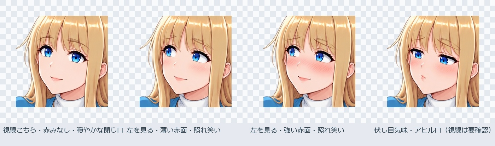

# WhiteSpace — 画像制作の参考資料

別のPCやスマートフォンから参照するための資料用ブランチです。現在、**GitHub上での資料閲覧・画像プレビュー・ファイル取得が利用できます。**

GitHub Pagesを使うWeb版も用意済みですが、一般公開URLへの配信は確認待ちです。HTMLの操作画面はGitHubのファイル表示では実行されません。

- 素材一覧：159ファイル、描き文字42選択肢
- 表情：既存26＋新規4の30候補。視線・赤み・眉・口で分類
- Web版：素材の試し重ね、表情4件比較、採否のJSON書き出し・取り込み
- ComfyUI：下記の初回手順と、読み込み用ワークフローを収録

モデル重み、実行環境、認証情報は含みません。mainとゲームの作業ブランチは変更していません。

## プレビュー




## ファイルを取得する

このブランチのCode → Download ZIPで共有版一式を取得できます。`index.html` が入口です。表情の採否はブラウザーごとに保存され、自動同期しません。確定した採否JSONを書き出して保管し、別端末で取り込んでください。

ワークフローJSONはリンク先のRaw表示から保存できます。画面へ読み込む通常のJSONと、プログラム用のAPI JSONを区別してください。

以下は初回操作・衣装と構図・保存の資料です。PC固有のパスは `［作業フォルダー］` に置き換えています。

## はじめてのComfyUI — このPC用の操作ガイド

更新：2026-10-22。[資料の入口](index.html) / [衣装・構図のプロンプト集](guide/index.html) / [保存と区分](guide/index.html)

まずは「既存モデルで1枚出す → 服の色を1つ変える → 構図を試す」の順で進める。追加モデル、拡張機能、LoRAの再学習は初回には不要。以下はこのPCの保存済み構成を読んで作った操作案内で、今回ComfyUIを起動して確認した手順ではない。

## 最初に確認すること

- 作業は承認済みの画像生成環境で行う。専用フォルダー・portable版・localhostは、Windows Sandbox／VMによる実行隔離とは別物。今回、VMの隔離状態は確認していない。
- ゲーム、Ren'Py SDK、Launcher、GUI自動操作を試す手順は含めない。それらの実行には環境保護規約（PC内の補足資料）が適用される。
- 起動済みのComfyUIがあれば二重起動しない。他の作業者のプロセスを停止しない。新規インストール・更新・モデル取得はここでは行わない。
- 最初は1枚ずつ。良い結果のPNGとワークフローJSONは保全し、変更版を別名で保存する。

## 1. 既存の起動方法と画面

既存の起動ファイルは次の場所。上の実行条件を確認したうえで、自分が操作する画像生成環境で使う。

```text
［作業フォルダー］\tools\local-ai-foundation\Start-ComfyUI.cmd
```

コンソールで準備が終わったら、ブラウザーで `http://127.0.0.1:8188` を開く。この起動ファイルはブラウザーを自動で開かない。コンソールはサーバー本体なので、生成中に閉じない。起動・接続できない場合は下の「困ったとき」を見る。

## 2. 最初のワークフローを開く

最初は [01-first-image.json](data/9e860c48e3da844c.json) を使う。ファイルをComfyUI画面へドラッグするか、ワークフローの「Open／開く」から読み込む。`.api.json` はプログラム用で、初回の画面読み込みには使わない。

読み込み時は現在の作業が置き換わるため、先に自分の未保存ワークフローをExport／保存する。一般的な操作は[公式の初回生成ガイド](https://docs.comfy.org/get_started/first_generation)に対応するが、導入済みフロントエンドの版でメニュー名や位置が異なる場合がある。

ひな形は次のフォルダーにある。

```text
［作業フォルダー］\projects\local-ai-image-lab\workflows\beginner
```

| 画面用ファイル | 練習すること | 確認状況 |
| --- | --- | --- |
| [01-first-image.json](data/9e860c48e3da844c.json) | 図書館・私服の成人女性を1枚 | 過去に生成した09の設定を使用。今回のコピーは未実行 |
| [02-clothing-color.json](data/417e95204b4c3cf9.json) | 01の紺カーディガンを赤へ | 色の語だけ変更。新しい結果は未検証 |
| [03-composition-carpet.json](data/6ba01a1dc8f682d3.json) | 横長・絨毯の横座り・素足 | 複数条件を変更した新しい練習案。品質未検証 |
| [04-heroine-lora.json](data/e919abc7fa549baf.json) | 学習済みのヒロインLoRAを使う | 800step選択版を使用。素足を指定した新プロンプトは未検証 |

01は通常の人物生成で、ヒロイン本人の再現用ではない。04も顔・服・手・ポーズの完全一致は保証できない。これまで内蔵画像生成で制作した素材と、ComfyUIの出力は別系統。

## 3. まず変更しない設定

読み込んだノードの日本語タイトルと、次の値を照らし合わせる。

| ノード | 初回の値・役割 |
| --- | --- |
| モデル | `animagine-xl-4.0-opt.safetensors` |
| Positive | 描きたい人物・服装・構図の文章。まず01のまま |
| Negative（01〜03） | `text, watermark, logo, blurry, deformed hands, extra fingers, duplicate people` |
| 画像サイズ・枚数 | 幅832、高さ1216、batch_size 1。03だけ横長1216×832 |
| KSamplerのseed | `42006`、生成後の制御は `fixed`（固定） |
| steps / CFG | `28` / `5.0` |
| sampler / scheduler | `euler_ancestral` / `normal` |
| denoise | `1.0`。今回は文章からの新規生成用 |
| VAE Decode | 変更不要。潜在データを画像へ変換する |
| SaveImage | 画像保存。初回prefixは `general/20261022/first-run/image` |

28steps・CFG5・Euler ancestralと上記の解像度は[Animagine XL 4.0の公式モデルカード](https://huggingface.co/cagliostrolab/animagine-xl-4.0)も参照した。今回はこのPCの過去の通常設定を優先している。モデルを変えた場合に同じ設定が適切とは限らない。

04のLoRAは `heroine_wshrn26_animagine40_v1.safetensors`、strength_model **0.75**、strength_clip **0.0**、識別語 **wshrn26**。Text Encoderを学習していないためCLIPを不用意に上げない。学習し直す必要はない。詳しい学習履歴は[LoRA制作記録](notes/6f2300e1098e843c.html)へ。

04のNegativeは元のLoRA検証用の語を保っているため、01〜03とは異なる。初回はそれぞれ読み込んだ値を保つ。LoRAは `tools/local-ai-foundation/runtime/ComfyUI_windows_portable/ComfyUI/models/loras/` に配置済み。見つからない表示が出たらファイル名を確認し、再学習や別の重みの取得はせず状況を記録する。

## 4. 実行して保存を確かめる

1. Positiveを01のままにし、SaveImageのprefixだけ日付・題材に合わせる。例：`general/20261022/first-run/image`。
2. 「Run／実行」ボタンを1回押す。対応する版では `Ctrl+Enter` も使える。完了前に何度も押すと待ち行列が増える。
3. 実行中はコンソールと画面にエラーがないかを見る。初回のモデル読み込み時間は環境次第。所要秒数は保証しない。
4. SaveImageの画像表示を確認し、実ファイルも次のフォルダーで確認する。

```text
［作業フォルダー］\tools\local-ai-foundation\outputs\images\general\20261022\first-run
```

ファイル名の例は `image_00001_.png`。連番は既存ファイルにより変わる。ブラウザーの右クリック保存はDownloads等へ入る場合があり、サーバーのSaveImage保存とは別。

5. ワークフローをExport／保存し、同じ試行のPNGと対応づける。[記録の雛形](data/b47b39da2aecfdc9.json)を自分の作業記録へコピーし、プロンプト、seed、変更点、結果を書いておく。
6. 画像が出たことと、採用できることは別に評価する。顔、手指、服の色・丈、座り方、室内の靴なし、背景との接地を確認する。

## 5. 衣装と構図を変えてみる

まず02で01と比較する。seedを固定し、カーディガン色だけ変える。意図した変更ができたら、同じやり方で服の種類、表情、背景を1条件ずつ試す。同じseedでも人物や形が変わることはある。

03は床座りと横長構図の練習用。01と複数条件が違うため、色だけの比較には使わない。室内は男女とも素足か靴下。構図を増やすときは[プロンプト集](guide/index.html)から短い指定を選ぶ。

候補を増やす段階では、良い設定を別名保存してからseedを変更する。生成後にseedを自動変更するモードでは、再現用に実際の結果PNG／履歴のseedを記録する。初回は固定のままが分かりやすい。

## 困ったときの戻り方

| 症状 | まずすること |
| --- | --- |
| ブラウザーが接続できない | 自分の起動コンソールに準備完了・URLが出たか確認。既存サーバーやポートの利用者を調べず終了しない |
| モデルが見つからない／赤いノード | モデル欄を再選択。下の既存ファイルの有無を確認。別モデルを適当に選ばず、無ければエラー文と画面を記録する |
| ノードがないと言われる | まず01を開き直す。4ひな形は標準ノードのみ。Managerや拡張機能の一括導入はしない |
| GPUメモリ不足 | 自分の待ち行列を止め、batch_sizeが1か確認。次に画像サイズを小さくして試す場合は変更値を記録。ほかの人のGPUプロセスを終了しない |
| 処理が止まって見える | コンソールの進捗・エラーを確認。連続実行を追加せず、必要なら自分のジョブをInterrupt／中断し、自分の待ち行列を消す |
| 意図した服・姿勢にならない | 語を増やす前に矛盾を除く。正面と横向き、立位と座位などを同時に指定しない。まず人物1人で試す |
| どこを変えたか分からなくなった | 今の版を別名保存してから01を再読込。元のひな形は上書きしない |
| 保存先が分からない | 下記のoutputs/imagesとSaveImageのprefixを確認。portable本体内のComfyUI/outputではない |

既存モデルの場所：

```text
［作業フォルダー］\tools\local-ai-foundation\models\checkpoints\animagine-xl-4.0-opt.safetensors
```

終了時は自分の生成を止め、待ち行列と保存を確認する。自分で起動したコンソールの `Ctrl+C` で終了し、終了したことを確認する。ブラウザーを閉じるだけではサーバーは終了しない。Python全体の一括終了はしない。

## このガイドで確認した範囲

2026-10-22に既存起動スクリプト、保存処理、モデルの存在・サイズ、選択LoRAのハッシュ、ひな形のJSON構造を静的に確認した。今回の新規画像生成は0枚。新しいUIでの読み込み、GPU動作、出力の品質は未検証。[検証記録](notes/0f54ebe72e0f4c70.html)に区別して残す。


---

## 衣装・構図から始めるプロンプト集

更新：2026-10-22。[操作ガイド](guide/index.html) / [保存方法](guide/index.html)

プロンプトを一からネットで調べなくても始められる。「誰を・何を着て・どこで・どちらを向いて・どこまで写すか」を日本語で決め、下の部品を使う。ここで日本語の希望を伝えて、ComfyUI向けの文面へ整理することもできる。

この集は一般向けの着衣サンプル。文章の意味を指定するための例であり、各例の出力品質は未検証。[Animagine XL 4.0のモデルカード](https://huggingface.co/cagliostrolab/animagine-xl-4.0)を踏まえ、まず短い英語タグをカンマでつなぐ。正確な複数人配置や手指は文章だけでは難しい場合がある。

## 日本語で決める注文票

```text
人物：成人女性1人／既存ヒロインLoRAを使うか
髪と瞳：金髪のロング、青い瞳
服：白いタートルネック、青いカーディガン、紺の足首丈スカート
表情：穏やかな笑顔
姿勢：絨毯に横座り
視線：画面左を見る
写す範囲：全身
カメラ：目の高さ、斜めから
場所：リビング、後ろにソファ
足元：室内なので素足または靴下
優先順位：服装 → 座り方 → 背景
変えたくない点：髪色と瞳
```

優先順位を決めると、失敗時にどの条件から直すかが分かる。「男子がソファ、女性が絨毯」など人物間の高さ・接触・距離は、人物1人の練習後に分けて検討する。参照画像は人物、画風、構図のどれを参考にするかも明示する。

## 基本の組み立て

```text
[識別語], 1girl, solo, adult woman age 24,
[髪・瞳], [表情], [服装], fully clothed,
[写す範囲], [姿勢], [視線], [場所], [カメラ],
masterpiece, high score, great score
```

角括弧は説明用。実際には括弧ごと削除して具体的な語へ置き換える。通常生成で識別語は不要。ヒロインLoRAを接続した04では `wshrn26` を残し、金髪・長髪・青い瞳も書く。識別語だけで外見が固定されるとは限らない。

## よく使う部品

| 指定したいこと | 入れる語の例 |
| --- | --- |
| 白いタートルネック | `white turtleneck` |
| 青いカーディガン | `blue cardigan` |
| 紺の足首丈プリーツスカート | `navy blue ankle-length pleated skirt` |
| 普段着のパンツ | `beige trousers` |
| 素足／白い靴下 | `bare feet` ／ `white socks`。片方を選ぶ |
| 全身／上半身／顔寄り | `full body` ／ `upper body` ／ `close-up`。1つを選ぶ |
| 正面／斜め／横顔 | `front view` ／ `three-quarter view` ／ `profile` |
| 目の高さ／俯瞰 | `eye level` ／ `from above` |
| 立つ／椅子に座る | `standing` ／ `sitting on a chair` |
| 絨毯に横座り | `sitting sideways on a carpet, legs folded to one side` |
| 両手を前で重ねる | `hands clasped in front` |
| 見る方向 | `looking at viewer` ／ `looking to the left` ／ `looking down` |
| 笑顔／控えめな照れ | `gentle smile` ／ `shy smile, light blush` |
| 眠そう／不安 | `sleepy expression` ／ `worried expression` |
| 白背景／リビング | `white background` ／ `living room, sofa in background` |

服の名前は具体的に、同じ服の相反する色や丈を並べない。長いタグ列より、必要な条件を残す。室内で全身を描く場合は靴・パンプス・スニーカーを引き継がない。

## 例1：服の色だけを比較

01をそのまま1枚作り、02で `navy cardigan` だけを `red cardigan` に変更する。seed、サイズ、モデル、その他の語は固定。服と顔の両方が変化する場合もあるので、色変更に成功したかと人物の維持は別に見る。

## 例2：絨毯に座る全身（03に収録）

```text
1girl, solo, adult woman age 24, long blonde hair, blue eyes,
gentle smile, blue cardigan, white turtleneck, long navy skirt,
fully clothed, full body, sitting sideways on a carpet,
legs folded to one side, bare feet, looking to the left,
living room, sofa in background, eye level,
masterpiece, high score, great score
```

横長1216×832、batch 1。01から題材・姿勢・サイズを同時に変えた練習案なので、単独要因の比較にはしない。足の本数、スカートの丈、家具へのめり込みを確認する。

## 例3：ヒロインの衣装候補（04に収録）

```text
wshrn26, 1girl, adult woman age 24, solo,
blonde hair, long hair, blue eyes,
full body, standing, three-quarter view, looking at viewer,
gentle smile, hands clasped in front,
blue cardigan, white turtleneck, gold necklace,
navy blue ankle-length pleated skirt, bare feet, white background,
masterpiece, best quality, very aesthetic
```

LoRAを接続した04専用。服を替えるなら元の服の語を削除して差し替える。プロンプトに識別語を足すだけではLoRAは接続されない。

## 例4：会話用の上半身

```text
1girl, solo, adult woman age 24, long blonde hair, blue eyes,
gentle smile, blue cardigan, white turtleneck, fully clothed,
upper body, three-quarter view, looking to the left,
living room, eye level, masterpiece, high score, great score
```

01のPositiveを置き換える練習案。ヒロイン本人を狙う場合は04を基に `wshrn26` を加える。視線の左右が守られるかは画像で確認する。

## Negativeと調整の順番

初回のNegativeは以下でよい。

```text
text, watermark, logo, blurry, deformed hands, extra fingers, duplicate people
```

Negativeは避けたい要素の指定であり、修正の保証ではない。最初から大量の語や強い重みを加えない。不要な靴が出るならPositiveの素足指定を確かめ、必要に応じてNegativeへ `shoes, high heels, sneakers` を追加して比較する。

1. 相反する姿勢・画角・服を取り除く。
2. 同じseedで1条件だけ変える。
3. 固定した設定で別seedを試し、偶然の失敗か傾向かを見る。
4. 文章だけで難しい場合は参照／マスク／ポーズ制御を検討する。[応用手順](notes/306714e6041f9e32.html)と[過去の品質比較](notes/6d9e782ceb1faaf3.html)を先に読む。

元画像を置くだけで顔が必ず一致するわけではない。ポーズ制御や画像編集は別のワークフローであり、通常の文章生成のdenoiseや接続を適当に変更して代用しない。

ネットのプロンプトを参考にするときは、モデル名・世代・LoRA・解像度・推奨値も見る。SD1.5用や別系列の長い例文を、そのままAnimagine XLへ移さない。追加重み・拡張機能が必要な例は、初回の4ひな形とは別に扱う。


---

## 保存先を分ける — 一般向け・成人向け・作業記録

更新：2026-10-22。[操作ガイド](guide/index.html) / [プロンプト集](guide/index.html)

一般向けと成人向けは分けることを勧める。あとで素材を探しやすくなり、プレビューや公開用フォルダーへの混入も減らせる。完成PNGに加え、参照画像・ワークフロー・比較画像・記録も同じ区分で管理する。

## このPCで実際に保存される場所

既存の `Start-ComfyUI.cmd` は、起動処理で保存先を次に固定している。

```text
［作業フォルダー］\tools\local-ai-foundation\outputs\images
```

SaveImageノードの `filename_prefix` に相対フォルダーを含めると、その下へ分けて保存できる。絶対パスや `../` は入れない。

| SaveImageのfilename_prefix | 保存される相対フォルダーと名前の例 |
| --- | --- |
| `general/20261022/clothing-blue/image` | `general/20261022/clothing-blue/image_00001_.png` |
| `general/20261022/carpet-composition/image` | `general/20261022/carpet-composition/image_00001_.png` |
| `adult/20261022/trial-01/image` | `adult/20261022/trial-01/image_00001_.png` |

日付は試す日に変更する。カウンターの番号は既存ファイル次第。この区分は保存整理のための名前で、モデルの動作や生成内容を切り替える設定ではない。

今回の4ひな形はすべて `general/20261022/...`。成人向けの画像やプロンプトは今回作成していない。既存ファイルの移動、起動ファイルや保存設定の変更もしていない。

## 記録と参照画像も対応づける

試行IDを1つ決め、PNGの題材名と対応させる。例：`20261022-clothing-blue-01`。

| 種類 | 推奨する作業用の場所 |
| --- | --- |
| 生成PNG | `outputs/images/<general または adult>/<日付>/<題材>/` |
| ワークフローJSON | `outputs/sessions/<区分>/<日付>/<題材>/workflow.json` |
| 実行条件・採否 | 同じ場所の `run-record.json` |
| 比較プレビュー | 同じ場所の `previews/` |
| 使用した参照画像の控え | 同じ場所の `inputs/`。原本は別に保全 |

ここでの `outputs` はすべて `［作業フォルダー］/tools/local-ai-foundation/outputs`。sessions以下は整理案であり、ComfyUIが自動作成・振り分けする設定ではない。JSONのExportや記録は自分でこの場所へ保存する。[記録の雛形](data/b47b39da2aecfdc9.json)をコピーして使える。

## 分類と、アプリ全体の保存分離は異なる

上記prefixで分かれるのはSaveImageの出力。既存起動構成では次の場所は共通のまま。

| 用途 | 既存起動構成の場所（local-ai-foundation配下） |
| --- | --- |
| ComfyUIへの入力 | `data/inputs` |
| 一時ファイル | `outputs/temp` |
| ユーザー設定等 | `outputs/comfy-user` |
| ブラウザーのダウンロード・履歴 | 使用するブラウザー側の設定次第 |

参照画像の控えをsessionsへ整理しても、ComfyUIへアップロードした入力の保存先まで自動で分離されるわけではない。入力・temp・userも含めた厳密な分離が必要なら、専用の保存場所と別の起動プロファイルを設計する。既存起動ファイルに任意の保存先を渡すだけで切り替わる構成ではない。今回その変更は行っていない。

## 公開用フォルダーへ移す前に

- このリポジトリには公開を想定した資料・サンプルもある。未採用の画像をいきなり `sample`、`images`、公開ギャラリーへ入れない。
- `tools/local-ai-foundation/outputs` は既存のGit除外対象。ただしGit除外は、既に追跡されたファイルの削除・暗号化・アクセス制限・クラウド同期の停止ではない。公開しない素材は同期・共有対象も確認した専用保存先で管理する。
- SaveImageのPNGには通常、プロンプトやワークフロー等のメタデータが入る。公開する場合は公開用コピーを作り、画像とメタデータを確認する。再現用の元PNG・JSONは上書きしない。
- PNGにワークフローが入っていても、必要なモデル、LoRA、入力画像まで同梱されるわけではない。作業記録にファイル名と参照元を残す。
- 自動出力先とブラウザー保存先を混同しない。ファイルを削除する前に、生成PNG・ExportしたJSON・必要な入力の対応とバックアップを確認する。

これは保存整理の手順であり、参照素材やモデルの利用条件を一括で保証するものではない。外部へ出す素材は、使用した重み・参照素材・出力・公開先の条件を個別に確認する。
