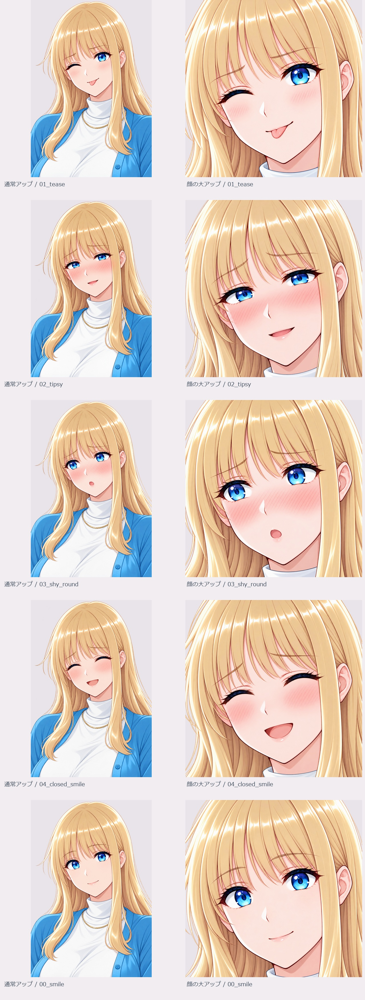

# ヒロイン・表情追加と顔大アップ

[総合入口](../../README.md) ／ [全シーン・資料一覧](../../reports/ALL_SCENES.md) ／ [操作用HTML](../../faceups/index.html)

過去の試作・候補を含む資料です。採用済み、部分未達、旧版の区別は元の一覧・制作記録を参照してください。HTMLはZIPを取得した端末で開けます。GitHubでは下の画像リンクを閲覧できます。

| 画像ファイル | 開く |
| --- | --- |
| 00_smile_face.jpg | [画像](../../media/d46c2038b0ce0e0cac21.jpg) |
| 01_tease.jpg | [画像](../../media/0d054074cbfc7120bed9.jpg) |
| 01_tease_face.jpg | [画像](../../media/e893ef631f1d5a314c34.jpg) |
| 02_tipsy.jpg | [画像](../../media/343f365a53db2cd5ddcd.jpg) |
| 02_tipsy_face.jpg | [画像](../../media/d673b8a0831a56796913.jpg) |
| 03_shy_round.jpg | [画像](../../media/719437f39970835f33c9.jpg) |
| 03_shy_round_face.jpg | [画像](../../media/26ea73bf63d39316983e.jpg) |
| 04_closed_smile.jpg | [画像](../../media/c98dd9215da6116ab5e9.jpg) |
| 04_closed_smile_face.jpg | [画像](../../media/566513808b7f08fcd072.jpg) |
| 通常と顔大アップの比較.jpg | [画像](../../faceups/framing-comparison.jpg) |
| 00_smile_face.png | [画像](../../faceups/00_smile_face.png) |
| 01_tease.png | [画像](../../faceups/01_tease.png) |
| 01_tease_face.png | [画像](../../faceups/01_tease_face.png) |
| 02_tipsy.png | [画像](../../faceups/02_tipsy.png) |
| 02_tipsy_face.png | [画像](../../faceups/02_tipsy_face.png) |
| 03_shy_round.png | [画像](../../faceups/03_shy_round.png) |
| 03_shy_round_face.png | [画像](../../faceups/03_shy_round_face.png) |
| 04_closed_smile.png | [画像](../../faceups/04_closed_smile.png) |
| 04_closed_smile_face.png | [画像](../../faceups/04_closed_smile_face.png) |

## プレビュー

