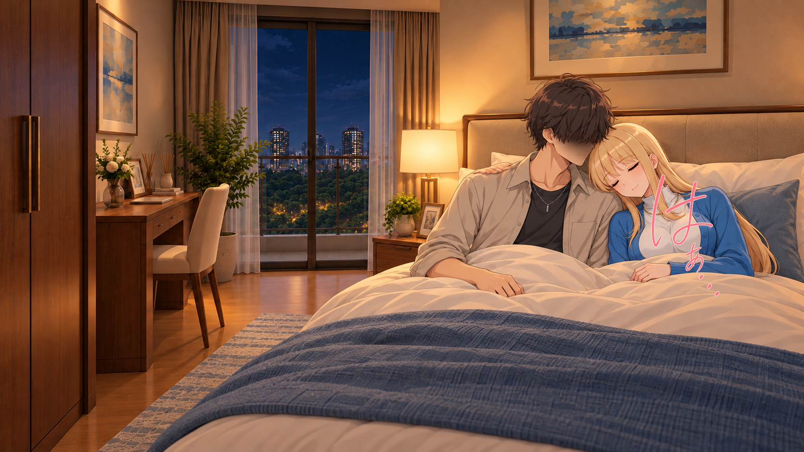
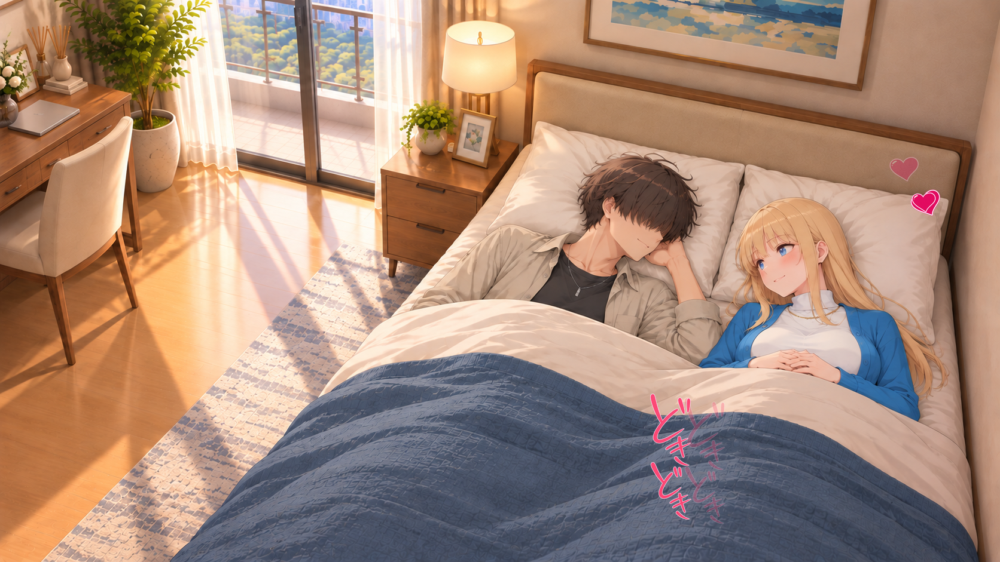
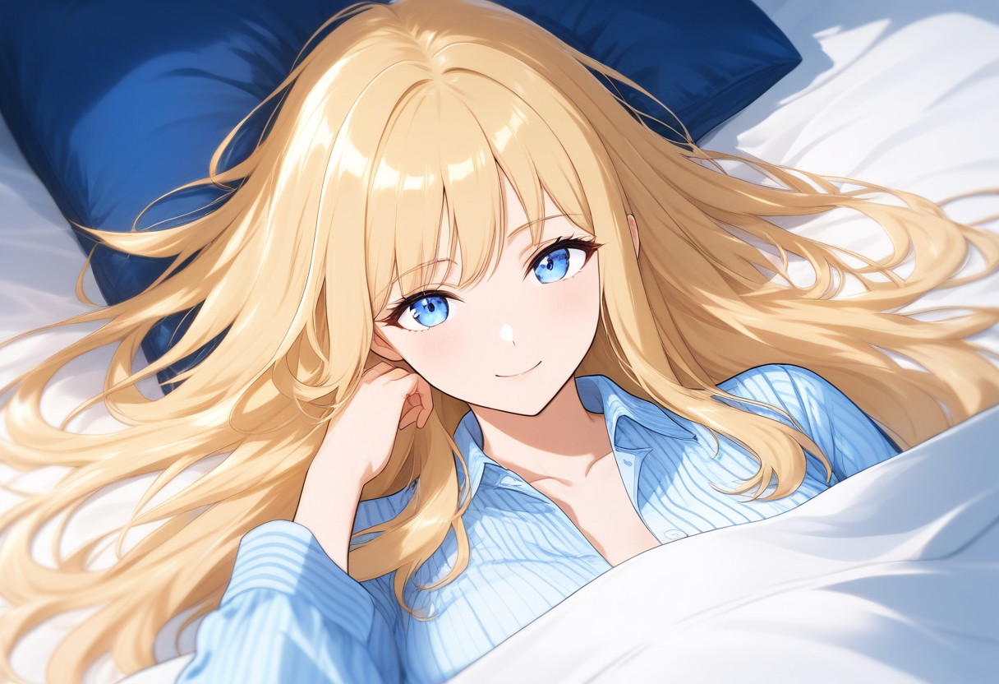
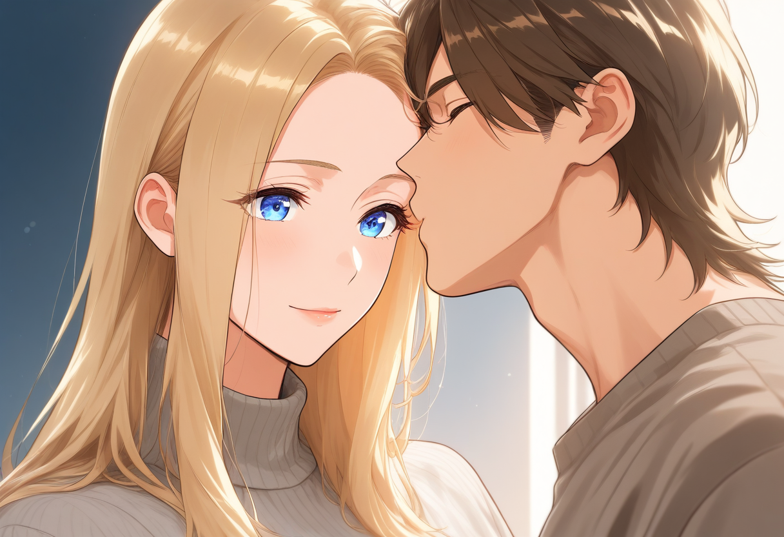

# 自宅・寝室：シーン検討

[場所を選び直す](../../README.md)

既存の参考画像です。採用未判定。背景・人物が一体の試作も含みます。室内の旧素材は履物の修正状態が未確認です。

## 昼・枕にもたれて照れながら会話

人物・表情はベースCGに統合。描き文字とハート等は別素材を数値合成。 相手へ視線／薄い赤み／柔らかな眉／閉じた笑み

[GIFを見る](../../../reference-scenes/01_home_bed_day-v15.gif)

## 夜・肩へ寄りかかりうとうと

人物・表情はベースCGに統合。描き文字とハート等は別素材を数値合成。 閉じた目／弱い赤み／脱力した眉／閉じ口

## 横になって添い寝・小さく笑い合う

人物・表情はベースCGに統合。描き文字とハート等は別素材を数値合成。 相手へ視線／薄い赤み／穏やかな眉／閉じた笑み

[GIFを見る](../../../reference-scenes/12_home_flat_sleep-v15.gif)

## 仰向けで、隣へ視線を向ける

既存の完成参考画像。背景・人物が統合された試作を含む。室内の旧版は履物未確認。

## おやすみの額へのキス

既存の完成参考画像。背景・人物が統合された試作を含む。室内の旧版は履物未確認。
