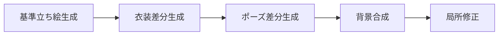

# ComfyUIによる画像生成ノウハウ＆活用ガイド

**エグゼクティブサマリ:** ComfyUIはモジュラー構成の強力な画像生成エンジンで、チェックポイント（SDXL/SD1.5等）やLoRA、ControlNet、IP-Adapter、アップスケーラー、インペイント機能など多彩な要素を組み合わせて柔軟なワークフローを組むことができます。本ガイドでは中級～上級者向けに、**キャラを固定したままの差分生成・ポーズ変更・背景差替え・写実化・アップスケール**といった目的別のワークフローと、主要ノード・パラメータ設定、実践レシピ、モデル別パフォーマンス比較、ControlNet/IP-Adapter/LoRAの使い分け、バッチ処理・品質管理、成人向けコンテンツ取扱いなどを詳細に解説します。なお本資料はWindows環境（GPUはNVIDIA/AMD問わず）を想定しています。  

## 目的別ワークフロー  
- **キャラ固定の差分生成:** 元画像の**キャラクター性（顔立ち・髪型・目の色・体格など）**を維持しつつ、衣装や色調を変更します。IP-Adapterや顔特化LoRAを使い、参照画像から元キャラの特徴を学習させると、一貫性を保った生成が可能です。たとえば、顔を固定して服を変えるといった際は、元画像をIP-Adapterの参照に用い、衣装に特化したLoRAを組み合わせます。  
- **ポーズ変更:** ControlNet（OpenPose）で骨格情報を制御します。骨格参照画像を別途用意し、ComfyUIの**OpenPose Editor**プラグインでポーズを微調整し「Apply ControlNet」ノードに接続します。既存のポーズを使いたい場合は、CivitaiのポーズパックやPoseMy.artのスケルトン画像を参照にもできます。ControlNetとIP-Adapterを併用すれば「このポーズでこの雰囲気」という複合指示も可能です。  
- **背景差し替え:** 背景を変える際は、HED/セグメンテーションControlNetやマスク＋インペイントを使います。例えばHEDを使えば輪郭線を抽出して背景を塗り替えたり、画像中の背景領域を手動でマスクしてインペイントノードで修正したりできます。背景変更は最終段階で行うのが安全で、先に人物のみ固めてから背景を加えます。  
- **実写寄り変換:** キャラやシーンを写実的に近づけるには、写実系モデル（Juggernaut XL、RealVisXL、FLUX系など）を使います。たとえばJuggernaut XLやRealVisXLは人物ポートレートに強く、FLUX.1（開発版）は最新の高写実モデルです。元キャラの雰囲気を損ねないよう、段階的にプロンプト（現実写真風語や光源指定）に切り替え、必要に応じてIP-Adapterで顔を維持します。  
- **アップスケール／修正:** 低解像画像を高解像化するにはComfyUIのアップスケール機能（Real-ESRGAN等）を使用します。典型的ワークフローとして、`Load Upscale Model`ノードで4×ESRGANモデルをロードし、`Upscale Image`ノードに接続して生成結果を拡大します。また、局所修正にはマスクエディタやインペイントを併用し、顔・手・服の細部を補正します。  

## 主要ノードと設定  
- **CheckPoint読込:** `Load Checkpoint`ノードでモデル（AnimagineやJuggernautなど）の重みを指定します。ライセンスに注意しつつ商用許可モデルを選びましょう。  
- **テキスト・イメージ条件付け:** `KSampler`ノードでテキストプロンプトを処理し、必要に応じて`CLIPEncode`ノードで文脈埋め込みを入力します。img2imgの場合は入力画像を`Load Image`ノードで渡し、`KSampler`の`denoise`パラメータを1未満に設定します。`denoise`が低いほど生成画像は入力画像に近づき、高いほど差異が大きくなります。  
- **Sampler・Denoise・CFG:** 安定した生成にはSampler（例：DPM++、Euler_Aなど）、CFG（モデルへのプロンプト依存度）、ステップ数を調整します。一般にフォトリアル系では低めのCFG（7～9）、イラスト系では少し高め（8～12）などが使われます。不安定な結果になったらDenoiseやCFGを調整してみましょう。  
- **シード管理:** `KSampler`のシードを固定すれば再現性があります。履歴やJSON保存にもシード情報が含まれており、同じワークフローを再度読み込めば同じ出力が再現できます。  
- **ControlNet:** `Load ControlNet`ノードで座標系モデル（Pose/HED/Seg/LineArtなど）を読み込み、`Apply ControlNet`ノードで条件付けします。Pose用にはOpenPoseまたはDWPreprocessor（精度が高い）を使い、Strength（強度）を制御します。HEDなら輪郭線、Segmentationなら背景切り出しなど目的に応じて選択します。ControlNet活用時は元画像に対して１回または部分的に２回（MultiAreaConditioning）の適用を検討します。  
- **IP-Adapter/Adapter:** 画像スタイルや顔の特徴を保持するためのノード群です。標準版のほかに顔特化（Plus-Face）や高品質（Plus-Style）もあり、参照画像を入力して「この画風で生成せよ」という条件付けをします。参照画像はキャラの顔やスタイルをよく表すものを使用し、解像度は512以上推奨です。IP-Adapterの`weight`で影響度を調整し、0.6～0.8程度から試します。顔の一貫性重視なら`ip-adapter-plus-face`を使いweightを0.8～1.0に設定すると効果的です。複数画像を使う場合はBatch機能で特徴を平均化したり、異なるIP-Adapterを直列接続して重み合成したりできます。  
- **LoRA:** `Load LoRA`ノードで学習済LoRAモデルを適用します。Civitaiなどでドメインに合ったLoRAを選び、`strength_model`（LoRAの重み付け）と`strength_clip`を設定します。`strength_model`は高めに（0.6～1.0）するとLoRA特有のスタイルが強く反映されます。複数のLoRAを組み合わせたいときは、ノードを直列につなぎます（例：キャラ用LoRA→服装用LoRA→KSampler）。重み付けは試行錯誤で、主要効果を得る範囲（0.3～1.0）を調整します。  
- **Inpaint:** 修正部分だけ再生成するノードです。対象領域をマスクで指定し、`VAE Encode (for Inpainting)`ノードを通して`KSampler`に入力します。専用モデル（例：512-inpainting-ema）を用いると高精細な修正が可能で、標準モデルよりも改変品質が向上します。マスクはComfyUIのマスクエディタで描画でき、顔・手指・衣装の微修正に複数パスで対応します。  

## 実践ワークフロー例（Mermaidチャート）  

以下は「基準立ち絵生成→衣装差分→ポーズ差分→背景合成→局所修正」の流れ例です。各ステップのノード構成例も参照してください。  

- **基準立ち絵生成:** 好みのモデル（Animagine/DreamShaper等）をロードし、顔や体格を定めた基本画像を作成します。この段階でIP-AdapterやFace-LoRAでキャラの特徴を取り込み、ベースを固めておきます。  
- **衣装差分:** 基準画像に近いまま服装や小物を変えます。衣装を学習したLoRAを追加し、プロンプトに衣装変更語（例：「着物」、「海水浴用ビキニ」）を入れることで差分生成します。必要ならInpaintで衣装部分だけ塗り替えることも可能です。  
- **ポーズ差分:** ControlNet(OpenPose)で身体の向きやポーズを変更します。基準画像から抜き出した骨格（または外部のポーズ画像）をControlNetに入力し、プロンプトを適用します。OpenPose Editorでポーズを微調整し、再度制御に使うことで自然な動きが得られます。  
- **背景合成:** 人物が決まったら背景を設定します。海や大学キャンパスなど描きたい背景のキーワードを加えたり、Segmentation ControlNetで人物を切り抜いてから背景画像を合成します。InpaintingやOutpaintノードで砂浜や波を追加し、光源・HDRIライティングに気を配ります。  
- **局所修正:** 最後に細部を整えます。マスクを使って顔・髪・手指・衣装の不自然な部分をInpaintし、必要ならアップスケールして解像度を上げます。顔は専用のFace Restoration（別ツール）も併用すると、より忠実に補修できます。  

## パラメータ例とモデル比較  

- **Denoise（img2img）:** 0.3～0.7程度が目安です。低いと元画像に忠実、高いと大胆変化。初期は0.4~0.5で試し、変化量を確認しながら調整します。  
- **CFG（コンディショニング強度）:** 7～12が多用範囲。実写系では低め（7～9）で自然光表現、イラスト系ではやや高め（10～12）で鮮明化させると良い場合があります。異常が起きたら上下に動かして安定化を図ります。  
- **LoRA重み:** 初期0.6～0.8で試し、効果が薄ければ上げる、目立ちすぎるなら下げます。複数LoRAを組むときは、一方の重みを低めにしてバランスを取ります。  
- **IP-Adapter重み:** スタイル参照では0.5～0.7、顔専用は0.8～1.0がよく使われます。ControlNet併用時はIP+ControlNetの重み合計を1.2～1.5に抑え、それぞれ強度を下げるのがコツです。  
- **ControlNet強度:** 通常0.6～0.8程度。強すぎると補正しにくく、弱すぎると効果が薄いので中間を目安にします。  

下表はSDXL世代の代表モデル比較例です（各モデルはCivitai/HuggingFace等で公開済み）。用途やスタイルに応じて使い分けます。  

| モデル名           | 主な特徴・用途                            | 参考・備考                           |
| ------------------ | ----------------------------------------- | ------------------------------------ |
| **Animagine XL 4.0** | アニメ特化のSDXLモデル。イラスト風アニメ生成に最適  | 美少女・背景とも高品質なアニメ画風   |
| **Juggernaut XL v10** | 写実主義向け。肌質や照明・人体表現に優れたSDXLリアルモデル | フォトリアルなポートレートや風景     |
| **RealVis XL V4.0**   | 自然なライティングのリアル系ポートレート向け        | 商用写真や商品画像にも強い           |
| **DreamShaper XL**   | 汎用型（半実写～絵画～アニメ）。安定して幅広く生成可能 | スタイル転換の練習用やマルチタスク向け |
| **FLUX.1 (Dev)**    | 最新Transformer系写実モデル。細部・質感が高品位       | VRAMを多く使うが最高峰のリアル画像   |

## ControlNetとOpenPoseの使い分け・参照画像の作り方  
ControlNetは「**ポーズ・構図・形状**」など構造的条件に、IP-Adapterは「**画風・雰囲気・キャラ性**」に強いという住み分けです。OpenPoseではComfyUI用の**Pose Estimator & OpenPose Editor**プラグインが利用可能で、まず画像から骨格JSONを作成し、それを`Load Openpose JSON`→`OpenPose Editor`で手動調整し、`Apply ControlNet`に送ります。あるいは外部ツール（PoseMy.artやBlender Mixamoなど）でスケルトンPNGを作成し、`Load Image`→`Apply ControlNet (OpenPose)`に入力する方法もあります。Civitaiのポーズパック（複数の人型ポーズセット）も便利です。HED（輪郭）、Depth（奥行）、Segmentation（背景/人体分離）、LineArt（線画）など各ControlNetモデルは用途に応じて使い分けます。  

## IP-Adapter/Adapterの使い方と注意点  
IP-Adapter系ノードは参照画像を直接モデルに条件付けします。複数枚の参照画像を組み合わせてバッチ処理すれば特徴を平均化できますし、`IPAdapter Advanced`ノードを複数直列接続してパーツごとに重み付け合成も可能です。参照画像の解像度は最低512×512以上が望ましく、顔は正面大写し、衣装は全身が写っているものを選びます。`denoise strength`（通常0.1～0.5）や`IPAdapter weight`で出力への寄与率を調整し、参照画像に引きずられすぎないようバランスを取ります。ただしIP-Adapter単体では完全に画風をコピーするわけではないため、必要に応じて追加学習（Adapter系の拡張）や美術的微修正を行います。  

## LoRAの導入と運用  
LoRAは訓練済みモデルの微調整を追加するもので、ComfyUIでは`Load LoRA`ノードで読み込みます。使用するLoRAはCivitaiなどで用途に合ったものを選び（例：キャラ名LoRA、衣装LoRAなど）、`strength_model`や`strength_clip`でかけ算の重みを調整します。一般に強度は0.6～1.0の間で調整し、画像にLoRA効果が十分出る値を探ります。複数LoRAを併用する際はノードを直列につなぎ、上位ほど影響力が低くなるよう重みを小さめにします。また、モデル本体とLoRAはSD1.5/SDXLで互換性が異なるため、適切な組み合わせに注意します。  

## Inpaintingの実務  
画像内の特定領域を修正するには、マスクエディタで修正箇所を塗り（アルファチャンネル）、`VAE Encode (for Inpainting)`→`KSampler`で再生成します。顔や手など微細部は、専用のインペイントモデル（例：512-inpainting）を使うと自然な仕上がりになります。複雑な修正は複数パスに分けて行い、まず大まかな部分を直し、次に拡大して細部を仕上げる戦略が有効です。マスク作成や`Apply Inpaint`ノード設定は公式Inpaintチュートリアルも参考にしてください。  

## バッチ処理・再現性  
- **ワークフロー保存:** ComfyUIではワークフロー全体をJSON形式で保存・読み込みでき、これにより同じ生成手順・シードで画像を再現できます。複数差分を作る際は、ベースフローをコピーしてパラメータだけ変更することで効率的にバッチ生成できます。  
- **シード管理:** 各生成結果にはシードが付与され、履歴パネルで確認・固定できます。結果比較のためには同一シードで複数条件を試すか、逆にシードをランダム化して多様性をチェックします。  
- **出力比較:** 複数生成画像間の違いをまとめたい場合、CSVなどでリファレンス名や条件、評価を記録すると整理しやすいです。ComfyUI自身に差分表機能はないため、必要に応じて外部ツール（画像比較ライブラリや表計算ツール）で結果をまとめます。  

## 品質管理と評価指標  
生成品質は定量指標の評価が難しい領域ですが、実用的には下記のような視点でチェックします。テストケースを複数用意し、定期評価することが重要です。  
- **顔一致度:** 同一キャラであるべき場合、参照画像との顔認識マッチ度（埋め込み類似度やランドマーク誤差）を使って人物同一性を評価します。フリッカー（微妙なブレ）を減らすにはIP-AdapterやLoRAの強度、determinismを調整。  
- **画風一致度:** 参照イラストや既存作品がある場合、CLIP埋め込みやスタイル識別子で画風の整合性を測ります。一貫した結果でなければプロンプトやモデル、ControlNetの見直しが必要です。  
- **破綻率:** 各段階での失敗（手・顔の欠損、バグ的アーチファクト）が発生する割合をサンプルごとに記録します。閾値以上の頻度ならパラメータ変更やモデル交換を検討します。  
- **テストケース例:** 典型的な利用ケース（屋外/屋内、静止/動作など）をリストアップし、計画的に生成・比較します。表形式で「入力条件・設定値・問題点・対応策」をまとめると改善点が明確になります。

## 成人向けコンテンツの実務注意  
成人向け画像を扱う場合はモデル・規約・販売要件に十分注意します。  
- **モデル選定:** 成人コンテンツ向けの学習データを含むモデル（SD画質対応LoRAや風俗向けモデルなど）を選ぶ一方、商用利用や公序良俗を確認します。多くのSD系モデルは**CreativeML Open RAIL++**など比較的自由度の高いライセンスですが、肖像権や素材権侵害に注意してください。  
- **プラットフォーム規約:** Steamでは「実在人物のヌード・性描写」は禁止され、成人向け要素はストアページの成分表で明示（タグ付け、年齢制限設定）する必要があります。特に「ヌードまたは露骨な性的描写は不可」「18禁要素は適切にラベル付け」などSteam規定を順守します。DLsiteなど日本の成人向けプラットフォームでは18歳未満描写禁止・アダルト要素明示が必須です。  
- **メタデータ管理:** 生成物に**NSFWタグ**や作品説明（例：「露出高めの水着シーンあり」）を添えておくと審査でスムーズです。コンテンツサーベイ（Steamworks等）では性表現・暴力表現の有無を正確に申告し、年齢認証が必要な場合は必ず設定します。  
- **販売準備:** アダルト要素を扱う場合、販売プラットフォームで求められるデータ（コンテンツレーティング、ワーニング文言、タグ等）をあらかじめ用意します。たとえばSteamでは提出前にコンテンツサーベイで成人要素を申告し、地域レーティングを取得する必要があります。作品内にAI生成を使用した箇所がある場合は、メタデータやストア説明に「画像の一部にAIツールを使用」と記載するなどの透明性も推奨されます。  

**図表:** 上記ワークフローの概念図とモデル比較表を含めました。主要ノードやパラメータ例の詳細は公式チュートリアルや上記引用資料をご参照ください。

