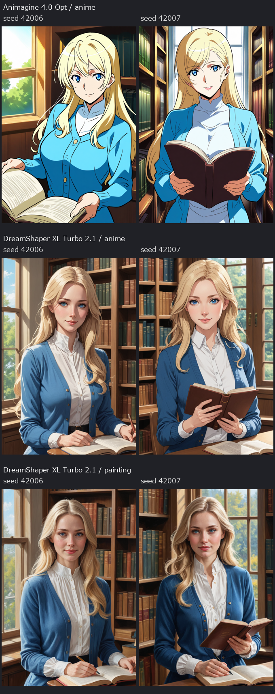

# DreamShaper XL Turbo v2.1 — 金髪・図書館の女性

2026-10-21。ComfyUIでDreamShaperを初めて試用。DreamShaper新規4枚、Animagine比較用新規2枚。画像参照なしのテキスト生成で、既存の金髪女性と同じ顔を再現した実験ではない。通常版DreamShaper XL 1.0やLightning版とも区別する。

左右はseed 42006／42007。モデルごとにsteps・CFG・samplerを変えているため、モデルだけを交換した厳密な比較ではない。DreamShaperの中段と下段は描画指定だけを変更した。

| 条件 | seed 42006 | seed 42007 |
| --- | --- | --- |
| Animagine 4.0 Opt・アニメ指定 | [原寸](../media/2d2b12a37da39cddc59e.png) / [UIワークフロー](../reports/COVERAGE.md#同梱しないもの) | [原寸](../media/43b56803bb70ed015275.png) / [UIワークフロー](../reports/COVERAGE.md#同梱しないもの) |
| DreamShaper XL Turbo v2.1・アニメ指定 | [原寸](../media/a1e90a40e289998b6acc.png) / [UIワークフロー](../reports/COVERAGE.md#同梱しないもの) | [原寸](../media/819bc0542ee6b645330f.png) / [UIワークフロー](../reports/COVERAGE.md#同梱しないもの) |
| DreamShaper XL Turbo v2.1・絵画指定 | [原寸](../media/5554c1153d1c9849bbae.png) / [UIワークフロー](../reports/COVERAGE.md#同梱しないもの) | [原寸](../media/8c6784db45279e891aa7.png) / [UIワークフロー](../reports/COVERAGE.md#同梱しないもの) |

## 今回の印象

Animagineは輪郭線・セル塗りが明確。DreamShaperはアニメ指定でも立体的なイラスト寄りとなり、絵画指定では肌・髪・布が写実寄りになった。この2シードでの観察であり、画風の限界や全般的な優劣は断定しない。

金髪・青い目・青い上着・図書館は確認できた。一方でDreamShaperは白いハイネックを襟付きの服に変えたり、本を机に置いて筆記具を追加したりしている。絵としての候補と、指示の完全再現は分ける。手と本・筆記具の接触も正式採用時に精査する。顔・ポーズ・衣装の差分編集や、元画像との人物固定は未検証。

## 設定と再現

- 全画像：832×1216、batch 1、denoise 1.0。
- Animagine：28 steps、CFG 5、Euler ancestral / normal。
- DreamShaper：6 steps、CFG 2、DPM++ SDE / Karras。Turbo公式カードの開始例のsteps・CFGを参考にした試用設定で、このキャラの最適値とはしていない。
- [全プロンプト・seed・SHA256・生成記録](../reports/COVERAGE.md#同梱しないもの)、[実行したAPI DAG](../reports/COVERAGE.md#同梱しないもの)、[ログ](../reports/COVERAGE.md#同梱しないもの)。PNGの埋込メタデータは無効化し、設定は副ファイルで保存した。
- ComfyUIで手動再現する場合は、上表の**UIワークフロー**を読み込む。API DAGと区別する。UI形式は既存の正常な標準ノード用テンプレートから生成したが、今回GUI操作での再実行はしていない。
- APIによる同じ試行の実行コード：[run_dreamshaper_trial.py](../reports/COVERAGE.md#同梱しないもの)。既存結果の上書きを拒否するため、そのまま再起動すると停止する。新しい実験は新規の専用出力先を決め、適用される環境保護規約を確認して実施する。

## モデルと費用

[公式配布元](https://huggingface.co/Lykon/dreamshaper-xl-v2-turbo)、[固定版カード](0959ea48a3b054cfba33.md)、[取得元・ハッシュ・利用条件](../reports/COVERAGE.md#同梱しないもの)。`DreamShaperXL_Turbo_v2_1.safetensors`を約6.94GB追加し、サイズ・SHA256一致を確認。モデルはGit対象外。Animagineを通常用とする既存設定は変更していない。

公開モデルを登録なしで取得し、ローカル生成。今回の有料契約・登録・支払い・有料推論API利用なし。ライセンスはopenrail++表記で、上流の用途制限などの条件はある。電気・通信・既存Codex利用枠は別。成人向け生成性能や販売先の条件はこの試験では確認していない。

## 実行環境と後片付け

ComfyUI 0.42.1、Python 3.13.14、RTX 4070 SUPER（12282MiB）。実行全体約58.6秒、うちComfyUIログのワークフロー実行42.60秒。前者は起動・モデル読込・終了込み、ダウンロード・ハッシュ照合・比較組版を除く。ピークVRAMと独立した1枚あたりの時間は未測定。

既存ComfyUIをホスト上の専用localhostサーバー・専用プロファイルで実行。VM／Windows Sandboxによる完全隔離ではない。オフライン用起動設定を使用し、生成中のモデル取得なし。ゲーム・SDK・GUIテストは起動していない。自分のサーバーの終了と専用一時領域の削除を確認した。既存の他プロセスは停止していない。

[詳細な実験・採否記録](../manuals/experiments/dreamshaper-xl-turbo-v2_1.md) / [知識集](../manuals/COMFYUI_KNOWLEDGE.md)
