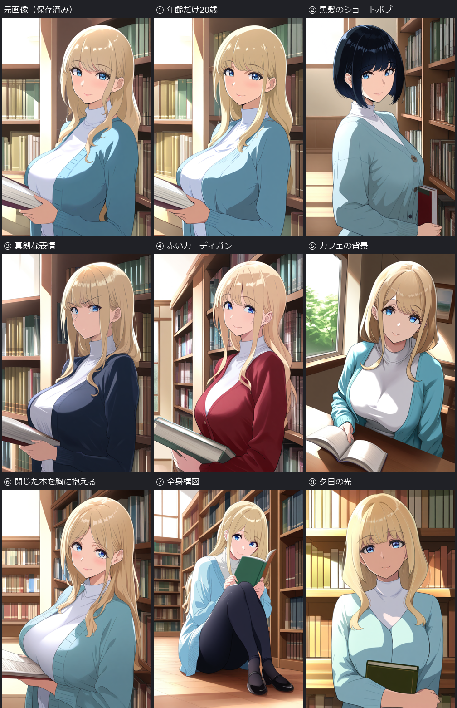

# Animagine XL 4.0 Opt — 最初の図書館画像から条件を変えた8枚

2026-10-21。ユーザー指定の①年齢だけ20歳、②髪型・髪色の変更、お任せの③〜⑧を各1枚生成。最初の`09-animagine40-normal.api.json`から、各画像で指定箇所だけを置き換えた。画像参照は入力していない。

左上は保存済みの元画像で、新規生成数には含めない。新規8枚、比較表示のみの既存画像1枚。番号は変更の指定を示し、指定達成を保証する表示ではない。

| 番号 | 変更した指示 | 結果・限界 | 原寸／UIワークフロー |
| --- | --- | --- | --- |
| ① | `age 28` → `age 20` | 年齢の数字だけ変更。髪・服・背景の特徴は近い。見た目から20歳という数値を確認した意味ではない | [画像](../media/d71bb884d9ed2df94b4a.png) / [UI](../reports/COVERAGE.md#同梱しないもの) |
| ② | `long blonde hair` → `short black bob haircut` | 黒髪の短いボブに変化。構図や顔も変わった | [画像](../media/541222632047d07a68f0.png) / [UI](../reports/COVERAGE.md#同梱しないもの) |
| ③ | `gentle smile` → `serious expression` | 笑顔から真剣な表情へ。上着の色味や構図にも変化 | [画像](../media/ab2c308edebddf8ca3cc.png) / [UI](../reports/COVERAGE.md#同梱しないもの) |
| ④ | `navy cardigan` → `burgundy red cardigan` | 上着が赤色に変化。髪や服の形・構図は完全一致ではない | [画像](../media/890201f3203429a115d5.png) / [UI](../reports/COVERAGE.md#同梱しないもの) |
| ⑤ | `library, bookshelves` → `quiet cafe, cafe interior` | 窓際のテーブルで本を開く構図。カフェという場所の識別は弱く、背景指定は部分達成 | [画像](../media/93cbe591defc31679575.png) / [UI](../reports/COVERAGE.md#同梱しないもの) |
| ⑥ | `holding book` → `holding a closed book against her chest` | 開いた本が残り、閉じた本を胸に抱える指定は未達 | [画像](../media/f620d91889271e5c4522.png) / [UI](../reports/COVERAGE.md#同梱しないもの) |
| ⑦ | `upper body` → `full body, head to toe, both shoes visible` | 頭から両足の靴まで入る座り姿。立ち姿は指示していない | [画像](../media/724c4f1df7eac62e9d0f.png) / [UI](../reports/COVERAGE.md#同梱しないもの) |
| ⑧ | `soft daylight` → `warm sunset light` | 暖色の光と影へ。髪の長さ、服の襟、本の状態も変化 | [画像](../media/957406efed77537431a2.png) / [UI](../reports/COVERAGE.md#同梱しないもの) |

①以外の年齢指定は元の28歳。②はユーザー指定に従い髪型・髪色の両方を変更した。③〜⑧の具体的な課題は作業側が選んだ。各条件につき1回のみで再生成・選別は行っていない。

## 固定した設定

- モデル：`animagine-xl-4.0-opt.safetensors`。
- seed **42006**、28 steps、CFG **5**、Euler ancestral / normal、denoise **1.0**。
- 832×1216、batch 1。元のネガティブプロンプトも変更していない。
- 元の画風指定`full color anime illustration`と品質タグを維持。新しいセル塗り・グラデーション・ハイライトの説明を追加していない。元の光の指定`soft daylight`は⑧だけ変更した。
- 文章からの新規生成。IP-Adapter、LoRA、ControlNet、画像参照、マスク合成、顔修復、アップスケールは使用していない。

変更したのは文章の一部分でも、生成画像の他の部分まで固定されるわけではない。今回も顔・構図・衣装に揺れがある。これは同一人物の完全固定や「変更箇所以外の画素保全」のテストではない。

[全プロンプト・設定・SHA256・目視評価](../reports/COVERAGE.md#同梱しないもの) / [実際のAPI DAG](../reports/COVERAGE.md#同梱しないもの) / [検証](../reports/COVERAGE.md#同梱しないもの) / [ログ](../reports/COVERAGE.md#同梱しないもの)。PNGの埋込メタデータは専用サーバーで無効化し、副ファイルへ保存した。UIワークフローは既存の元テンプレートから出力。GUIでの再実行は未検証。

## 実行と保全

ComfyUI 0.42.1、Python 3.13.14。起動・生成・終了を含め約105.4秒、ComfyUIログのワークフロー実行は72.43秒。原画像・元のUI/APIワークフローのSHA256不変を確認。比較画像はレイアウトと縮小だけで、生成画像の描き直しや色補正はしていない。

既存ComfyUIのホスト上の専用localhostサーバーと専用プロファイルを使用。VM／Windows Sandboxではない。新規モデル取得、依存更新、標準設定の変更、ゲーム／SDK／GUIテストの実行なし。自分が起動したサーバーの終了と専用一時領域の削除を確認。ホスト側には実行スクリプト・画像・ワークフロー・記録を追加した。

[実行コード](../reports/COVERAGE.md#同梱しないもの)は既存結果の上書きを拒否する。再実験には新しい専用出力先を決め、適用される環境保護規約を確認する。[詳細記録](../manuals/experiments/animagine40-original-variants-v1.md)
