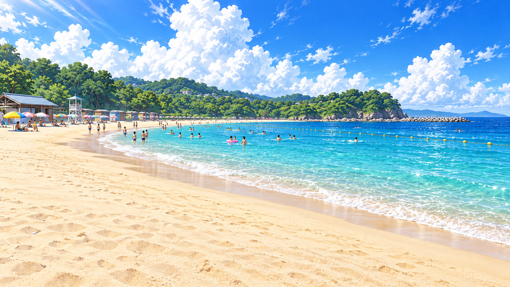
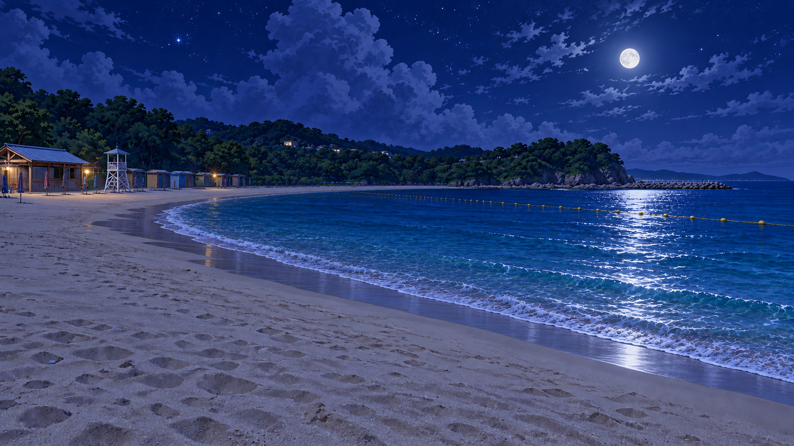

# 夏の海水浴場・昼と夜

昼は海水浴客で賑わう遠浅の湾、夜は無人で静かな海岸です。同じ海岸線、海の家、監視台、岬、防波堤が分かる構図。手前の砂浜を人物配置用に空けています。

| 賑わう昼 | 静かな夜 |
| --- | --- |
|  |  |

[場所設定・生成指示](../reports/COVERAGE.md#同梱しないもの)。完成候補として登録。ゲームの「海」から昼／夜を選択できるソースを追加しました。昼は既存の会話へ進み、夜は静かな背景を表示してマップへ戻ります。昼版のモブは背景に含まれ、独立レイヤーではありません。実機表示・操作は未検証です。

2026-10-22：ユーザー「海はOK」により昼夜とも採用確定。画像は変更していません。昼夜の生成指示を既存の出力記録からlocation.jsonへ補完しました。
