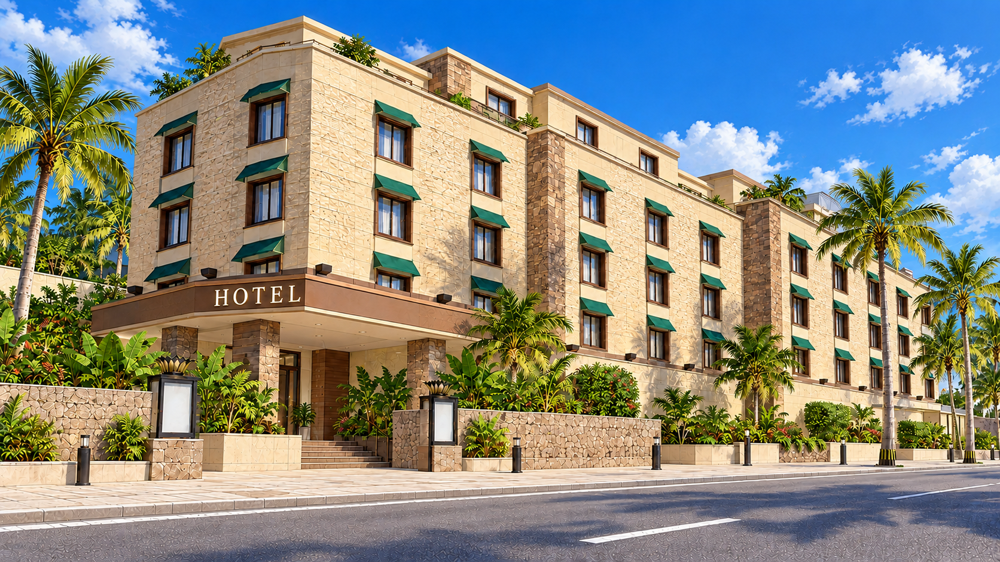
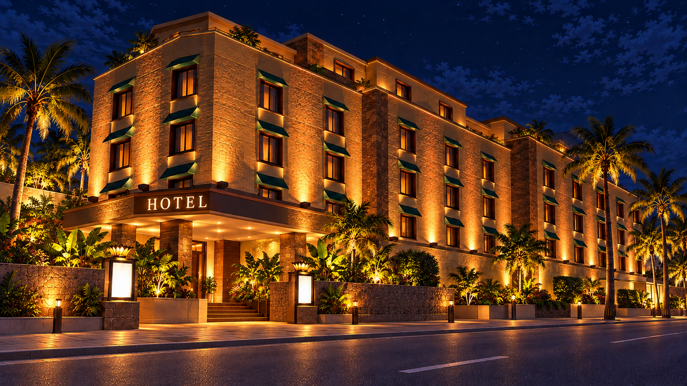

# ホテル・元の雰囲気を残した昼夜v3

元の石張りの外壁、強い暖色ライト、緑の庇、ヤシ、中層ホテルのボリュームを戻しました。固有名・大きな屋上装飾は使わず、窓配置や上階、入口庇を変えています。看板はHOTELのみ。

| 昼 | 夜 |
| --- | --- |
|  |  |

[場所設定・生成指示・旧版の採否](../reports/COVERAGE.md#同梱しないもの)。v3は完成候補。前の白い低層v2はユーザー指摘で不採用として保全。ゲームの昼夜参照はv3へ更新。実機表示は未検証。
