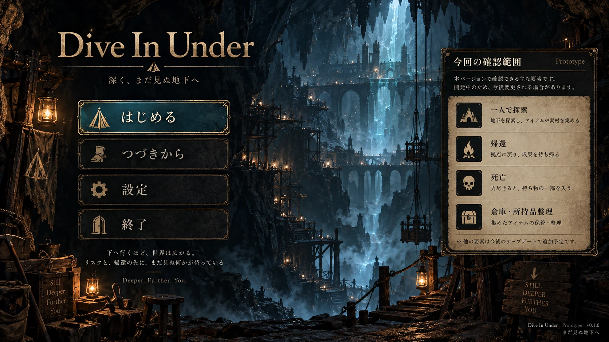
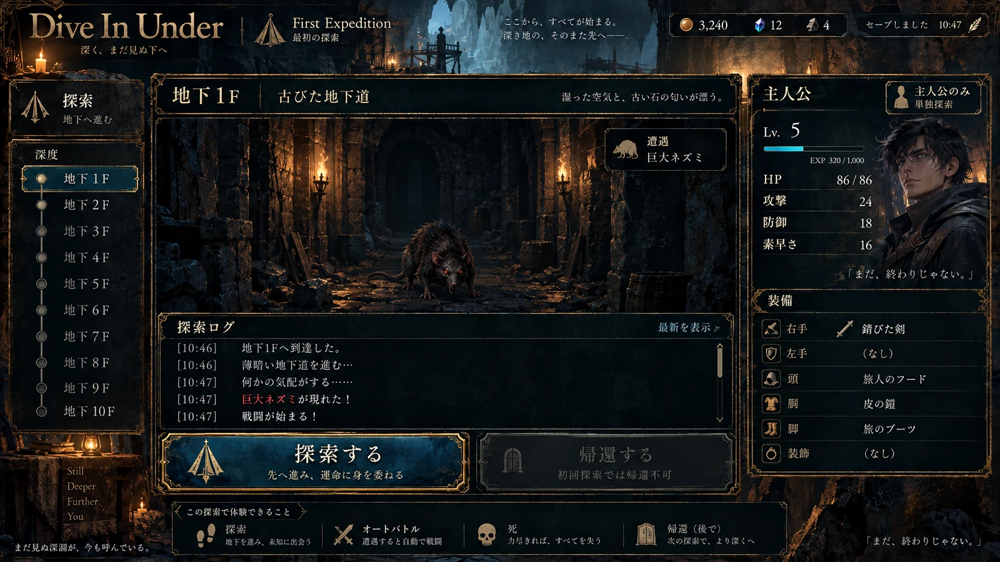
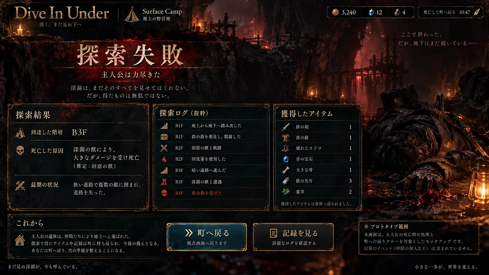
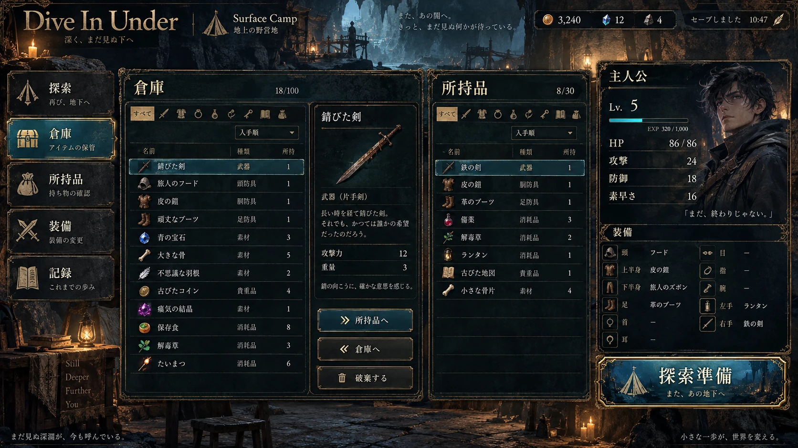

# UI / Design Mock — 画面イメージ4枚

> **2026-10-16時点のデザイン初稿**。画像は設計資料。ユーザーによるデザイン採用・最終承認はまだ。Steam向けWindows EXEの実装では、文字・ボタン・アイテム欄を**実際のUI部品として再構築**する。画像をそのまま押せる画面扱いにしない。

## 画面資料（Codex引き継ぎ用）

| ID | 画面 | フル解像度画像（GitHub版WebP） | 正しい画面上の振る舞い |
| --- | --- | --- | --- |
| UI-01 | タイトル | [01_title_screen.webp](../assets/ui-mocks/01_title_screen.webp) | 開始・続きから・設定。**新規開始時は地上の施設選択を挟まず初回探索へ** |
| UI-02 | 初回地下探索 | [02_first_exploration.webp](../assets/ui-mocks/02_first_exploration.webp) | **主人公1人だけ**、戦闘は素早さ順のオート。**初回は帰還不可、必ず死亡** |
| UI-03 | 死亡結果 | [03_death_result.webp](../assets/ui-mocks/03_death_result.webp) | 到達階・死因・ログ・戦利品を表示。**町へ戻る**。ペナルティ未決定 |
| UI-04 | 地上倉庫 | [04_warehouse.webp](../assets/ui-mocks/04_warehouse.webp) | 2回目以降の準備画面。**倉庫⇔所持品**、装備変更、次の探索へ |

### 01. タイトル画面

### 02. 初回地下探索

### 03. 初回死亡の結果表示

### 04. 地上・倉庫・装備

## 正しい画面遷移

\`\`\`text
タイトル
  └─ 新規開始 ──> 初回探索（主人公1人、帰還不可）
                        ├─ 自動戦闘・宝・イベント
                        └─ 必ず死亡 ──> 探索結果 ──> 町／地上
                                                  ├─ 所持品／倉庫
                                                  ├─ 装備・準備
                                                  └─ 再探索 ──> 2回目以降の地下
                                                                    ├─ 潜る
                                                                    └─ 帰還
\`\`\`

**重要**：黄金像が光り、犬が仲間になるのは**将来追加する導入イベント**。UI-03→UI-04の間にはまだ挟まない。

## 共通ビジュアルの方向性（仮採用ではなく提案）

- 実景：古い坑道、洞窟、大きな縦穴、木組みの足場、ロープ、石柱、松明、ランタン。
- 色：暗い青緑／黒をベースに、真鍮・金の枠、暖色の灯火。死亡場面のみ赤褐色をアクセントに。
- 情報：**中央が遭遇・ログ、左が探索・メニュー、右が人間ステータスと装備**。
- 素早さ・HP・装備耐久などの数字をすぐ確認できるようにする。必要な時だけ詳細ログを開けること。
- 複数の仲間・配下を将来追加するため、右ペインを**タブ／切り替え可能なキャラクターカード**に拡張しやすくする。
- 画面の飾りを実装しても、テキストの可読性・ボタン操作性を優先する。1280×720以上を想定したWindows向けレスポンシブUIの実機検証が必要。

## モック画像に含まれる「仕様ではない情報」

| モック表示 | 正しい扱い |
| --- | --- |
| 初回探索の主人公 Lv.5、通貨3240、初期武具名・各種数値 | **仮の表示。ゲーム開始時の実数値ではない** |
| タイトル側にある「帰還」「倉庫」などの紹介 | **試作品の説明パネル**であり、新規開始時に施設が解放される意味ではない |
| 探索画面の「帰還する」ボタン | **初回は使用不可**。2回目以降は使用できる |
| 死亡画面の「アイテムが倉庫へ送られました」「一部を失う」等 | **戦利品の保持・ロスト・送付先は未決定**。画像文言を採用しない |
| 倉庫容量 100、所持品容量 30、金貨等 | **UIサンプル値**。上限・通貨は未決定 |
| 最初から仲間がいる・黄金像が光る | **今回は含めない**。犬の加入は将来 |
| 画像に文字を焼き込んだボタン | **実装用UI資産ではない**。Codexはアート方向のみ参照 |

## 素材の保管先

- **GitHub**： \`projects/dive-in-under/assets/ui-mocks/*.webp\`（1672×941のレビュー用高品質WebP）。
- **元のPNG画像**：ChatGPTのLibrary \`/WhiteSpace/Dive In Under/UI Mocks/\` に4枚を保管。別途、元PNGとこの資料をまとめた配布ZIPを提供。
- **利用位置づけ**：参照用画像。UIパーツの切り出しや他ゲームの画面・ロゴのコピーではなく、この作品独自のゲームUIとして再設計する。
