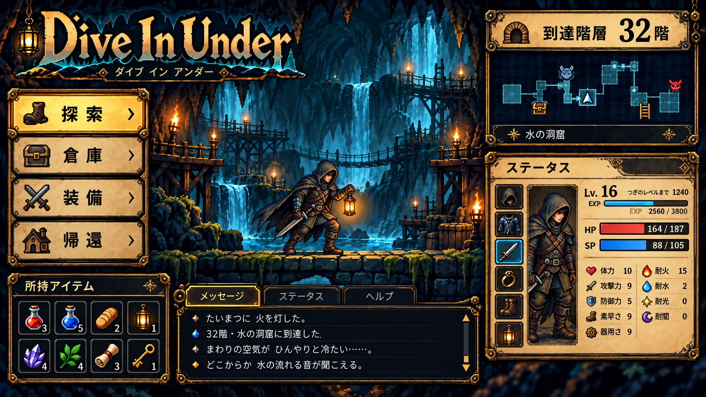
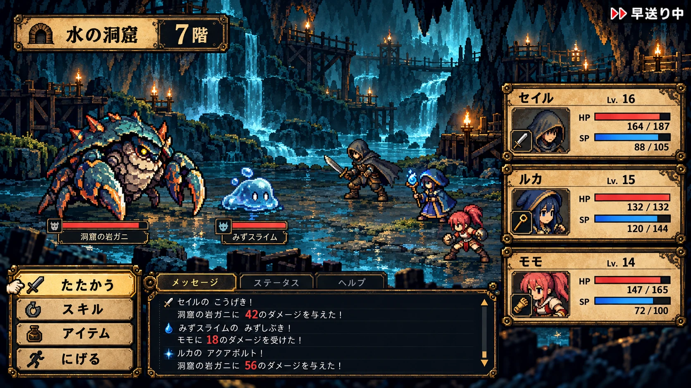
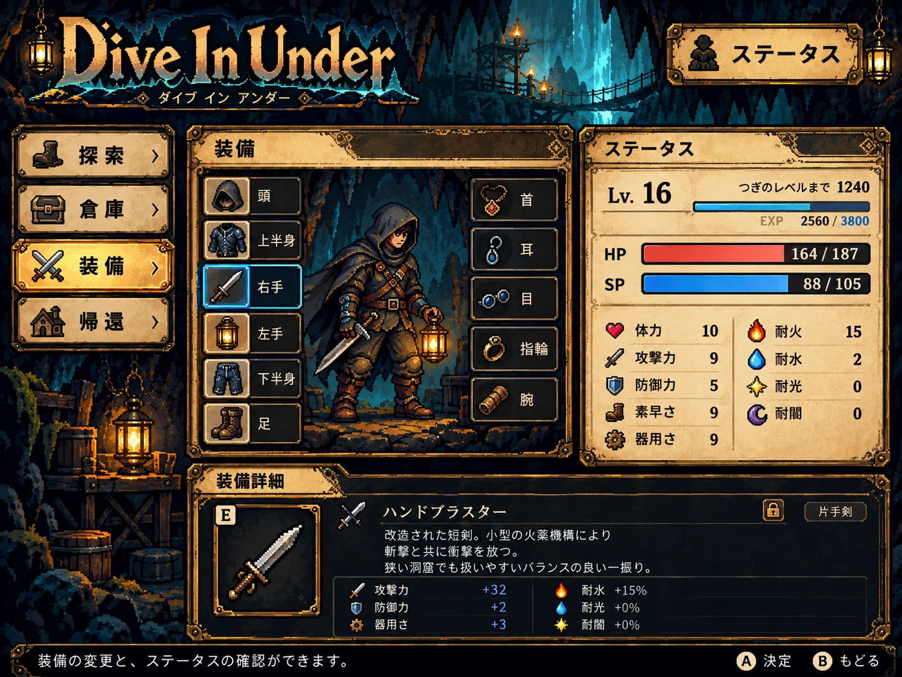

> 最新実装：main・通常0.6.1。01〜07の対象修正とユーザー評価待ちは [番号別一覧](../review/ui-feedback/README.md)。以下の0.6.0以前の記録は履歴。

> 現在の統合実装：通常0.6.0（ソース1c39a5c、CI39150351325）。[実画面と比較](../review/ui-integration-0.6.0/README.md)／[番号別フィードバック](../review/ui-feedback/README.md)／[SHA付き素材台帳](../assets/ui-reference/manifest.json)。
> 既存実装が利用したユーザー添付の町3参考は assets/ui-reference/supplemental/*-latest.png として保存済み。下記の別納品名04〜06とSHAが異なるため、同一原本とは推定しない。下記「0.5.4」「未実装」は文書作成時の履歴。

> 統合時点（2026-10-19）：mainへ実装0.6.0を統合。最新の通常入口は review/current/Play.cmd。本文内の旧版・取込待ち記述は策定時点の履歴で、現在の実装は review/ui-integration-0.6.0/ と区別して参照する。

# Dive In Under — 全画面UI参考・最新実画面リンク（統合正本）

> **更新：2026-10-19｜ここを全画面のUI比較・制作の単一入口とする。** 各画面で **①参考UI（目標）／②実際のゲーム画面（証拠）／③仕様／④実装状態** をセットで確認する。参考と実画面は別物。参考画像の文字、数値、アイテム・仲間構成をゲーム仕様としてコピーしない。

## 最優先：地上の町の3画面（2026-10-19 一旦採用）

**地上の屋外にある町で装備・所持品を整え、地下ダンジョンへ出発する**構成で統一。以前の「青い洞窟内が町」という参考案は今回の地上3画面より古い。新しい3枚はユーザーが本チャットで**「一旦これでよい」**と了承した**参考UIの完成イメージ**。いずれも **1672×941 RGB PNG、背景込みの画面モック（非透過）**であり、そのままゲーム画面へ貼る素材ではない。

**注意：次の3枚はチャットで生成・了承済みだが、このファイル更新時点ではGitHubの `assets/ui-mocks/` に画像バイナリ自体は未登録。** 参照画像パッケージから下記の指定ファイル名で取り込む。存在しない画像へのMarkdownリンクを先に置かない。リポジトリに取り込んだら本ページ内に ` ` を追加する。

| 優先 | 画面ID | 参考UI（今回の納品PNG） | 現状と最新の確認用実画面 | 仕様 |
| --- | --- | --- | --- | --- |
| **①** | **UI-07 冒険準備ハブ** | **`04_preparation_town_pixel.png`**（地上・屋外町、石/真鍮ボタン、主人公情報パネル）／**了承済・GitHub画像本体は取込待ち** | [町ハブの実画面（0.5.3時点・新起動導線は未実装）](https://github.com/shirai-masatomo/whitespace/blob/codex/dive-in-under/phase-02/projects/dive-in-under/review/status-layout-refinement/status-town-after.png) | [開始→準備→出発](STARTUP_PREPARATION_UI.md) |
| **②** | **UI-04 倉庫・所持品** | **`05_warehouse_town_pixel.png`**（地上・屋外町、左：携行15＋風呂敷3／中央：倉庫／右：詳細）／**了承済・GitHub画像本体は取込待ち** | **[0.5.4：装備アイコン適用済み倉庫](https://github.com/shirai-masatomo/whitespace/blob/codex/dive-in-under/phase-02/projects/dive-in-under/review/equipment-and-interface/equipment-assets-isolated/equipment-warehouse.png)**、[0.5.1：収納画面の各操作・3列詳細](https://github.com/shirai-masatomo/whitespace/blob/codex/dive-in-under/phase-02/projects/dive-in-under/review/warehouse-development/warehouse-overview.png) | [倉庫と持ち物](STARTUP_PREPARATION_UI.md)、[ITEMS](ITEMS.md) |
| **③** | **UI-01 タイトル** | **`06_title_town_pixel.png`**（地上の夕暮れ町、町の奥にダンジョンを予感させる入口、はじめる/設定/終了の見た目）／**了承済・GitHub画像本体は取込待ち** | [旧タイトル撮影（0.4.6の画面参考。0.5.4新規専用写真なし）](https://github.com/shirai-masatomo/whitespace/blob/codex/dive-in-under/phase-02/projects/dive-in-under/review/current/76-wide-title.png)、[0.5.4通常版の確認入口](https://github.com/shirai-masatomo/whitespace/blob/codex/dive-in-under/phase-02/projects/dive-in-under/review/current/README.md) | [新規開始・セーブ後回し](STARTUP_PREPARATION_UI.md) |

**最新の仕様は、毎回起動時に新規開始 → タイトル「はじめる」 → 冒険準備ハブ → ステータス/倉庫/装備を選択 →「探索に出発」→1F。** 起動中の冒険・倉庫・成長状態は保持、EXE再起動時は初期化。現行0.5.4の実装にこの新フローが入ったと誤記しない。タイトル参考にある「設定」等は機能未実装ならプレイヤーに動作するボタンとして表示しない。

### 新しい3枚の原稿登録先

- [画像台帳・チェックサム](../assets/ui-mocks/APPROVED_TOWN_MOCKS_2026-10-19.md) — 保存するファイル名・来歴・用途・GitHub登録状態。
- 画像原本の候補場所：`assets/ui-mocks/04_preparation_town_pixel.png`、`assets/ui-mocks/05_warehouse_town_pixel.png`、`assets/ui-mocks/06_title_town_pixel.png`。
- **受領PNGはユーザーが了承した参考画像。** 原画像の加工・切り出し・ゲーム組込は別作業。画像内の仮Lv／HP／SP／Gold、装備、消耗品、倉庫容量は**仕様ではない**。

## 既存の正式参考3枚と、対応する実画面

こちらは **GitHub mainに実ファイルが存在する正式参考**（2026-10-17の2Dドット版）。今回の「地上の町」の3枚は**これを上書きせず追加**する。探索／戦闘は地下の洞窟、地上3画面だけ地上屋外の町となる。

| 画面ID | 現行参考画像（クリックで原画像） | 実際の確認用スクリーンショット（クリックで表示） | レビューすること |
| --- | --- | --- | --- |
| UI-02 **探索** | **[PX-01 探索](../assets/ui-mocks/01_exploration_pixel.webp)** | [地下探索の実画面（0.4.6時点の代表キャプチャ）](https://github.com/shirai-masatomo/whitespace/blob/codex/dive-in-under/phase-02/projects/dive-in-under/review/current/88-normal-exploration.png) | 構図・洞窟・操作・ログ・進行表示。**分岐ミニマップは新仕様（参考への追加未反映）** |
| UI-05 **自動戦闘** | **[PX-02 戦闘](../assets/ui-mocks/02_battle_pixel.webp)** | [通常戦闘（0.4.6代表キャプチャ）](https://github.com/shirai-masatomo/whitespace/blob/codex/dive-in-under/phase-02/projects/dive-in-under/review/current/82-normal-battle.png)、[10Fボス](https://github.com/shirai-masatomo/whitespace/blob/codex/dive-in-under/phase-02/projects/dive-in-under/review/current/83-boss-floor-v2.png) | やや斜めの視点、接地、主人公と敵、HP/SP、ログ、倍速。**手動戦闘ボタンなし** |
| UI-06 **ステータス** | **[PX-03 ステータス/装備](../assets/ui-mocks/03_status_pixel.webp)** | **[0.5.4：青マントと装備/UI素材適用](https://github.com/shirai-masatomo/whitespace/blob/codex/dive-in-under/phase-02/projects/dive-in-under/review/equipment-and-interface/equipment-assets-isolated/blue-cloak-status.png)**、[能力タブ（0.5.3）](https://github.com/shirai-masatomo/whitespace/blob/codex/dive-in-under/phase-02/projects/dive-in-under/review/status-layout-refinement/status-abilities.png)、[状態タブ（0.5.3）](https://github.com/shirai-masatomo/whitespace/blob/codex/dive-in-under/phase-02/projects/dive-in-under/review/status-layout-refinement/status-conditions.png)、[プロフィール（0.5.3）](https://github.com/shirai-masatomo/whitespace/blob/codex/dive-in-under/phase-02/projects/dive-in-under/review/status-layout-refinement/status-profile.png) | 倉庫と独立、4タブ、主人公像、11装備枠、アイテム/能力説明 |
| UI-03 **探索結果（帰還／通常死亡／10F突破）** | **現行2Dドット版の専用モックなし**。PX-01/02の共通スキンを適用 | [生存帰還](https://github.com/shirai-masatomo/whitespace/blob/codex/dive-in-under/phase-02/projects/dive-in-under/review/current/79-first-return.png)、[通常死亡](https://github.com/shirai-masatomo/whitespace/blob/codex/dive-in-under/phase-02/projects/dive-in-under/review/current/74-wide-death.png)、[10Fクリア](https://github.com/shirai-masatomo/whitespace/blob/codex/dive-in-under/phase-02/projects/dive-in-under/review/current/85-normal-clear.png)（いずれも旧工程1の代表キャプチャ） | 報酬・損失・次の行動を明確化し、結果後は地上の準備ハブへ |
| UI-04拡張 **装備・修理** | PX-03の装備配置を共用。修理専用の正式モックは未制作 | [破損装備・修理画面](https://github.com/shirai-masatomo/whitespace/blob/codex/dive-in-under/phase-02/projects/dive-in-under/review/phase2-equipment/equipment-broken.png)、[修理後](https://github.com/shirai-masatomo/whitespace/blob/codex/dive-in-under/phase-02/projects/dive-in-under/review/phase2-equipment/equipment-repaired.png) | 11部位・耐久・修理ボタン・装備効果 |

### 正式参考の原画像プレビュー

**PX-01 — 探索**

**PX-02 — 戦闘**

**PX-03 — ステータス**

## その他の画面（全体目録：専用参考の不足を明示）

「実画面へのリンク」は**存在する証拠のみ**記載。未実装の将来画面に古い画像を最新と偽って貼らない。

| 画面／機能 | 理想UIの状況 | 既存の実画面／仕様 |
| --- | --- | --- |
| **イベント選択** | 新画風の専用モックなし | [イベントの代表実画面](https://github.com/shirai-masatomo/whitespace/blob/codex/dive-in-under/phase-02/projects/dive-in-under/review/current/69-wide-event.png) ／ [イベント台帳](EVENTS.md) |
| **宝箱・戦利品** | 専用モックなし | [探索の画面](https://github.com/shirai-masatomo/whitespace/blob/codex/dive-in-under/phase-02/projects/dive-in-under/review/current/88-normal-exploration.png) ／ [階層台帳](FLOORS.md) |
| **ミニマップ・クリック全景・分岐選択** | 手描き構想と仕様あり、**正式な全景モック未制作** | [階層分岐仕様](DUNGEON_MAP.md) |
| **黄金像の祈り・ガチャ** | 専用モックなし | [黄金像仕様](SHRINE.md)（工程3以降） |
| **支給所** | 専用モックなし | [持ち物仕様](ITEMS.md)（工程2、未完成） |
| **開始階層チェックポイント選択** | 専用モックなし | [全体仕様](../SPEC.md)（1F/11F/21F…） |
| **スキル編成・自動AI** | 専用モックなし | [工程4](dot/PHASE_04.md) |
| **仲間・配下編成** | 専用モックなし | [工程5](dot/PHASE_05.md) |
| **友好度・忠実度** | 専用モックなし | [工程6](dot/PHASE_06.md) |

## デザイン・実装の共通ルール

- **地上**：町の屋外、石畳・木造/石造の建物・店・灯り・空がある。**地上の町を洞窟内の町に戻さない**。地上3画面は同じ世界観に統一。
- **地下**：青緑の洞窟と暖色ランタン、斜めの戦闘場。探索と戦闘は既存PX-01/02の方向。
- **共通UI**：暗い石、真鍮四隅、使い込んだ羊皮紙、統一したアイコン、読みやすい日本語、押下/選択状態。基本数値や文字、クリック、ゲージは**Godotの実データとControl**で描く。
- **厳守事項**：ゲーム画面のモックを1枚貼ってUI操作を偽装しない。PX-02の手動攻撃/アイテム/逃走ボタンは採用しない。工程1〜4は主人公1人で成立。PX-03の能力/耐性は仮数値。初期装備5点・青いマントは[ITEMS](ITEMS.md)の正式要件に従い、装備は11枠。
- **探索の新要件**：[分岐・ミニマップ](DUNGEON_MAP.md)の前・現・次階層／クリックで全景／種別は通常非表示。旧「モックのミニマップは採用しない」という記載は**撤回済み**。
- **セーブについて**：今回の試遊は起動ごと新規開始。セーブ・ロードは後回し。[STARTUP_PREPARATION_UI.md](STARTUP_PREPARATION_UI.md) を優先。
- スクリーンショットは `review/` に保管し、参考原画と混同しない。**0.5.4装備/スキン適用後に新しく撮影されていない画面は旧版キャプチャと明記**し、次回の安全な画面レビューで新しい画像を追加する。
- **通常ゲーム起動に大量シミュレーションや負荷処理を組み込まない。** ユーザーPCの起動・フリーズ再現は無断でしない。

## 実装状況・資料リンク

- **現在の通常版の証拠**：[0.5.4 通常版README](https://github.com/shirai-masatomo/whitespace/blob/codex/dive-in-under/phase-02/projects/dive-in-under/review/current/README.md) ／ [新素材導入レビュー](https://github.com/shirai-masatomo/whitespace/blob/codex/dive-in-under/phase-02/projects/dive-in-under/review/equipment-and-interface/README.md)（2026-10-19照合。ゲームは起動していない）。
- **現在の画面遷移の正本**：[冒険準備](STARTUP_PREPARATION_UI.md)／[全体仕様](../SPEC.md)。
- **素材不足・必要ファイル**：[UI_ASSET_INVENTORY](UI_ASSET_INVENTORY_2026-10-18.md)／[UI参考納品台帳](../assets/ui-mocks/APPROVED_TOWN_MOCKS_2026-10-19.md)。
- **古い4枚のアーカイブ**：[2026-10-16旧モック](../assets/ui-mocks/archive/2026-10-16/)（**現行画風ではない**）。
- **製造担当への指示**：[UI_VISUAL_ALIGNMENT_HANDOFF.md](dot/UI_VISUAL_ALIGNMENT_HANDOFF.md)。

> **状態**：本ファイルはUI参照・レビューの更新。ゲームコード、EXE、保存データは変更していない。参照画像3枚のGitHubへのバイナリ取込と、新仕様の実ゲーム反映は別タスク。
