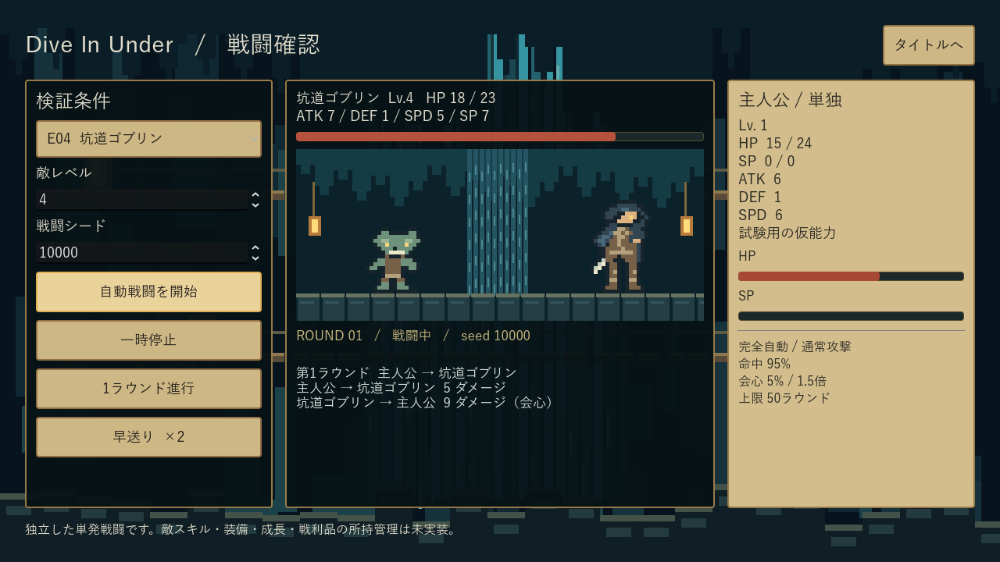
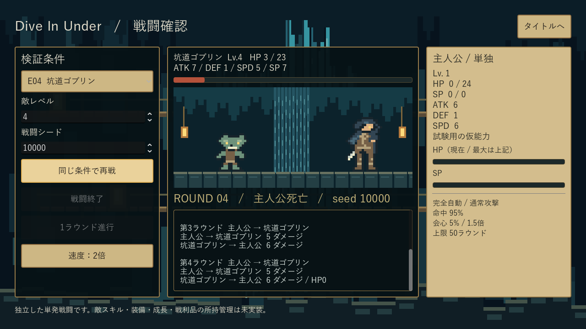

# Dive In Under — 今回の確認入口

**工程1の戦闘基盤。工程1全体は未完了です。** この場所を最新版の確認入口として更新利用します。実装・検証対象：`472bc01a9a816530fcb462e4ff90883e354b94cc`。資料のみの追記コミットとは区別します。

## 試す

- このPC：[最新Windows ZIP](../../build/DiveInUnder-foundation-windows-x64.zip) / [EXE](../../build/windows/DiveInUnder.exe) / [操作手順](../../tools/PLAY.txt)。EXEとPCKは同じフォルダに置きます。
- GitHub：[成功CIのZIP](https://github.com/shirai-masatomo/whitespace/actions/runs/39022931253/artifacts/12096484715) / [CIログ一式](https://github.com/shirai-masatomo/whitespace/actions/runs/39022931253/artifacts/12097054030)（head `ae0f8a2`、2027-01-15まで、GitHubログインが必要な場合あり）。[Draft PR #5](https://github.com/shirai-masatomo/whitespace/pull/5) の後続CIでも `DiveInUnder-foundation-windows-x64` を取得できます。このPC内の上のbuildリンクはGitHub上では取得できません。CIとローカル版のソースはBUILD.jsonで区別します。
- 「戦闘を確認する」→敵/Lv/シード→「自動戦闘を開始」。停止・早送り・1ラウンド進行・再戦・タイトルへ戻る操作を確認できます。探索ゲーム本編・保存は未実装です。
- 正確な環境・再現コマンド：[開発環境資料](../../docs/DEVELOPMENT.md)。Godot **4.7.2.stable.official.ed1daf0bf** / 同版テンプレート / GDScript。

## 実画面と新参考UI

| 実行中EXEの画面 | 対応参考 | 今回反映した点・残り |
| --- | --- | --- |
|  | [PX-01](../../assets/ui-mocks/01_exploration_pixel.webp) | 洞窟・滝・木の足場・暖色灯・真鍮枠。ロゴや装飾は仮 |
|  | [PX-02](../../assets/ui-mocks/02_battle_pixel.webp)、[PX-03](../../assets/ui-mocks/03_status_pixel.webp) | 主人公1人＋敵、静止ドット仮表示、HP/SP実値、羊皮紙パネル、自動戦闘ログ |
|  | PX-02のログ配置 | 単発戦闘の終了状態。工程1の「死亡結果→町」画面ではない |

モック画像をゲーム画面に貼り付けていません。手動の「たたかう/スキル/アイテム/逃げる」、仲間3人、ミニマップ・横移動、追加属性・器用さ、画像中のLvや装備名は導入していません。装備UIは未実装で、将来の正式11枠を少ない枠へ置き換えていません。

## 素材一覧・確認事項

**最新制作方針：キャラクターは戦闘用の静止画1枚で見え方を確認し、採用後もしばらく静止画を継続。** モーション・表情差分・カットイン・演出強化は後工程。工程1〜4はソロのゲームループ・UI・戦闘成立を優先します。

| 素材/参照 | 確認用サムネイル | 用途・状態 | 元データ |
| --- | --- | --- | --- |
| 主人公＋E04静止ドット仮表示 | [戦闘画面](02-battle.png) | **候補・未承認**。表示検証に使用中、正式採用ではない | [battle_stage.gd](../../ui/battle_stage.gd) の HERO/GOBLIN |
| E01/E02/E03/E05/B10静止ドット仮表示 | 単体画像なし | **候補・未承認**。敵選択時の静止表示。個別の美術受入は未実施 | 同ファイルの RAT/SLIME/BAT/BEETLE/STATUE |
| 洞窟・滝・ランタンの仮背景 | [タイトル画面](01-title.png) | **候補・未承認**、コードで描く試作背景 | [cavern.gd](../../ui/cavern.gd) |
| 現行PX-01〜03 | [既存画像一覧](../../assets/ui-mocks/README.md) | **参照モック**。実装素材ではない | [UI_MOCKS.md](../../docs/UI_MOCKS.md) |
| 旧モック4枚 | [既存アーカイブ](../../assets/ui-mocks/archive/2026-10-16/) | **差し替え済み参照**。現在の画風基準に使わない | アーカイブ内の原画像 |

独立したキャラクターPNG/生成AI素材は今回まだ作っていません。コード内の静止パターンと実画面を区別して管理し、一覧のための画像コピーやダミー素材は増やしません。現時点の判断事項は「静止ドットのサイズ・読みやすさ・羊皮紙の色味」の見え方。未承認の仮表示を量産素材として確定しません。

## 検証証拠と限界

- [142項目のテストログ](tests.log) / [基準1000seed JSON](simulation.json) / [日本語要約](simulation.json.txt) / [同条件比較](comparison.json) / [比較要約](comparison.json.txt)
- [追加4条件の集計JSON](scenario-summary.json)：各1000seed。全seed結果：[E01 Lv1](solo-E01-L1.json) / [E02 Lv1](solo-E02-L1.json) / [E04 Lv2](solo-E04-L2.json) / [E04 Lv3](solo-E04-L3.json)
- [ビルドログ](export.log) / [配布物ハッシュ](build-manifest.json) / [隔離監査](isolation.json) / [隔離GPUログ](render.log) / [UI入力確認](ui-smoke.json)
- キャッシュ修正後2回連続成功：[1回目監査](first-start-isolation.json) / [1回目GPUログ](first-start-render.log)。[EXEヘッドレス](exe-headless.log) も成功。
- 隔離監査は非WinSta0・非表示ステーション、専用Desktop内の起動PID所属、終了コードを確認。OSの入力・画面切替は使わず、Godot内のマウス入力経路とViewport撮影です。**物理マウス/キーボードでの人手試遊は未検証**。
- 停止指示前の画面外/no_focus方式は画面隔離ではありません。通常画面に見えた可能性があり、旧画像はローカルartifactsに保持。現在はその起動経路を禁止し、上記の非対話Desktop方式へ変更しています。
- 3枚はタイトル＋単発戦闘の状態。工程1の必須4実画面・反復探索・10F攻略を満たした証拠ではありません。未実装一覧は [進捗](../../docs/dot/PROGRESS.md) に集約。
