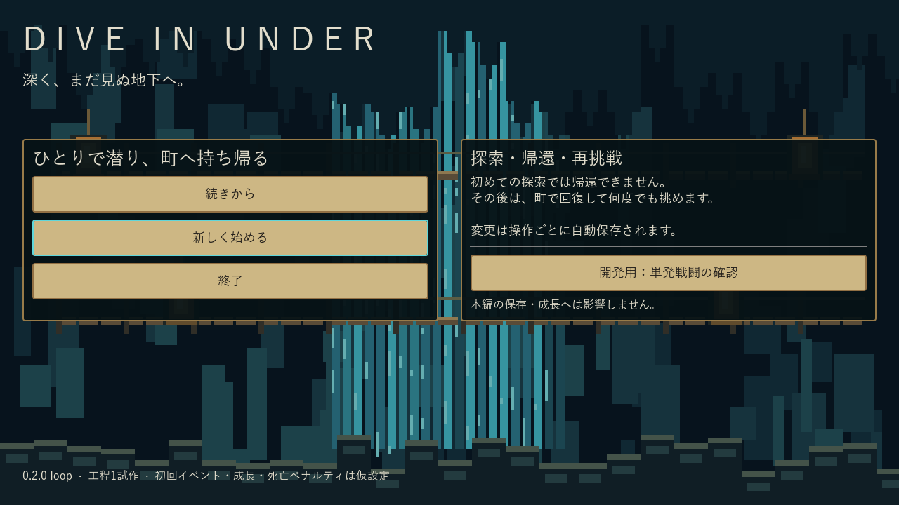
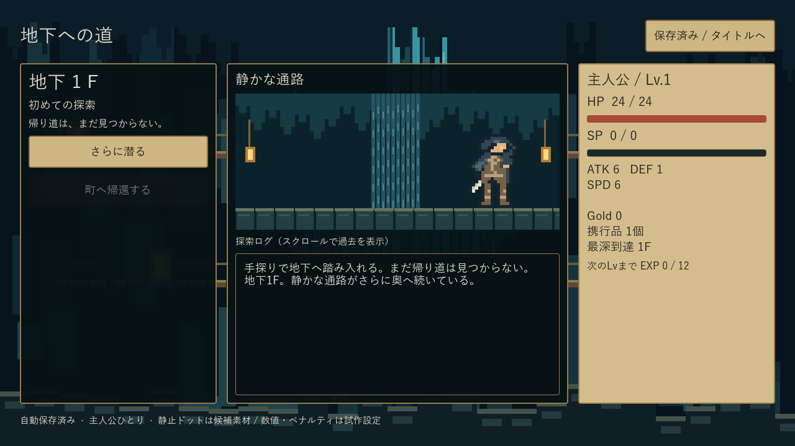
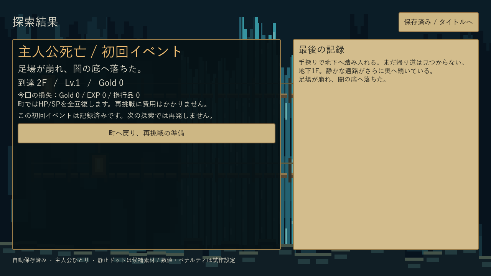
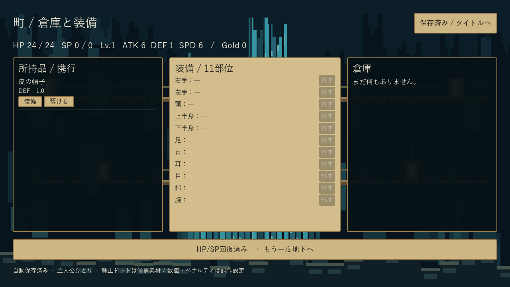
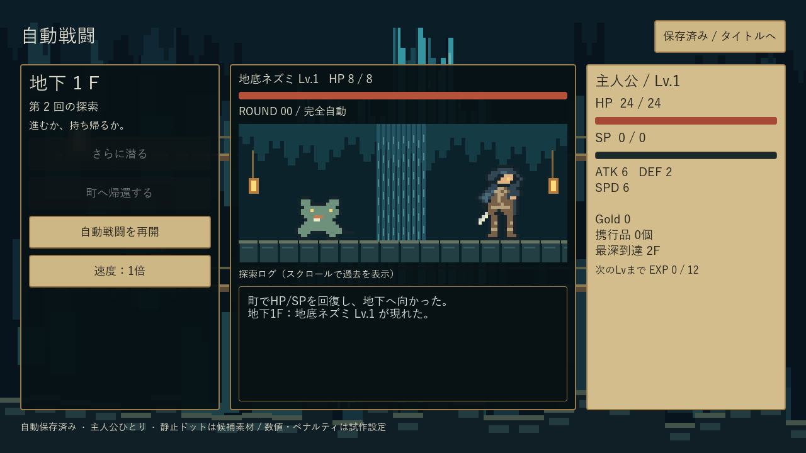

# Dive In Under — ローカル確認入口

**工程1の基幹ループ 0.2.0。工程1全体は未完了です。** 実装・ローカルEXE検証対象：`035d3fdf6de34bbbae1d574143e7833af098aad0`。後続の資料コミット、PR head、CIが実際にcheckoutしたmerge commitは区別します。

## このPCで試す

普段の牧場の確認フォルダに **Dive In Under 確認.lnk** を1個だけ追加しました。既存の牧場リンクと起動先は変更していません。

`C:\Users\masat\Documents\codex_test\projects\sporehollow\確認入口\Dive In Under 確認.lnk`

1. ショートカットを開き、このフォルダの **[Play.cmd](Play.cmd)** をダブルクリックすると最新EXEを起動できます。
2. **[index.html](index.html)** を開くと、画像付きの操作・素材・未完了一覧を確認できます。
3. 「新しく始める」→初回探索→死亡結果→町→装備・倉庫→再探索・帰還・死亡・再挑戦。「続きから」は途中の保存を再開します。

[ローカルZIP](../../build/DiveInUnder-foundation-windows-x64.zip) / [EXE](../../build/windows/DiveInUnder.exe) / [起動手順・保存先](../../tools/PLAY.txt) / [環境一覧](../../docs/DEVELOPMENT.md) / [配布物SHA256](build-manifest.json)。EXE/PCKペアを同じ場所に置きます。ブラウザーがcmdリンクを制限する場合は、このフォルダでPlay.cmdを実行してください。自動起動はしていません。

GitHub側では [Draft PR #5](https://github.com/shirai-masatomo/whitespace/pull/5) の最新Windows CIから `DiveInUnder-foundation-windows-x64` を取得します。配布ファイル名は既存の入口を維持するため継続しています。CI版はBUILD.jsonで実際のソースコミットを確認してください。

## 実EXEの画面と参考

| 実画面 | 対応参考・今回の確認 |
| --- | --- |
|  | 新規開始/続きから/開発用単発ツールを分離。PX-01の洞窟・水・ランタン |
|  | PX-01。主人公1人、帰還不可、ログ枠・HP/SP現在/最大 |
|  | 初回済フラグを死亡時点で保存。大きな死亡バナーと町への再挑戦導線 |
|  | PX-03の羊皮紙。所持品/倉庫/11部位、不要な操作は無効表示 |
|  | PX-02。全自動、速度状態、暗いログ背景、敵と主人公のHP |
| [帰還結果](08-return-result.png) / [通常死亡](09-normal-death.png) | 初回イベントとは別の通常戦闘死亡と再挑戦 |
| [単発ツール](02-battle.png) / [単発結果](03-battle-result.png) | 開発用の固定seed確認。本編保存には影響しない |

撮影は非WinSta0・非表示Station内の専用Desktop、実EXEのGPU viewportから取得。通常デスクトップにゲームを出していません。入力はアプリ内マウスイベント経路であり、**人間の物理マウス/キーボード試遊を代替する証拠ではありません**。

タイトル・初回探索・死亡結果・町の4枚はChatGPT Libraryにも保存しました。[ネイティブ添付用library_file_id一覧](library-images.json)。元PNGに返却されたLibrary version拡張属性を設定済みです。

## 素材一覧

| 素材/参照 | 状態・用途 | 実体 |
| --- | --- | --- |
| 主人公、E01〜E05、B10 | 静止ドット候補・未承認。各キャラクター静止表示1種類、独立PNG素材なし | [battle_stage.gd](../../ui/battle_stage.gd)、上の実画面 |
| 洞窟・水・ランタン | コード描画の仮背景 | [cavern.gd](../../ui/cavern.gd) |
| 現行PX-01〜03 | 既存の画風参照。実装素材ではない | [参照一覧](../../assets/ui-mocks/README.md) |
| 旧モック4枚 | 差し替え済み履歴 | [既存archive](../../assets/ui-mocks/archive/2026-10-16/) |

モーション・表情差分・カットイン・演出差分は追加していません。素材一覧のための画像コピーや別の確認フォルダは作っていません。

## 検証結果

- [戦闘142項目](tests.log)、[ループ/保存176項目](loop-tests.log)：失敗0。
- [100seed×12回の反復探索](loop-summary.json)：3F帰還方針、空き部位に装備、イベント実行。通常の死亡後も再出発でき、アイテム所有・初回済状態が破綻しないことを検証。**最終10Fバランスの検証ではありません**。
- [基準1000seed](simulation.json) / [日本語要約](simulation.json.txt) / [厳密同条件比較](comparison.json)：正規化records・各log SHA・全metrics一致。勝率21.6%、死亡78.4%、平均4.152/中央値4ラウンド、全戦闘残HP平均1.331。
- [故障注入6件](harness-faults.json)：Start切断、Back切断、古い成功JSONを残した結果未出力、隔離/ヘッドレス共通nonce検査、traceだけの改変、metricだけの改変をすべて拒否。
- [EXE入力経路](exe-headless.json) / [別EXEプロセスによる戦闘途中再開](resume-smoke.json) / [EXEログ](exe-headless.log)。保存SHAとrevisionが一致。
- [隔離監査](isolation.json) / [GPUログ](render.log) / [描画入力確認](ui-smoke.json) / [ビルドログ](export.log)。PID 25836、専用Desktop所属、所有窓2、終了0、run ID一致。

自己レビュー後に、町の出発ボタンが画面外へ押し出される配置、保存した戦闘の能力値整合、未来の保存版の巻戻し防止、検証の偽陽性3件を修正して再テストしました。物理入力・長時間試遊は未検証。

## 仮設定・未完了

初回2Fイベント、HP24/ATK6/DEF1/SPD6/SP0、帽子1個、Lv成長、町無料回復、通常死亡Gold10%減/EXP・装備・携行品保持は [expedition.json](../../data/v1/expedition.json) の交換可能な試作設定です。イベント候補の個別重みは未定のため、適格候補間を等確率にしています。EV03仲間加入は除外済み。

10F固定ボス・11F到達記録と再出発の分岐は実装しました。高Lv入力で分岐をテストしましたが、**通常の複数回探索・成長・装備による10F突破の最終バランス証明は次のまとまり**です。11Fの内容、仲間/犬/ガチャ/耐久/全スキル、正式PNG採用は未実装です。

保存はバージョン検査、一時ファイル検証、前回.bak、置換を行い、失敗時は画面の状態更新を取り消します。破損時は元データを保持して復旧/新規開始を明示選択。新規・復旧は元データを退避します。同じ保存の同時プレイは避けてください。SHAによる外部更新検出はありますが、同時書込みの完全な排他・別設定版からの移行は未対応です。

過去の `solo-E*-*.json`、`scenario-summary.json`、`first-start-*` は基盤472bc01時点の保存済み証拠です。現在の版の証拠として流用していません。機能別状態は [IMPLEMENTATION_STATUS.md](../../docs/IMPLEMENTATION_STATUS.md)、工程の残りは [PROGRESS.md](../../docs/dot/PROGRESS.md)。
