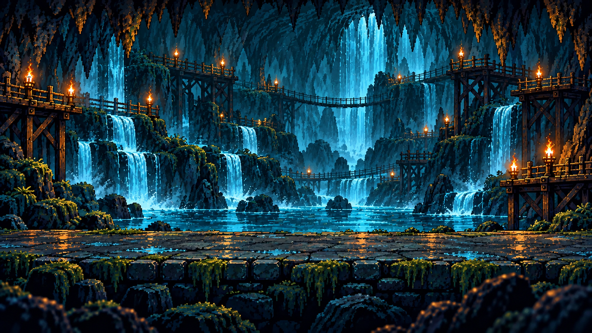
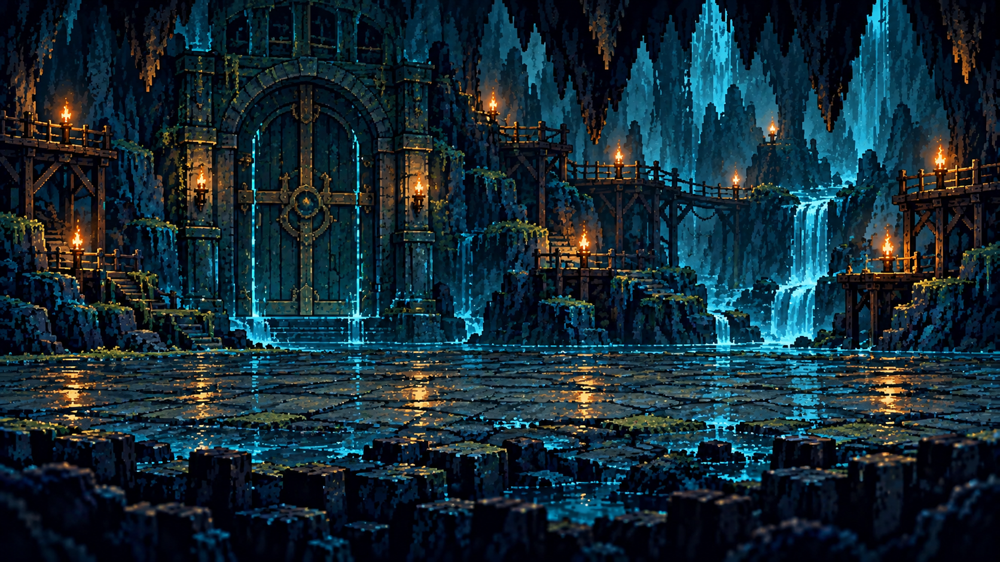
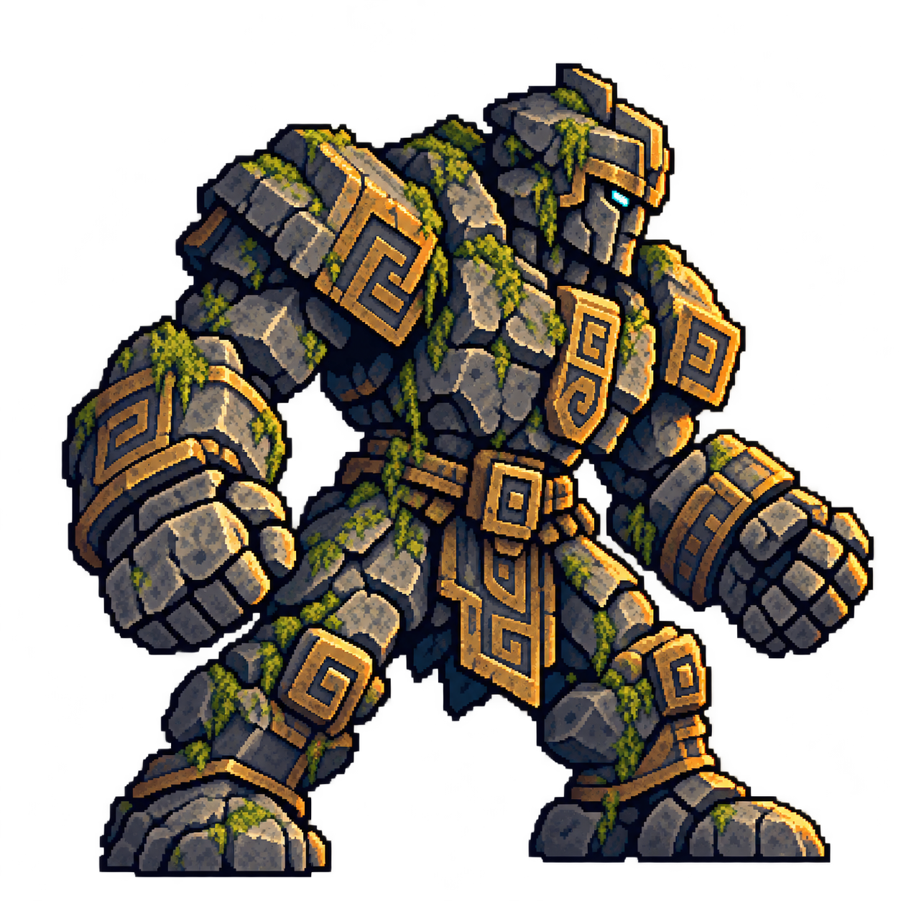
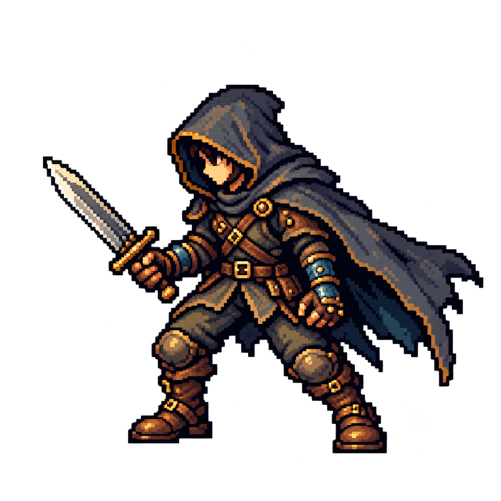
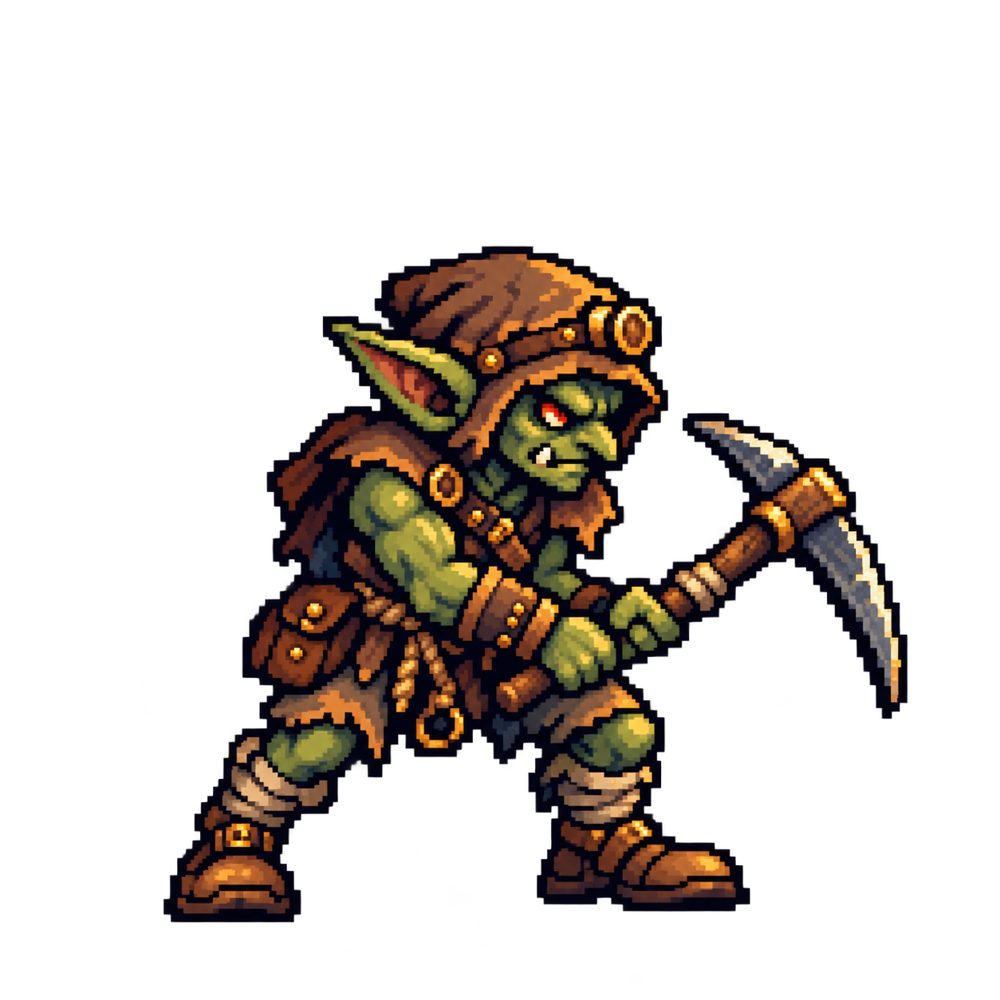

# 静止画像候補A — 素材一覧と採否レビュー

**最新：静止素材9点と現配置を基準として採用済み。ただし参考PX-02の斜め視点への一致は未達。採用と視点の完成判定を分ける。工程1全体は未完了。**

以下は各納品・採否時点の履歴。過去の「未採用」は当時の状態。

**基準5点は現時点の基準として採用。追加4点は未採用候補（2026-10-17）。工程1全体は未完了。** 2026-10-17、ユーザーの「とりあえず採用でいいよ」により、背景2点・主人公・E04坑道ゴブリン・B10門番の石像の5点を現時点の基準素材として採用。永久固定ではなく、必要な見直しは可能。静止画のみを維持。 ファイル名のcandidate-v1は来歴保持のため変更しません。

[実EXEとPX参考の比較](index.html#comparison) / [実EXEの通常戦闘](32-visual-goblin.png) / [10Fボス](34-visual-boss.png) / [画像制作チャットへの引継ぎ](../../docs/IMAGE_PRODUCTION_HANDOFF.md) / [来歴・SHA・透明性JSON](../../assets/visual-candidates/v1/manifest.json)

基準5枚は親タスクがimagegenでプロジェクト参考に基づき生成。外部素材パックなしとの制作元報告です。ユーザーが指定tempへ保存した実PNGを読み、ピクセルを確認してコピーしました。原稿を再描画・縮小保存・透過修正していません。コピー前後SHA一致、親のバイト数・寸法・人物アルファ128範囲と一致。親の既知SHAは未提供のため、Library原本とのSHA一致は断定していません。

背景は文字・枠・人物なし。人物は実アルファ透過ですが、薄い縁と内部の部分アルファがあり、厳密な64/96px格子ではない詳細なピクセル調原稿です。縮小表示の確認を経て現基準として採用されました。

| 候補 | 原稿寸法 | 透過 | 向き／用途 | 状態 |
| --- | --- | --- | --- | --- |
| [通常洞窟](../../assets/visual-candidates/v1/dive-ordinary-cave-candidate-v1.png) | 1672×941 | なし | 独立背景 | 現基準として採用 |
| [10Fボス門](../../assets/visual-candidates/v1/dive-boss-gate-cave-candidate-v1.png) | 1672×941 | なし | 独立背景 | 現基準として採用 |
| [門番石像](../../assets/visual-candidates/v1/dive-b10-gatekeeper-static-candidate-v1.png) | 1254×1254 | あり | 左配置・右向き | 現基準として採用 |
| [主人公](../../assets/visual-candidates/v1/dive-hero-static-candidate-v1.png) | 1254×1254 | あり | 右配置・左向き | 現基準として採用 |
| [坑道ゴブリン](../../assets/visual-candidates/v1/dive-e04-goblin-static-candidate-v1.png) | 1254×1254 | あり | 左配置・右向き | 現基準として採用 |

## 原稿と記録

### 通常洞窟

`dive-ordinary-cave-candidate-v1.png` / SHA-256 `bd4596d01a561e6c26d7652e04298c60c17697bedbbc284418a58528d2ed8a7b`

### 10Fボス門

`dive-boss-gate-cave-candidate-v1.png` / SHA-256 `f71f3b070312a91c3d4eee40c212a90385af1fcf652fd52d74f6da93b1b65f33`

### 門番石像

`dive-b10-gatekeeper-static-candidate-v1.png` / SHA-256 `15111b49424358284893d98c212e82b78e72419c4ad9d0388db526822dd8bd58`

足元原稿座標: [646, 1221]。アルファ128以上の範囲: [86, 88, 1216, 1221]。画像キャンバス下端とは区別します。

### 主人公

`dive-hero-static-candidate-v1.png` / SHA-256 `27eda9f13520ea888eeb2e18301c0df1e5b72c582a8f43ea8ba10fff39e91048`

足元原稿座標: [640, 1135]。アルファ128以上の範囲: [108, 212, 1210, 1135]。画像キャンバス下端とは区別します。

### 坑道ゴブリン

`dive-e04-goblin-static-candidate-v1.png` / SHA-256 `c94e1a08ea616fc3176f26282682d9daede8672eab76911f2b8cfa6c3f58df16`

足元原稿座標: [565, 1156]。アルファ128以上の範囲: [205, 309, 1138, 1156]。画像キャンバス下端とは区別します。

## 比較で判断すること

- 主人公／ゴブリン／像の絵柄、縮小後の輪郭、双方の大きさ、足元の接地が合うか。
- 通常洞窟と10F門、深度帯の色調が参考PX-01/02へ近いか。
- 羊皮紙・真鍮枠・日本語・HP/SP・ログ・装備一覧が読みやすいか。UIは実データに同期するGodot部品です。
- E01〜E03/E05は納品PNGを未採用候補として表示。正式採用や全敵の採用完了とは扱いません。

5点は現基準として採用済みです。今後の修正案は実画面と参考との差を添えて確認します。工程2・仲間・犬・全スキル・耐久・11F内容には進みません。

## 採用記録と履歴の区別

2026-10-17、ユーザーの「とりあえず採用でいいよ」により、背景2点・主人公・E04坑道ゴブリン・B10門番の石像の5点を現時点の基準素材として採用。永久固定ではなく、必要な見直しは可能。静止画のみを維持。

[採用記録JSON](visual-adoption.json)。0.4/0.4.1実EXE内の候補・採否未定注記は収録時点の履歴です。現0.4.2のmanifestとEXEは採用済みへ更新。原稿SHA、過去の監査、既存ZIPを遡って書き換えません。0.4.2で採用済み注記へ揃えました。残る敵4種の制作は親の専用画像制作チャットへ引き継ぎ、実装側では重複生成しません。

## 追加4候補 — 納品原画を保持して実EXE比較

専用画像制作チャットのimage_gen、各1回。採用済み主人公/E04/B10と最新PX-02を参照したとの制作元報告。1254×1254 RGBA、右向き・全身・静止1枚。親提示SHAとコピー前後SHA一致。新規4点は未採用です。

| ID・名称 | 実EXE | 足元/本体下端（原稿px） | Atlas表示範囲 x,y,w,h | 実表示矩形 幅×高さpx |
| --- | --- | --- | --- | --- |
| [E01 地底ネズミ](../../assets/visual-candidates/v1/dive-e01-underground-rat-static-candidate-v1.png) | [比較](51-enemy-rat.png) | [770, 1007] | [30, 472, 1195, 541] | 208.08×94.20 |
| [E02 粘菌スライム](../../assets/visual-candidates/v1/dive-e02-slime-mold-static-candidate-v1.png) | [比較](52-enemy-slime.png) | [627, 949] | [24, 323, 1206, 632] | 208.08×109.04 |
| [E03 鉄羽コウモリ](../../assets/visual-candidates/v1/dive-e03-ironwing-bat-static-candidate-v1.png) | [比較](53-enemy-bat.png) | [520, 1030] | [32, 236, 1197, 799] | 208.08×138.89 |
| [E05 岩甲虫](../../assets/visual-candidates/v1/dive-e05-rock-beetle-static-candidate-v1.png) | [比較](54-enemy-beetle.png) | [645, 1093] | [47, 308, 1197, 791] | 208.08×137.50 |

境界はアルファ16以上の実測本体＋4px。遠い微小アルファは表示範囲から外すだけで、PNGの透明性や画素は変更しません。コウモリのみ本体下端を地面より18px上へ置く静止案。尾・翼・触角・足元が欠けず全6敵がステージ内であることを実EXEで確認。[9枚のSHA・境界・来歴](../../assets/visual-candidates/v1/manifest.json)。ネズミの横向き寄りの見え方、各サイズ、浮き量、斜め構図との適合はユーザーの節目レビュー対象です。
