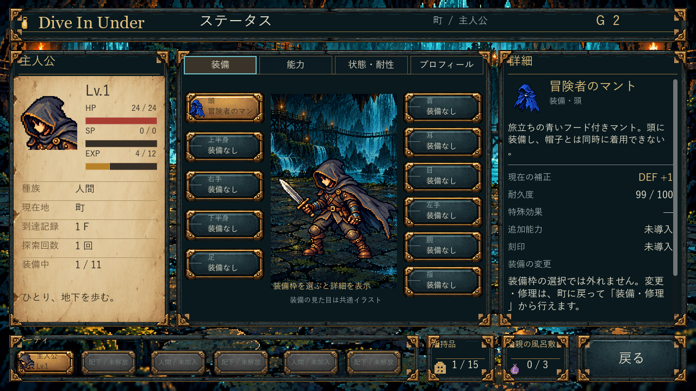
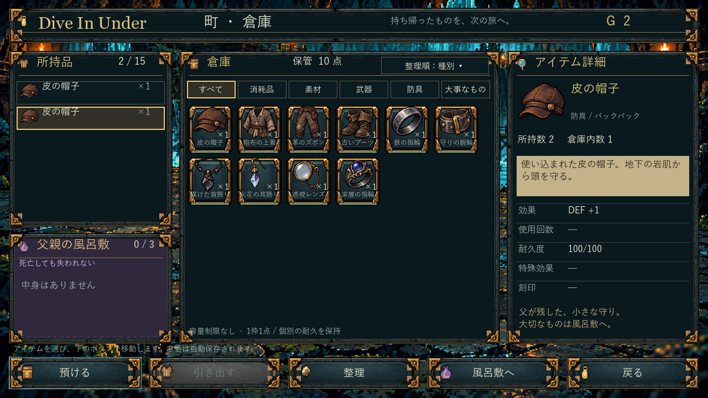

# 装備画像・UI素材の適用 — 通常EXE 0.5.4へ反映済み

ユーザーの装備素材とUI素材を、原PNG・透過を保持したまま取り込む。画像全体を完成画面に貼り付けず、AtlasTexture/StyleBoxTexture/NinePatchRectと実Button/Labelを分離した。

## 適用内容

- I01〜I09・I11の10種類：倉庫の所持品/グリッド/詳細、ステータスの装備/詳細、装備・修理へ個別アイコンを対応付け。2種類の指輪は別画像。
- 青い冒険者のマントA02を新規開始時に頭へ装備。11枠のまま、帽子と排他、独立UID・耐久を持つ。防御+1/耐久100は調整用仮値。旧I01は改名しない。
- 真鍮と石の枠/四隅、羊皮紙、通常/選択/押下/無効ボタンをUIシートから適用。文字・操作・ゲージ数値はネイティブのまま。元絵の途中まで塗られたゲージは流用しない。
- 新規設定はloop-provisional.5。旧.4をexpedition-legacy-4.jsonとしてバイト保存し、既存セーブの装備・成長・進行・耐久を維持。既存キャラクターへマントを強制装着しない。

## 今回保管のみ

初期5点のうち剣/服/ズボン/靴の4点は素材領域を登録して保管。アイテムの正式性能が未決定のため新規種類・性能は先行追加しない。赤マントも色違いの参照として保持。UIの残りの宝石・スクロール装飾も元シートに保持。

## 負荷と確認

ローカルで画像取り込みと約12秒の一括テスト（1485チェック）まで実施、失敗0。ユーザーからPCフリーズの報告があり、原因は未確定。その時点でGodot/ゲームの実行プロセスは残っていなかった。追加のローカル描画・ビルドを止め、以降の描画・Windows配布作成はGitHub CIで行う。ローカル実行も許可されているが、負荷作業は内容・見込み時間を事前に通知する。

最終版はGitHub CI39146623104で同一EXE/PCKの1280×720隔離描画、実Button操作、別EXE再起動、旧保存保全を確認し、取得ZIPのGitHub digestと展開EXE/PCKを照合した。2026-10-19に通常起動先・配布ZIPを0.5.4へ切替済み。ローカルでは報告後Godotを起動せず、ファイル取得/展開/照合/切替だけを低いプロセス優先度で順番に実行した。工程2の全損/再調達、支給所、報酬満杯時処理、初期装備の残り4点の性能は未決。モデル設定変更なし。

## 画像の保存先・制作

- assets/equipment/v1/equipment-sheet.png：ユーザー提供（原本保持）。
- assets/equipment/v1/adventurer-cloak-blue.png：imagegen組込みモードで青色の単独透過アイコンを作成。
- assets/equipment/v1/manifest.json：最終プロンプト、領域、対応種類、未適用領域。
- assets/interface/v1/interface-sheet.png：ユーザー提供（原本保持）。
- assets/interface/v1/manifest.json：適用/保管区分。

青マントのプロンプト要約：提供シート上段2番目のマントだけを取り出し、形・フード・銀留め具・裾・ピクセル表現を保って赤い布を青へ変更。単独、文字なし、透過背景。全文はmanifest.json。

## クラウド実画面の自己レビューと修正

初回3fe275cのCIは成功したが、実画面を見ると倉庫の高解像度アイコンが元寸法へ拡大して一覧を覆っていた。TextureRectのexpand_modeをtexture/sizeより先に設定し、アイコンが実際の親操作枠内へ収まることを追加確認する。金色選択面の子Labelは暗色に変更し、小さいタブは読みやすい薄い枠、広い操作面は素材の9分割枠を使用する。装備画像のCPU取得も元シートにつき1回にまとめた。変更前はbefore-warehouse-icon-size.png/before-status-selection.png。修正後の再撮影では、A描画成立：全アイコンが操作枠内へ収まり、文字・11枠・詳細・戻るが見切れず、選択の金色面でも文字を判別できる。B画面の自然さ：原素材の石/真鍮/羊皮紙が洞窟背景と共存し、アイコンの縦横比を保ち、倉庫の一覧が比較可能。キャラクターと床の配置は前段から変更していない。細かい文字の最適化、ゲージ・スクロール装飾の残りは後続。

## 最終確認と配布

実行ソース：a5c3c6925fbc501d24ce84ccfa1f2fbbeed74456。Godot4.7.2 Standard/GDScript、Windows x64、1280×720。

[CI成功](https://github.com/shirai-masatomo/whitespace/actions/runs/39146623104) / [Windows成果物](https://github.com/shirai-masatomo/whitespace/actions/runs/39146623104/artifacts/12143229525) / [確認画像・ログ](https://github.com/shirai-masatomo/whitespace/actions/runs/39146623104/artifacts/12144070897) / [通常起動先とSHA](local-release.json)。

既存の起動入口01と通常配布ZIPは同じ最終PCKを選択。旧0.5.3のEXE/PCK/ZIPを保持し、ユーザーのセーブを確認fixtureへ変更していない。モデル設定変更なし。

- 通常新規ゲームのボタンから青マントが頭に1個だけ装備されること、実防御補正と耐久、帽子との入替、預入/引出/風呂敷/再装備、同一個体の耐久保持、別EXEでの再開を確認。
- 旧0.5.3設定を使う保存の装備/進行/耐久/ファイルSHAを保持。別途、旧保存8ケースの実EXE移行/再開も成功。
- 4タブ、装備詳細、キーボード、スクロール、戻る、操作前後/再開後のセーブSHA一致を確認。倉庫とステータスは別画面。
- 機能チェック、固定少数の再現比較、通常10Fの3プロセス再開は最終クラウドCIで成功。追加の難易度調整・大量統計は行っていない。

## 最終実画面

画像は通常起動と同じEXE/PCK。青マント画面は通常新規開始→1F解決→生還→町で確認。倉庫の10種類一覧・ステータス詳細の劣化装備は、隔離した確認用のアイテム構成であり、ユーザー所持品への配布や変更を意味しない。

## 未決事項（まとめ）

初期装備の残り4点（剣/服/ズボン/靴）の性能・実装、マントの正式性能、死亡全損と再調達、支給所、探索報酬満杯時処理。赤マント、既成ゲージ・スクロール装飾の残りは原シートで保管。今回の素材適用はこれらの仕様を確定しない。
