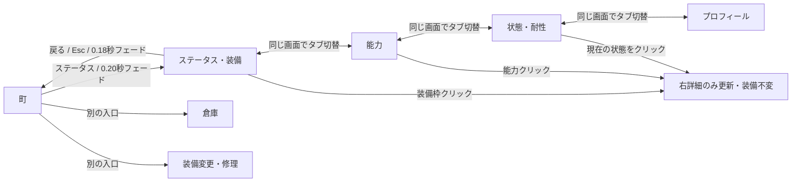

# ステータス画面：レイアウト・操作設計

1280×720。倉庫とは別の閲覧画面。町の「ステータス」から開き、毎回「装備」タブを初期表示する。タブ切替は同じControl内だけを更新する。

## 完成レイアウト

| 領域 | 座標・サイズ | 内容 |
| --- | --- | --- |
| ヘッダー | x16 y14 / 1248×64 | タイトル・ステータス・町・実Gold |
| 左・常設 | x16 y92 / 296×510 | 顔・主人公名・実Lv、HP/SP/次LvまでのEXP、種族・到達記録。羊皮紙 |
| 中央 | x324 y92 / 580×510 | 上に4タブ。装備時は中央に静止全身絵、周囲に11枠 |
| 右・詳細 | x916 y92 / 348×510 | 選択した項目の名前・説明・実値。長文は縦スクロール |
| 下部 | x16 y616 / 1248×88 | 人間と配下を1組にした3組分の領域。実在は主人公1人。右下に戻る |

装備配置は左に頭/上半身/下半身/足/左手、右に右手/首/耳/目/指/腕。冒険者のマントは頭1枠を使う。名前と部位を文字でも示す。クリックは詳細確認だけで、装備解除や交換を行わない。既存の装備・修理は町の別ボタンから開く。

## 4タブの表示例（仮数値は使用しない）

| タブ | 中央の表示例 | 選択後の右詳細 |
| --- | --- | --- |
| 装備 | 全身絵＋11枠。現行の皮の帽子が装備中なら頭に表示し、空枠は「装備なし」 | 皮の帽子/頭、個体の実効DEF、現在/最大耐久。追加能力・印は未導入と区別 |
| 能力 | HP/SP/ATK/DEF/SPDとEXP。共通コアの現在値と成長・装備の内訳 | 例：攻撃力を選ぶ→現在値と通常攻撃への効果、装備耐久との関係 |
| 状態・耐性 | 実際の付与中状態と防御態勢。町では現行データ上「状態異常なし」。8属性の名前は倍率未設定として無効表示 | 付与中なら効果/残りの自身行動機会/発生スキル。未設定属性を0%と扱わない |
| プロフィール | 確定情報＝主人公/人間。年齢・出身・人物紹介は未設定と区別。進行記録は実セーブから表示 | 選択した確定項目または旅の記録の説明。参考画像の19歳・湖の村・冒険者などは流用しない |

## 画面遷移とクリックの前後

| 操作前 | 入力 | 操作後・不変条件 |
| --- | --- | --- |
| 町 | ステータス | 左の主人公情報＋初期タブ装備。データ/保存不変 |
| 装備タブ・未選択枠 | 頭をクリック | 頭枠を金色で固定、右に実装備詳細。装備は外れない |
| 装備タブ | 能力 | 中央だけ能力一覧へ。左の情報とキャラクター選択を維持 |
| 能力 | 攻撃力 | 右の説明を更新。他能力やデータは不変 |
| 状態・耐性 | 未設定の属性 | 無効・選択不可。架空の耐性なし |
| 任意タブ | Tab/矢印＋Enter、または1〜4 | タブ/項目をキーボードで選択。選択/ホバー/フォーカスを区別 |
| 任意タブ | 戻る / Esc | フェードアウト後、開いた町へ復帰。保存・乱数・耐久不変 |

入場0.20秒、退場0.18秒。タブは選択装飾＋中央の短い0.10秒表示切替。押下時にボタンの縁を沈める。連打中に閉じる処理が重複しないようにする。HP/SPの表示更新は0.15秒補間し、表示演出はセーブへ書き込まない。

## 素材

追加制作は今回不要。採用済み主人公の静止全身絵を原画不変で再利用し、顔はGodotのAtlasTextureで表示領域を参照する。洞窟・真鍮フレーム・小型装備アイコンも既存素材/部品を使用。文字・ゲージ・枠選択・タブ・スクロールは独立したControlで実装する。主人公の服装は静止美術であり実装備の見た目反映ではない旨を補助説明する。

必要最小確認：町から開く、4タブ、11枠/能力の右詳細、空装備と未設定情報、キーボード、戻る、長文スクロール、1280×720の見切れ、UI操作前後の状態/セーブSHA一致。戦闘・保存形式・仲間・属性計算は変更しない。
