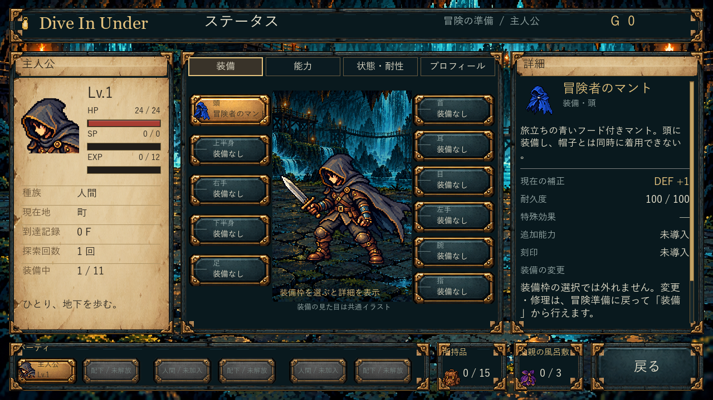
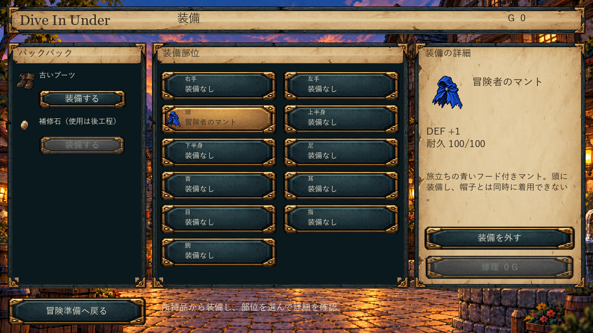
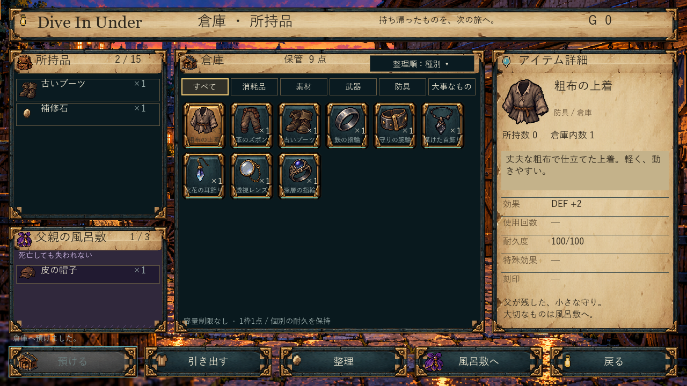
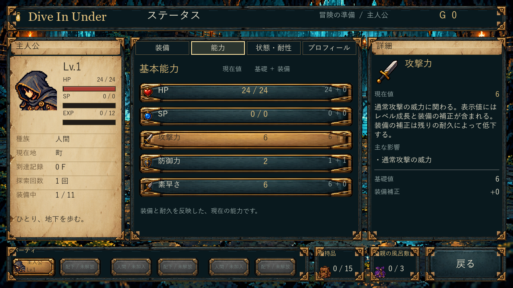
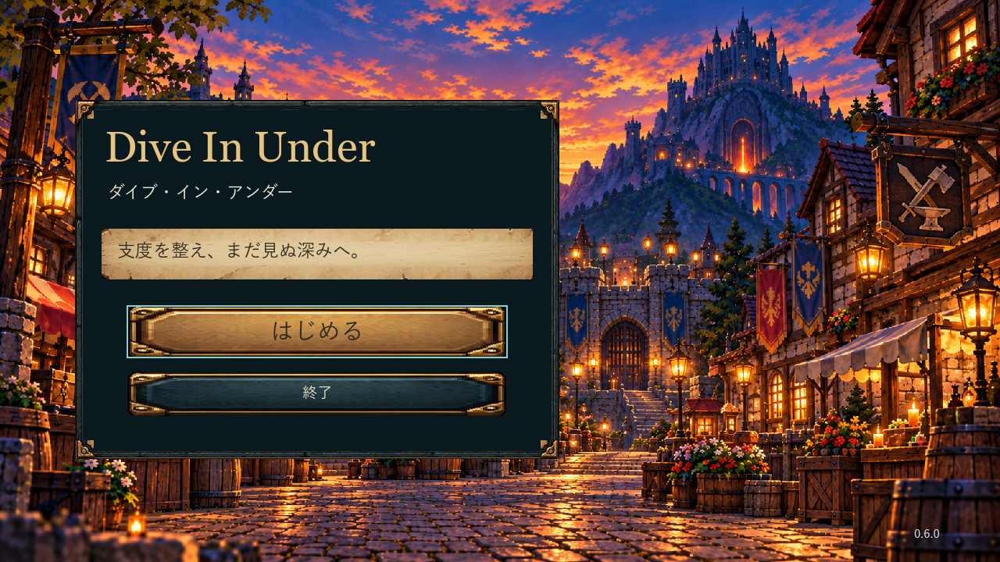
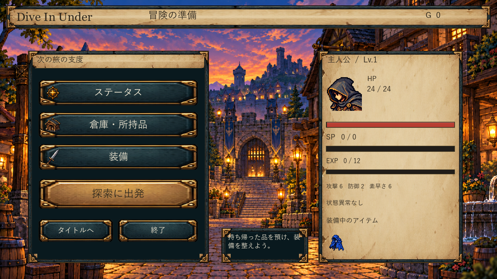
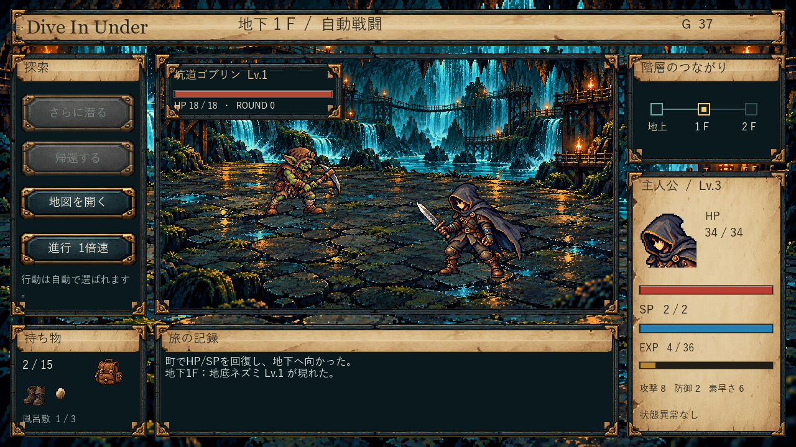

## 現行：仲間UI・装備／アイテム操作 0.11.0（2026-10-21）

**[実画面と空白のユーザー記入欄](party-ui-0.11.0/REVIEW.md)**／[22画面](party-ui-0.11.0/index.html)／[実装・確認・未確認](party-ui-0.11.0/README.md)。作戦モック承認後に実装。CI39596167114、実行855085c、通常入口へ反映。完成画面のユーザー評価は未実施。以下の現在・通常という呼称は当時の履歴。

## 現行：レビュー修正01〜09・通常0.8.1（2026-10-20）

[今回の実画面・番号別比較](review-fixes-0.8.1/index.html)／[実装と確認・未確認](review-fixes-0.8.1/README.md)／[通常入口](../current/README.md)。CI39408062823成功、実行ソース8b92fd8。ユーザーの見た目・操作感の評価は未評価、採否未判断。

以下は既存の評価履歴を保全したものです。各節の「最新」「通常」は当時の呼称で、現行の正本は上記の通常入口です。

## 2026-10-20 探索UI・操作改善 0.8.0

[番号01〜10・前後実画面](exploration-flow-0.8.0/index.html) / [操作とクリック数](exploration-flow-0.8.0/OPERATIONS.md) / [確認と未確認](exploration-flow-0.8.0/README.md)。通常0.8.0、実装33b33a2、CI39275995061成功。実装／限定確認と、ユーザーの評価・採用判断は分ける（未評価）。以下の元レビューと評価履歴は保全。

> 最新通常版0.7.0：[10F体験・操作・後続用基盤の8項目と実画面](journey-0.7.0/README.md) ／ [比較・演出連続画像](journey-0.7.0/index.html)。見た目・遊びの利用者評価は未評価。以下は既存の評価履歴として保持。

## 最新：UI改善01〜09＋タイトル追記（通常0.6.4）

今回の01〜09は、下記の旧レビュー01〜07とは別の対応一覧です。最新mainを照合し、既対応を維持してUIと操作を改善。Spaceは最新追記で停止／再開、タイトルはカタカナ削除・一枚パネルへ。実装・対象確認済み、見た目の最終評価は未評価。

[今回の変更前後13画面](responses/0.6.4/index.html)／[番号別の実装・既対応・確認・保留](responses/0.6.4/README.md)／[作業開始時の根拠](responses/0.6.4/INITIAL_CHECK.md)／[通常入口](../current/README.md)。
旧レビュー・原画像・評価履歴は以下に保持します。

# UIフィードバック01〜07 — 対応指示と実装結果

**2026-10-19、ユーザーから01〜07の実装指示を直接受領**。[指示記録](history/REQUEST_2026-10-19.md)。
最新のブランチ・版・入口を先に確認し、残存する7件を対象に修正した。
**実装状態とユーザーの見た目評価・採用判断を分ける。全7件は修正済み、ユーザー評価は未評価、採用は未判断。**

- 対応版：**0.6.1**、実行ソース **7620325e00e063f48a869535aef64994a8f31815**。
- 開発：**main**。旧phase-02の未反映実装をa4b07f7で統合後、mainで修正。
- 起動：既存「01 ゲームを起動」→ review/current/Play.cmd → 検証済み0.6.1。通常入口とZIPを切替済み。
- [番号別の実画面比較](responses/0.6.1/index.html)／[確認結果と未確認](responses/0.6.1/README.md)／[着手時に残っていた根拠](responses/0.6.1/INITIAL_CHECK.md)／[CI](https://github.com/shirai-masatomo/whitespace/actions/runs/39233227479)。
- 既に解消済みとして変更を省いた番号はなし。BGM・戦闘処理・ゲーム仕様の変更なし。

| 番号 | 実装状態 | 変更・理由 | ユーザー評価 | 採用判断 | 実画面比較 |
| --- | --- | --- | --- | --- | --- |
| 01 | 修正済み | 枠内は実測した幅に収まる明示的な「…」。右詳細とツールチップは正式名全文。 | 未評価 | 未判断 | [前](images/01-status-equipment.png)／[後](responses/0.6.1/after/01-status-equipment.png)／[比較](responses/0.6.1/01.html) |
| 02 | 修正済み | 日本語の行分割データを配布物へ含め、説明を日本語・単語境界で折り返す。 | 未評価 | 未判断 | [前](images/02-equipment.png)／[後](responses/0.6.1/after/02-equipment.png)／[比較](responses/0.6.1/02.html) |
| 03 | 修正済み | 6列を維持してマスの名前領域を独立。枠から離し、下部案内に暗い帯を付ける。 | 未評価 | 未判断 | [前](images/03-warehouse.png)／[後](responses/0.6.1/after/03-warehouse.png)／[比較](responses/0.6.1/03.html) |
| 04 | 修正済み | 項目名・現在値・内訳を同じ文字サイズ／縦中央と共通の上下余白へ。 | 未評価 | 未判断 | [前](images/04-status-abilities.png)／[後](responses/0.6.1/after/04-status-abilities.png)／[比較](responses/0.6.1/04.html) |
| 05 | 修正済み | ボタン位置は維持。不透明な全面パネルを、タイトル直下だけの小さい半透過プレートへ。 | 未評価 | 未判断 | [前](images/05-title.png)／[後](responses/0.6.1/after/05-title.png)／[比較](responses/0.6.1/05.html) |
| 06 | 修正済み | HPバーを数値の直下・肖像の横へ移す。出発ボタンと残りの構成は維持。 | 未評価 | 未判断 | [前](images/06-preparation.png)／[後](responses/0.6.1/after/06-preparation.png)／[比較](responses/0.6.1/06.html) |
| 07 | 修正済み | 固定敵から名前・Lv・登場ログを一緒に生成。通常遭遇は別の1例で区別して確認。 | 未評価 | 未判断 | [前](images/07-battle.png)／[後](responses/0.6.1/after/07-battle.png)／[比較](responses/0.6.1/07.html) |

最終確認はクラウドの隔離EXE1回・10.659秒。対象7件、準備へ戻る、倉庫往復、ステータスの非破壊性、07の通常遭遇1例を確認。
ローカルのビルド・ゲーム起動、大量seed、長時間試験は行っていない。別解像度・ユーザーPCのGUI・全敵全階層・ユーザーの最終評価は未確認。

原レビューのPNG・出典・評価履歴は保持。[最初のレビュー本文](history/original-0.6.0-README.md)と[最初の画像出典](history/original-0.6.0-IMAGE_SOURCES.md)を無変更で保存。以下も元のレビュー・評価状態をそのまま残した履歴であり、上の今回の実装許可／状態とは区別する。

---

# 初回レビュー履歴（0.6.0保存時・原文）

# Dive In Under UIレビュー — ユーザー評価用

対象 **0.6.0** ／ 整理日 **2026-10-19（日本時間）**

このページは指摘を評価するための資料です。**全7件とも「未評価・未採用」**で、実装指示ではありません。番号で「01採用、05保留」のように判断できます。

## 対象と見方

- 既存の0.6.0実画面を目視したレビューを整理しました。今回新しくゲームを起動・撮影したものではありません。
- 画像の出典コミット：`60e5b37922e076bd84481a0fb32082ff8a223416`（phase-02）。実行ソース：`1c39a5c13e4626c2914f49aae47ee76ecbfcb6aa`。
- 公開前に main と phase-02 を照合し、phase-02の最新記録が0.6.0のままであることを確認。mainにゲームコードを統合したという意味ではありません。
- 以下の画像は元PNGを無加工で格納しています。生成画像・理想図ではありません。見出し番号と画像名が対応します。画像を開くと全画面を拡大できます。
- 03の倉庫と07の戦闘は**固定の撮影用状態**です。通常プレイの到達・戦闘成功の証明ではありません。
- [製造側の変更・制約・証拠](https://github.com/shirai-masatomo/whitespace/blob/60e5b37922e076bd84481a0fb32082ff8a223416/projects/dive-in-under/review/ui-integration-0.6.0/README.md) ／ [撮影状態の記録](https://github.com/shirai-masatomo/whitespace/blob/60e5b37922e076bd84481a0fb32082ff8a223416/projects/dive-in-under/review/ui-integration-0.6.0/evidence/integration-review.json)

## 判断一覧

| 番号 | 内容 | 種類 | 優先度（案） | ユーザー評価 | 採用状態 | 対応・再確認 |
| --- | --- | --- | --- | --- | --- | --- |
| 01 | [装備名が枠内で途切れて見える](#ui-01) | 表示上の指摘 | 高 | 未評価 | 未採用 | 未着手 |
| 02 | [説明の最後の句点だけが次の行に落ちる](#ui-02) | 表示上の指摘 | 高 | 未評価 | 未採用 | 未着手 |
| 03 | [倉庫の名前と下部案内を読みやすくする](#ui-03) | 表示上の指摘＋改善案 | 高 | 未評価 | 未採用 | 未着手 |
| 04 | [能力一覧の文字と枠の間隔を整える](#ui-04) | 見やすさの改善案 | 中 | 未評価 | 未採用 | 未着手 |
| 05 | [タイトルの大きな面と文字を世界観に寄せる](#ui-05) | 好みを含むデザイン提案 | 低 | 未評価 | 未採用 | 未着手 |
| 06 | [準備画面の人物・HPをひとまとまりに見せる](#ui-06) | 好みを含むデザイン提案 | 低 | 未評価 | 未採用 | 未着手 |
| 07 | [戦闘の撮影用データで敵名とログが一致しない](#ui-07) | 撮影用データの整合性確認 | 中 | 未評価 | 未採用 | 未着手 |

優先度はレビュー側の提案で、採用を意味しません。読みにくさを高、配置・撮影資料の整合性を中、好みを含む装飾を低としています。

「表示上の指摘」は画像で見える状態、「デザイン提案」は好みも含む案です。修正案はどれも採用済みではありません。

## 01｜装備名が枠内で途切れて見える

**種類：表示上の指摘／未評価・未採用**

- **見る場所：** 中央の装備枠。選択中の「冒険者のマント」の名前。
- **見えていること：** 名前の全体を装備枠内で読み取れない。
- **改善案：** 枠と文字の内側余白・文字サイズを調整する。短縮する場合も、選択時の詳細では正式名を全文表示する。
- **採用した場合の確認目安：** 「冒険者のマント」を、枠線と重ならず読み取れる。短縮表示の場合は省略と分かり、右詳細で正式名を確認できる。

[01 全画面を開く](images/01-status-equipment.png) ／ [元画像](https://github.com/shirai-masatomo/whitespace/blob/60e5b37922e076bd84481a0fb32082ff8a223416/projects/dive-in-under/review/ui-integration-0.6.0/after/status-equipment.png)

## 02｜説明の最後の句点だけが次の行に落ちる

**種類：表示上の指摘／未評価・未採用**

- **見る場所：** 装備変更画面の説明文の末尾。ステータス装備画面にも同種の折返しがある。
- **見えていること：** 説明の末尾の「。」が単独行になり、文章と余白が不自然に見える。
- **改善案：** 禁則処理や説明欄の幅・余白を見直し、句点が行頭に残らないようにする。
- **採用した場合の確認目安：** 同じ説明文で句点だけの行がなく、本文が枠内に収まる。

[02 全画面を開く](images/02-equipment.png) ／ [元画像](https://github.com/shirai-masatomo/whitespace/blob/60e5b37922e076bd84481a0fb32082ff8a223416/projects/dive-in-under/review/ui-integration-0.6.0/after/equipment.png)

## 03｜倉庫の名前と下部案内を読みやすくする

**種類：表示上の指摘＋改善案／未評価・未採用**

- **見る場所：** 中央の倉庫マスの金色の縁付近と、画面最下部の案内・状態表示。
- **見えていること：** アイテム名が枠線付近に詰まり、一部が途切れて見える。下部の案内は明るい町の背景へ直接重なっている。
- **改善案：** マス内の文字用余白を確保し、下部案内には落ち着いた色の帯を敷く。左の所持品／中央の複数列倉庫／右の詳細という構成は維持する。
- **採用した場合の確認目安：** 名前と金色の枠線が重ならず、下部案内を背景の明暗に左右されず読める。

[03 全画面を開く](images/03-warehouse.png) ／ [元画像](https://github.com/shirai-masatomo/whitespace/blob/60e5b37922e076bd84481a0fb32082ff8a223416/projects/dive-in-under/review/ui-integration-0.6.0/after/warehouse.png)

## 04｜能力一覧の文字と枠の間隔を整える

**種類：見やすさの改善案／未評価・未採用**

- **見る場所：** 能力一覧の各行。項目名・数値と上側の枠線の距離。
- **見えていること：** 項目名と数値が上の枠線に近く、行内の余白が偏って見える。文字欠落の断定ではない。
- **改善案：** 項目名・数値を行の縦中央へそろえ、上下に同程度の余白を置く。
- **採用した場合の確認目安：** 各行の名前と数値の高さがそろい、上の線に張り付いて見えない。

[04 全画面を開く](images/04-status-abilities.png) ／ [元画像](https://github.com/shirai-masatomo/whitespace/blob/60e5b37922e076bd84481a0fb32082ff8a223416/projects/dive-in-under/review/ui-integration-0.6.0/after/status-abilities.png)

## 05｜タイトルの大きな面と文字を世界観に寄せる

**種類：好みを含むデザイン提案／未評価・未採用**

- **見る場所：** タイトル中央のロゴ・開始案内を載せた大きなパネル。
- **見えていること：** 大きな面と通常の文字が背景の町を広く覆う。操作不良の指摘ではない。
- **改善案：** 採用するなら、背景が見える透過ロゴと細い装飾枠へ寄せる。文字の読みやすさと「はじめる」の見つけやすさは保つ。
- **採用した場合の確認目安：** 現行と参考を見比べ、町の雰囲気とタイトルの読みやすさのどちらも改善したとユーザーが評価する。

[05 全画面を開く](images/05-title.png) ／ [元画像](https://github.com/shirai-masatomo/whitespace/blob/60e5b37922e076bd84481a0fb32082ff8a223416/projects/dive-in-under/review/ui-integration-0.6.0/after/title.png)

[参考UIと実画面を並べた比較](https://github.com/shirai-masatomo/whitespace/blob/60e5b37922e076bd84481a0fb32082ff8a223416/projects/dive-in-under/review/ui-integration-0.6.0/after/comparison-title.png)

## 06｜準備画面の人物・HPをひとまとまりに見せる

**種類：好みを含むデザイン提案／未評価・未採用**

- **見る場所：** 主人公の肖像・HP数値・HPバーの配置、およびゲージの形。
- **見えていること：** 人物とHP表示の間隔が広く、ゲージは四角いバーとして見える。数値や操作の不具合を示すものではない。
- **改善案：** 人物・HP数値・バーの距離を詰めて一組に見せる。装飾は細い端飾りなどに抑え、数値と残量を優先する。
- **採用した場合の確認目安：** どの人物の状態か一目で分かり、出発ボタンの目立ちやすさを損なわない。

[06 全画面を開く](images/06-preparation.png) ／ [元画像](https://github.com/shirai-masatomo/whitespace/blob/60e5b37922e076bd84481a0fb32082ff8a223416/projects/dive-in-under/review/ui-integration-0.6.0/after/preparation.png)

[参考UIと実画面を並べた比較](https://github.com/shirai-masatomo/whitespace/blob/60e5b37922e076bd84481a0fb32082ff8a223416/projects/dive-in-under/review/ui-integration-0.6.0/after/comparison-preparation.png)

## 07｜戦闘の撮影用データで敵名とログが一致しない

**種類：撮影用データの整合性確認／未評価・未採用**

- **見る場所：** 敵表示「坑道ゴブリン Lv.1」と、下部ログ「地底ネズミ Lv.1 が現れた。」。
- **見えていること：** 同じ画像の敵名・姿と登場ログが食い違う。この画像は固定状態を使った撮影資料であり、通常プレイのバグと確認できたわけではない。
- **改善案：** まず撮影用の敵・ログをそろえる。通常プレイにも同じ現象があるかは、別の証拠がある場合に切り分ける。
- **採用した場合の確認目安：** 同一の撮影状態で、敵名・姿・登場ログが対応する。通常プレイの不具合という結論は別途確認する。

[07 全画面を開く](images/07-battle.png) ／ [元画像](https://github.com/shirai-masatomo/whitespace/blob/60e5b37922e076bd84481a0fb32082ff8a223416/projects/dive-in-under/review/ui-integration-0.6.0/after/battle.png)

## すでに良くなった点・今回の指摘対象外

- 地上の冒険準備と出発の導線、倉庫右側の羊皮紙詳細は改善している。
- 地図の重なり順、洞窟ステージの床の連続性を、旧版の問題として繰り返し指摘しない。
- 将来の仲間枠や未設定の属性は意図的な表示。未実装バグとして扱わない。
- この資料だけでUI全体の完成・ユーザー受入を確定しない。操作性の全面試験やPCフリーズ原因の調査も行っていない。

## フォルダを使う運用

1. レビュー担当が番号・対象版・元画像・改善案をここに保存する。初期状態は未評価・未採用。
2. ユーザーが番号ごとに「採用／要修正／保留／不採用」を判断する。範囲を変更した場合は変更後の内容を残す。
3. 判断一覧にユーザーの決定と日付を記録する。明示的に採用された項目だけを、許可された実装の候補にする。
4. 製造担当はこのフォルダを参照する。ただし、**フォルダを読んだこと、資料が置かれたこと自体は実装の許可ではない**。実装はユーザーが許可した範囲で行う。
5. 実装後は対応版・コミットと修正後画像を番号へ対応づける。未採用の提案を混ぜて実装しない。旧画像と評価履歴は残す。

レビュー保存、製造担当の受領、実装、再確認は別々の状態として記録します。今回の保存だけで、担当への通知や自動取り込みが完了したとは扱いません。
