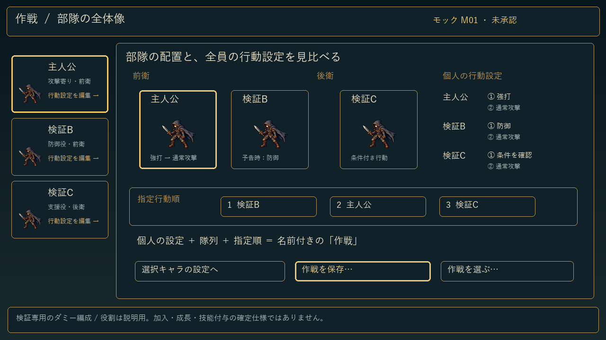
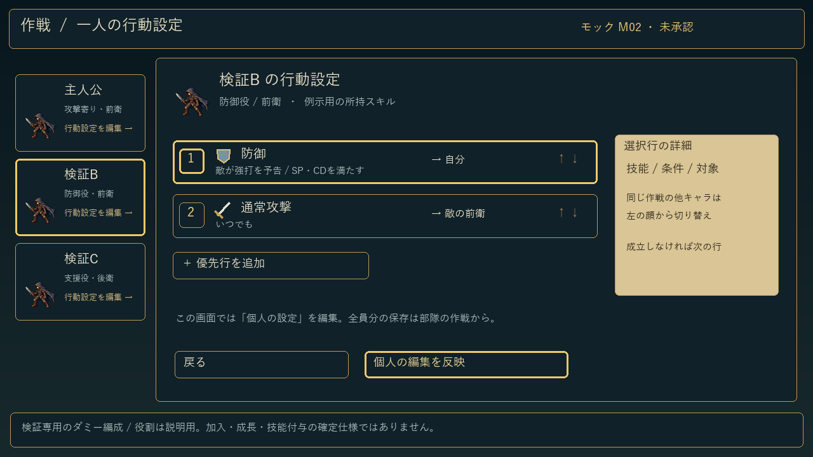
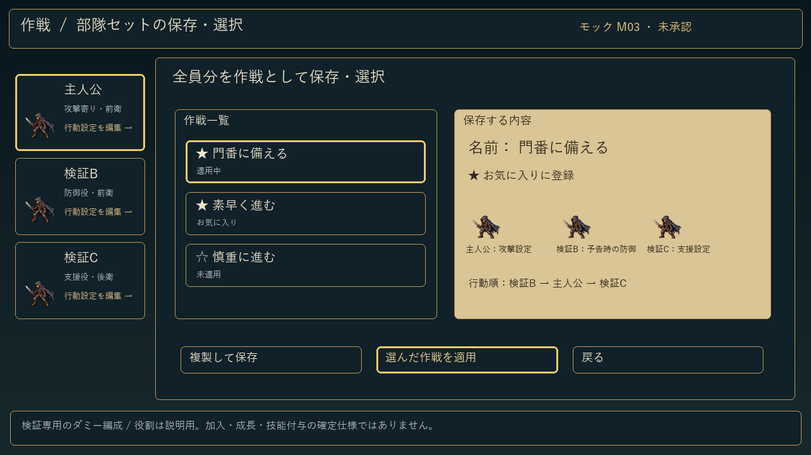
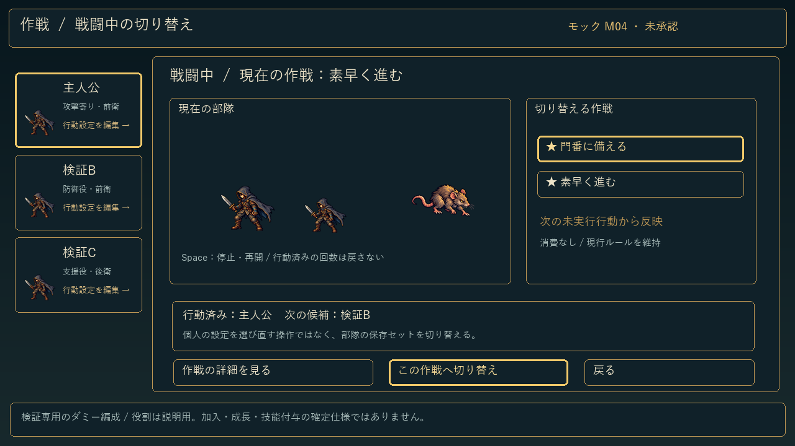

> 2026-10-21 追記：ユーザーがM01〜M04の構成を承認。以下の「未承認」は初回提出時の記録です。実装画面の評価・指摘は[別資料](REVIEW.md)で行います。既存の記入欄は保持します。

# 作戦UIモック — ユーザー確認用

状態：**未承認・配置／操作モック**。通常ゲームのUIを置換していません。版：0.11.0案、制作元：main `7c77ac2`（通常0.10.0）。1280×720。既存主人公素材を再使用したダミー編成です。検証B/Cの役割・技能は説明用で、加入・成長・技能付与の仕様を確定しません。

左の画像は原寸へリンクしています。右はユーザーの記入欄です。GitHubの**Markdown編集**で記入できます。表示ページ上で直接入力するフォームではありません。ユーザーの記入を保持し、対応結果は下の別欄へ追記します。

| 画面名・画面画像 | 私の指摘①、②、③ |
| --- | --- |
| **M01 部隊全体** 個人の設定・前後衛・指定順を見比べる。  [原寸画像](mocks/M01.png) | ①   ②   ③    |
| **M02 一人の行動設定** 顔から対象を選び、技能アイコン・条件・対象・優先順を編集。  [原寸画像](mocks/M02.png) | ①   ②   ③    |
| **M03 全員分を作戦として保存・選択** 名前・お気に入りと、含むキャラ設定・行動順を示す。  [原寸画像](mocks/M03.png) | ①   ②   ③    |
| **M04 戦闘中の切替** 現在の部隊を見ながら保存セットを変更。既存の次の未行動・無料・回数維持を使う。  [原寸画像](mocks/M04.png) | ①   ②   ③    |

## 担当者の対応記録（記入欄とは別）

- 初版：4状態を提出。装飾は既存の羊皮紙・暗い石・真鍮スキンへ接続する想定。画像はゲームのスクリーンショットではありません。
- 承認前は新作戦UIを実装・配布しません。0.10.0の既存作戦UIは維持。他の確定修正を先行します。
- 参照調査：[Ludeon公式の説明テキスト](https://github.com/Ludeon/RimWorld-ChineseSimplified/blob/master/Core/DefInjected/ConceptDef/Concepts_NotedSelfshow.xml)に、人物別の仕事設定と手動の数値優先度が説明されています。本モックでは一覧で比較しやすい構成と数字の優先表示だけを参考にしました。RimWorldの画像・UIスキン・優先度1〜4のルールは流用していません。数字はDive In Underの既存の行優先順です。
