# 実装画面レビュー — 0.11.0

これはGitHub Markdownの編集用資料です。右欄はユーザーの指摘記入用で、表示ページへ直接入力するフォームではありません。担当者の対応結果は別資料へ追記し、この欄の指摘を消しません。

解像度1280×720、配布用Windows EXE/PCKをクラウドの非対話Windows stationで描画。入力はゲームのViewport内。OSのマウス操作の証拠ではありません。撮影コミットとハッシュは[CI記録](ci.json)・[配布記録](local-release.json)、確認は[完了JSON](after/party-ui-review.json)へ記載します。画像がまだ無い間は確認未完了です。

通常の仲間加入・成長イベントは追加していません。「検証仲間」は今回の隔離確認専用で、正式キャラ画像未作成のため共通肖像を使います。[承認済みモック](MOCK_REVIEW.md)とは区別してください。モックの構成承認を、以下の実画面の見た目評価済みとは扱いません。

## P01 — 冒険準備

0.11.0／条件：通常の新規開始・主人公のみ。

|画面名・実画面|私の指摘|
|---|---|
|**P01 冒険準備** 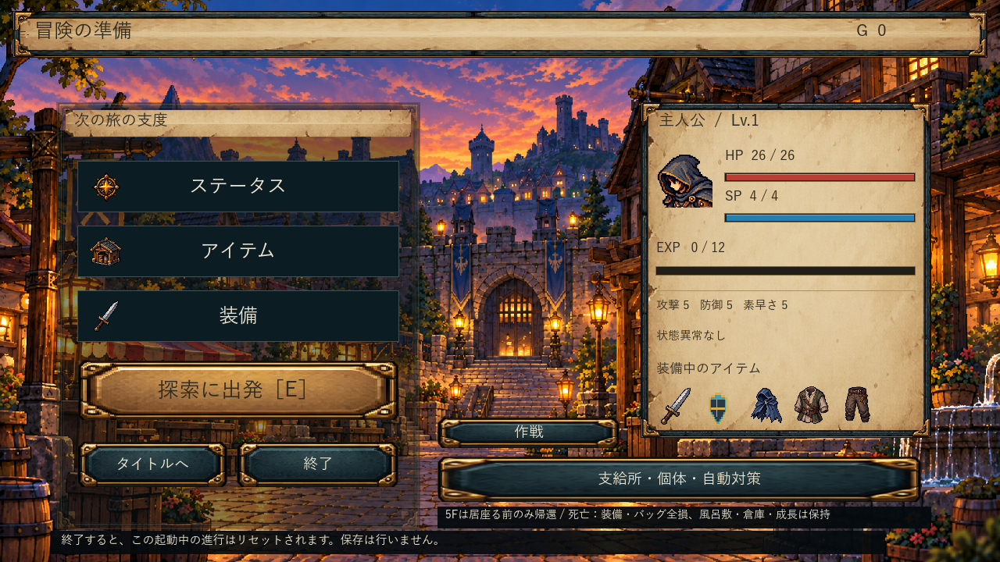 [原寸画像](after/01-normal-preparation.png)|①   ②   ③   |

## P02 — 装備／仲間選択

0.11.0／条件：検証用仲間B・装備前。

|画面名・実画面|私の指摘|
|---|---|
|**P02 装備／仲間選択** 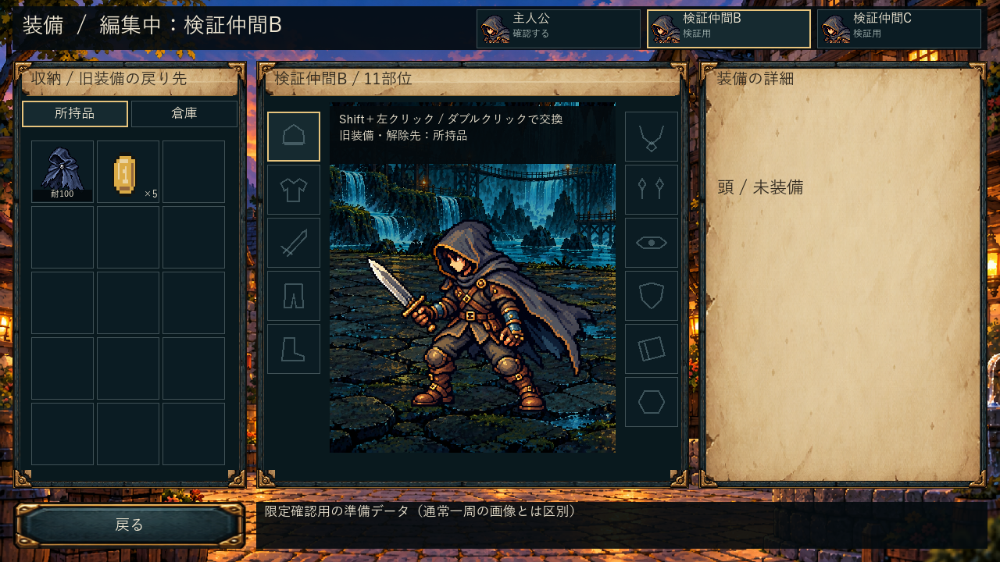 [原寸画像](after/02-equipment-companion.png)|①   ②   ③   |

## P03 — 装備／倉庫の指定マス

0.11.0／条件：検証仲間B・マス6へ解除後。

|画面名・実画面|私の指摘|
|---|---|
|**P03 装備／倉庫の指定マス** 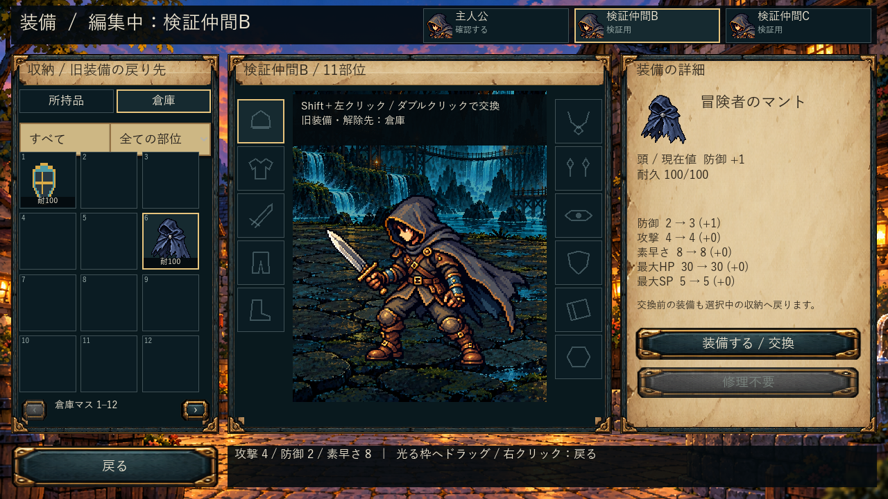 [原寸画像](after/03-equipment-warehouse.png)|①   ②   ③   |

## P04 — 装備／倉庫フィルタ

0.11.0／条件：防具・左手で絞り込み、元のマス番号を保持。

|画面名・実画面|私の指摘|
|---|---|
|**P04 装備／倉庫フィルタ** 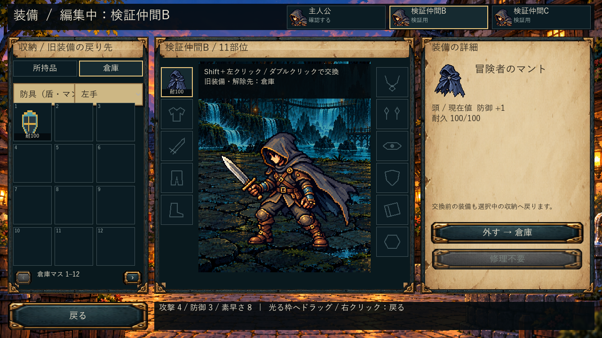 [原寸画像](after/04-equipment-filter.png)|①   ②   ③   |

## P05 — 装備／主人公へ切替

0.11.0／条件：同じ検証編成から主人公を選択。

|画面名・実画面|私の指摘|
|---|---|
|**P05 装備／主人公へ切替** 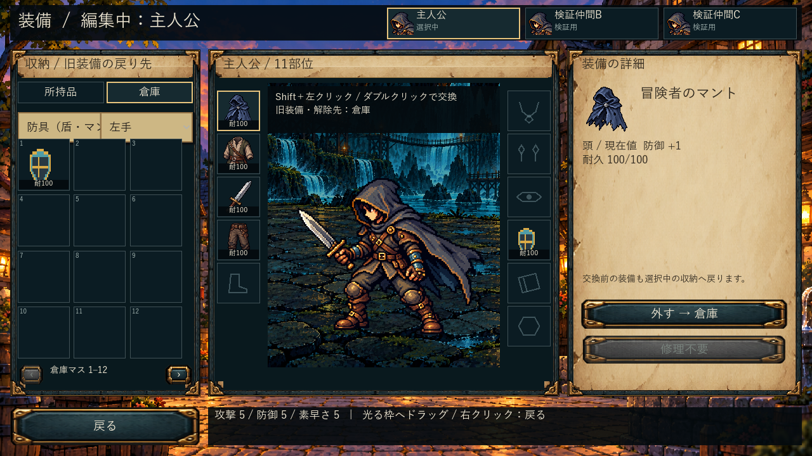 [原寸画像](after/05-equipment-hero.png)|①   ②   ③   |

## P06 — ステータス／主人公

0.11.0／条件：検証編成の主人公。

|画面名・実画面|私の指摘|
|---|---|
|**P06 ステータス／主人公** 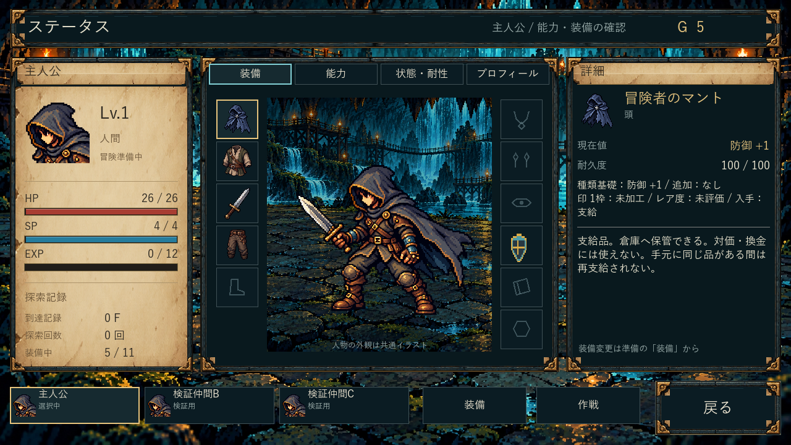 [原寸画像](after/06-status-hero.png)|①   ②   ③   |

## P07 — ステータス／仲間の能力

0.11.0／条件：検証仲間B、未実装能力を区別。

|画面名・実画面|私の指摘|
|---|---|
|**P07 ステータス／仲間の能力** 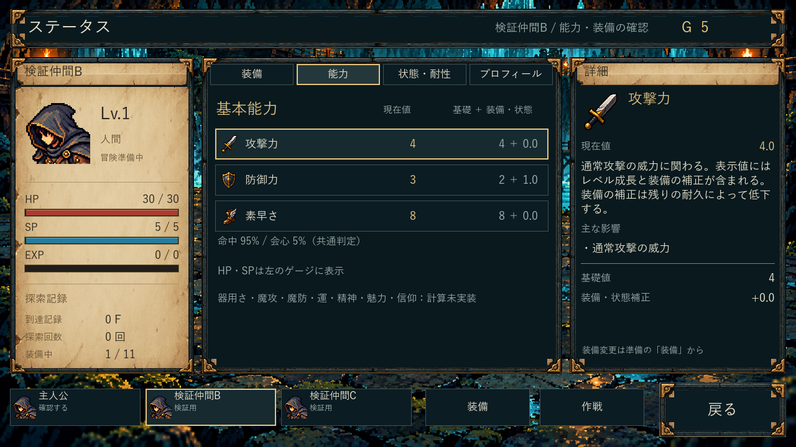 [原寸画像](after/07-status-companion-abilities.png)|①   ②   ③   |

## P08 — 作戦／部隊全体

0.11.0／条件：検証3名。モック承認後の実装画面。

|画面名・実画面|私の指摘|
|---|---|
|**P08 作戦／部隊全体** 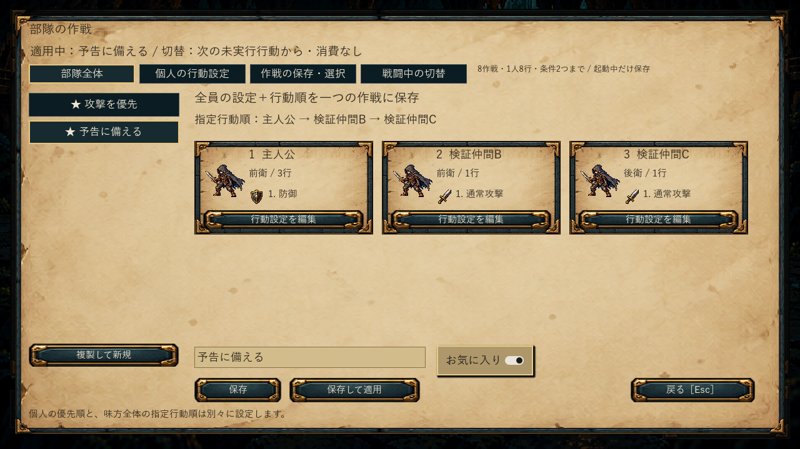 [原寸画像](after/08-tactics-overview.png)|①   ②   ③   |

## P09 — 作戦／個人の行動設定

0.11.0／条件：検証仲間B。技能・条件・対象・優先順。

|画面名・実画面|私の指摘|
|---|---|
|**P09 作戦／個人の行動設定** 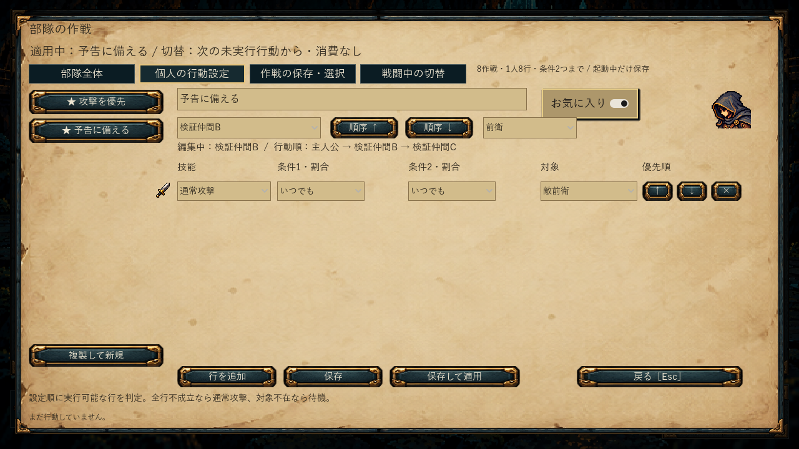 [原寸画像](after/09-tactics-individual.png)|①   ②   ③   |

## P10 — 作戦／全員分を保存・選択

0.11.0／条件：検証3名、名前・お気に入り・指定順を含む。

|画面名・実画面|私の指摘|
|---|---|
|**P10 作戦／全員分を保存・選択** 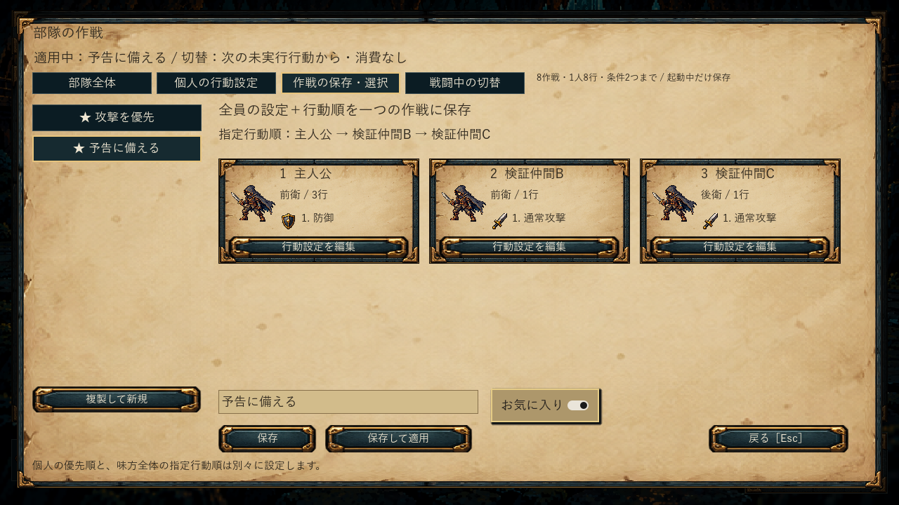 [原寸画像](after/10-tactics-save-select.png)|①   ②   ③   |

## P11 — アイテム／3カラム

0.11.0／条件：検証用の所持品・倉庫・実風呂敷。

|画面名・実画面|私の指摘|
|---|---|
|**P11 アイテム／3カラム** 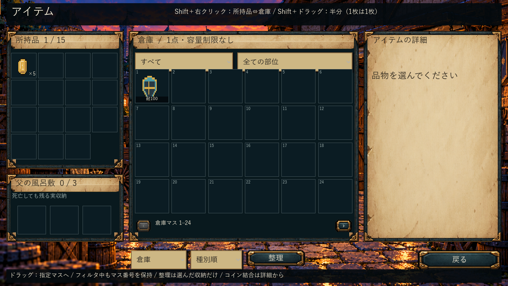 [原寸画像](after/11-items.png)|①   ②   ③   |

## P12 — アイテム／半分移動

0.11.0／条件：5枚から2枚を倉庫へ、3枚は所持品。

|画面名・実画面|私の指摘|
|---|---|
|**P12 アイテム／半分移動** 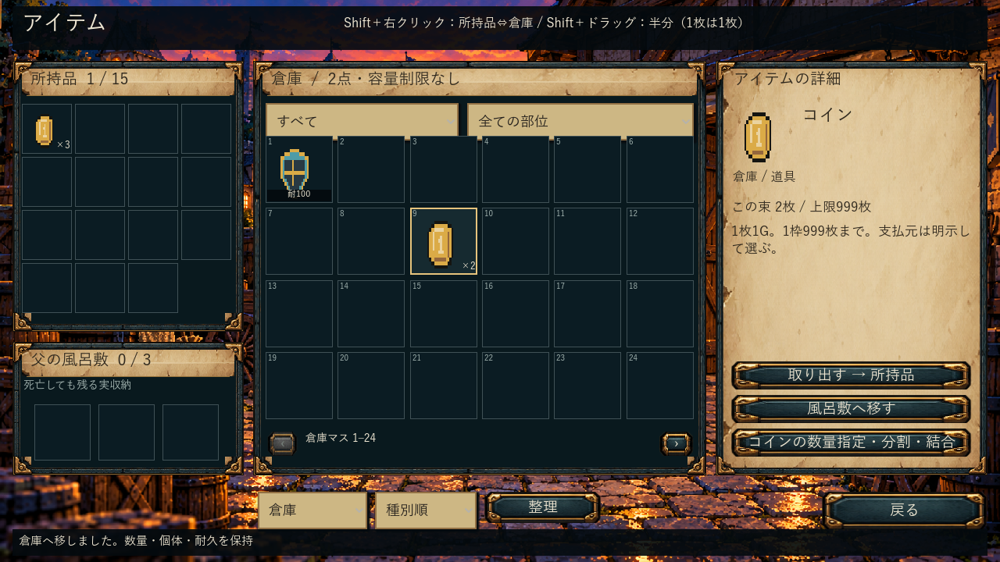 [原寸画像](after/12-items-half-stack.png)|①   ②   ③   |

## P13 — アイテム／手動配置

0.11.0／条件：倉庫の指定マスへ移動、整理前。

|画面名・実画面|私の指摘|
|---|---|
|**P13 アイテム／手動配置** 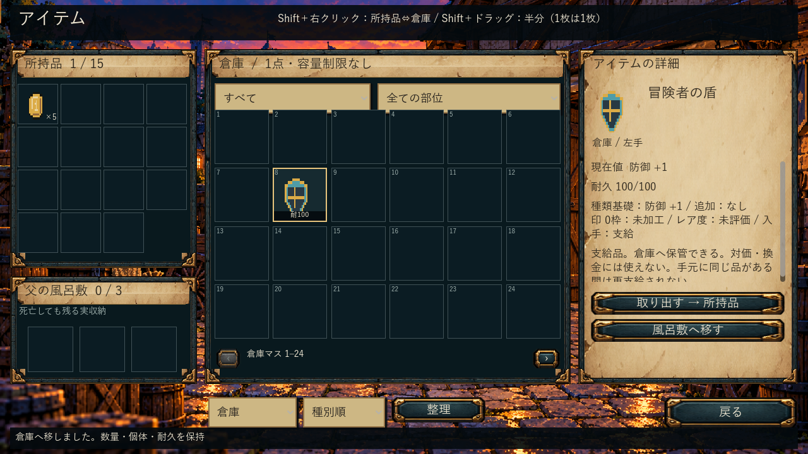 [原寸画像](after/13-items-manual-cells.png)|①   ②   ③   |

## P14 — 宝箱／入手前

0.11.0／条件：固定2Fの確認用状態。

|画面名・実画面|私の指摘|
|---|---|
|**P14 宝箱／入手前** 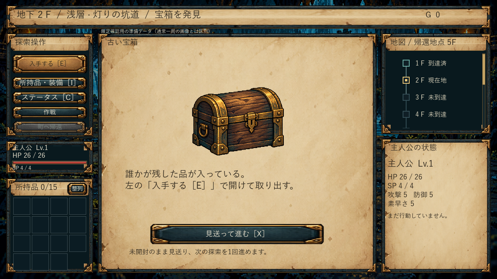 [原寸画像](after/14-chest-before.png)|①   ②   ③   |

## P15 — 宝箱／開封・取得完了

0.11.0／条件：空きがあるため入替を挟まず入手。

|画面名・実画面|私の指摘|
|---|---|
|**P15 宝箱／開封・取得完了** 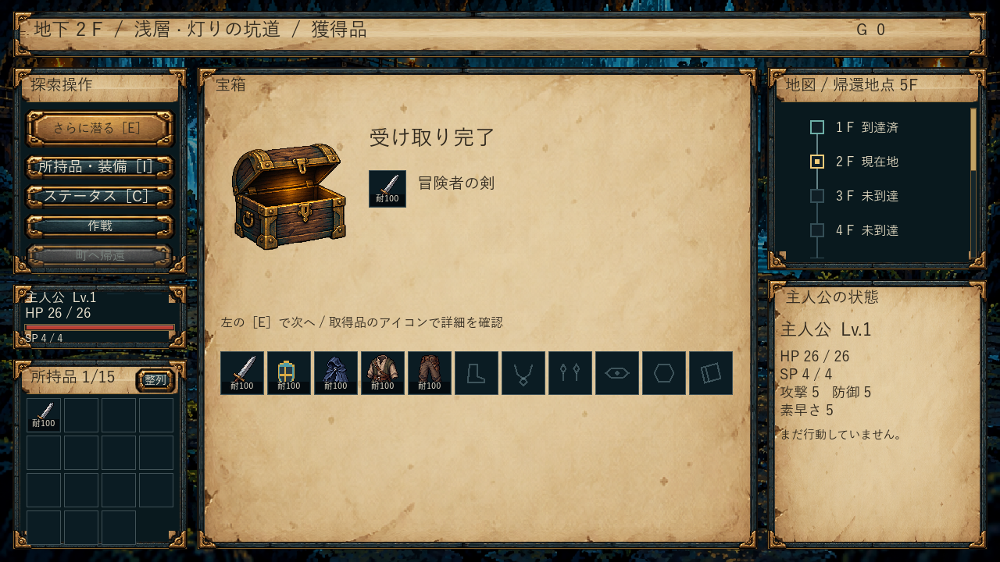 [原寸画像](after/15-chest-acquired.png)|①   ②   ③   |

## P16 — 降下演出

0.11.0／条件：同じ2Fから3Fへの0.18秒中の静止記録。

|画面名・実画面|私の指摘|
|---|---|
|**P16 降下演出** 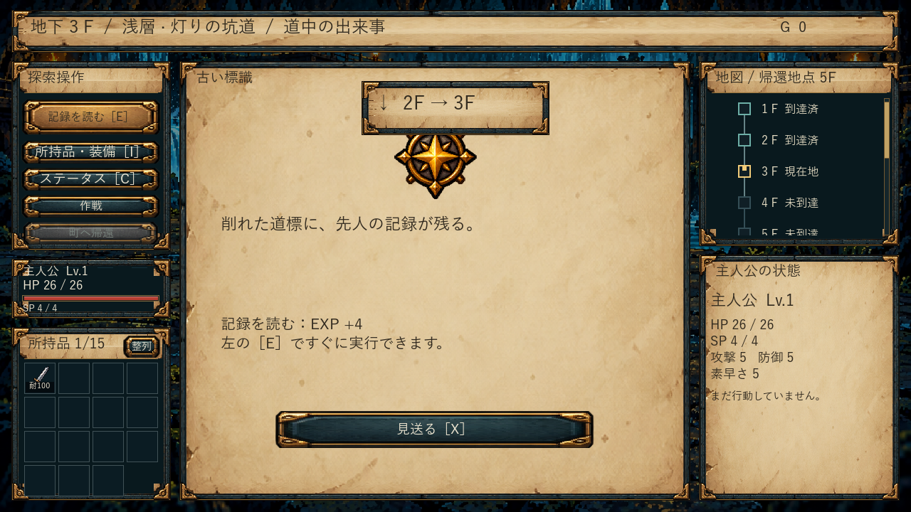 [原寸画像](after/16-descent.png)|①   ②   ③   |

## P17 — 探索・出来事

0.11.0／条件：降下後。左操作・右上地図の位置を維持。

|画面名・実画面|私の指摘|
|---|---|
|**P17 探索・出来事** 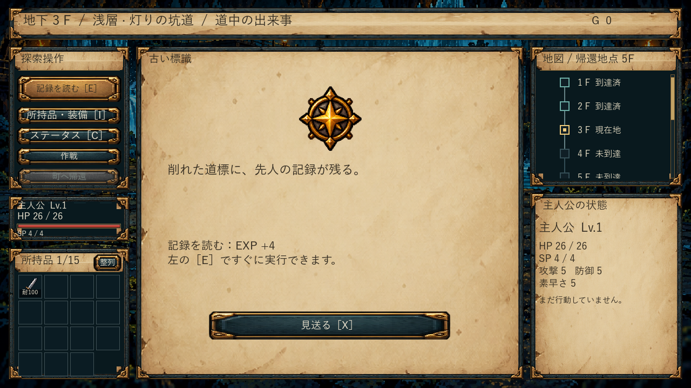 [原寸画像](after/16-exploration.png)|①   ②   ③   |

## P18 — 戦利品／所持品満杯・取得前

0.11.0／条件：確認用15枠。初めは入手する。

|画面名・実画面|私の指摘|
|---|---|
|**P18 戦利品／所持品満杯・取得前** 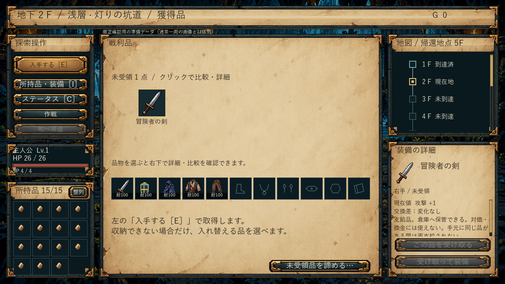 [原寸画像](after/17-loot-full-before.png)|①   ②   ③   |

## P19 — 戦利品／入替する所持品を選ぶ

0.11.0／条件：入らない場合だけ表示。

|画面名・実画面|私の指摘|
|---|---|
|**P19 戦利品／入替する所持品を選ぶ** 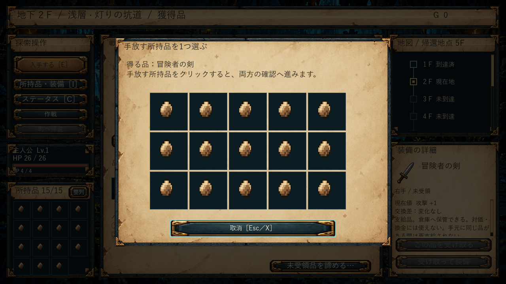 [原寸画像](after/18-loot-replace.png)|①   ②   ③   |

## P20 — 戦利品／入替取消

0.11.0／条件：未取得品を保持。

|画面名・実画面|私の指摘|
|---|---|
|**P20 戦利品／入替取消** 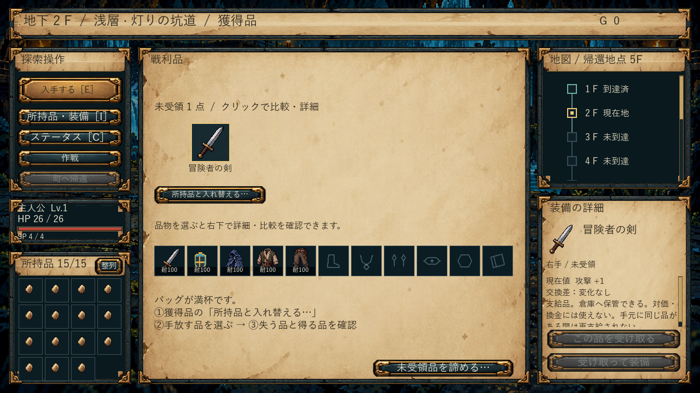 [原寸画像](after/19-loot-cancelled.png)|①   ②   ③   |

## P21 — ポータル／5Fの二択

0.11.0／条件：確認用の5F到着時・居座る前。

|画面名・実画面|私の指摘|
|---|---|
|**P21 ポータル／5Fの二択** 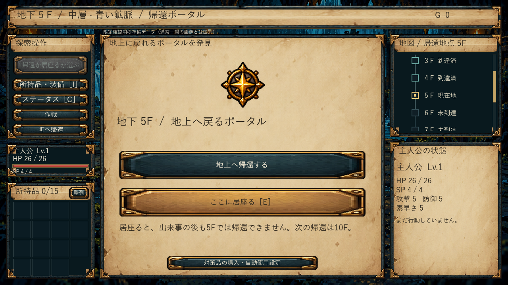 [原寸画像](after/20-portal-five.png)|①   ②   ③   |

## P22 — 作戦／戦闘中に切替

0.11.0／条件：固定通常戦闘。行動済みを維持。

|画面名・実画面|私の指摘|
|---|---|
|**P22 作戦／戦闘中に切替** 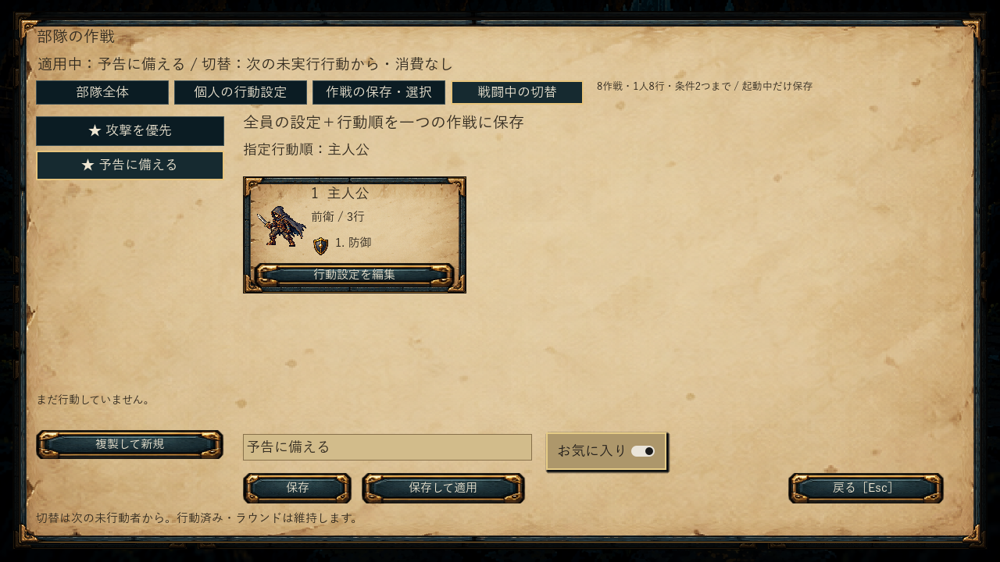 [原寸画像](after/21-tactics-battle-switch.png)|①   ②   ③   |

