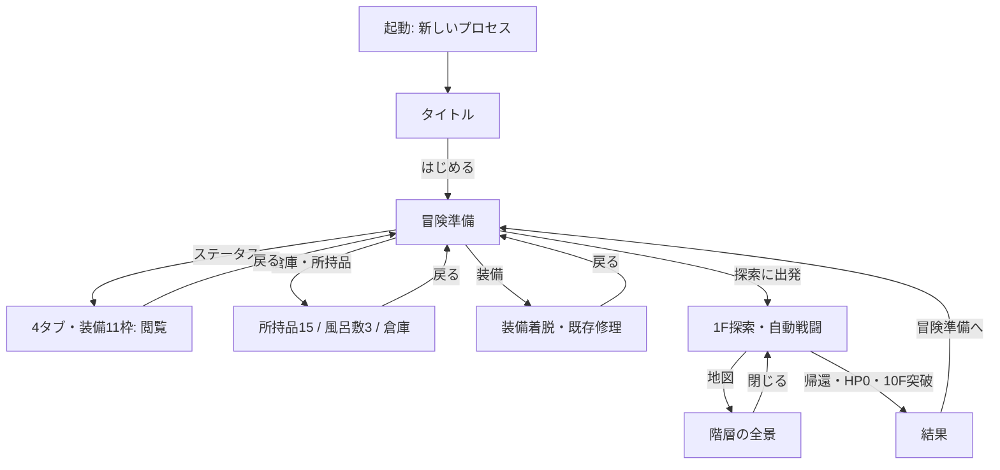

# Dive In Under 0.6.0 — 参考UI統合と通常画面の改善

通常入口へ反映する実ゲームの資料。[比較ビュー](index.html)／[全参考索引](../../docs/UI_REFERENCE_INDEX.md)／[素材不足](../../docs/UI_INTEGRATION_ASSETS.md)。

実行ソース `1c39a5c13e4626c2914f49aae47ee76ecbfcb6aa`、[クラウドCI 39150351325](https://github.com/shirai-masatomo/whitespace/actions/runs/39150351325)。ビルド・描画はクラウド。ローカルは告知済みの画面なし素材取込／構文確認2回（約6秒と4秒）、ファイル取得・照合・配置。通常デスクトップでゲームは起動していない。フリーズ原因を特定したという主張ではない。

## 実装済み

- 起動 → タイトル「はじめる」→冒険準備→出発→1F。準備からステータス／倉庫・所持品／装備へ。帰還・死亡・突破結果から準備へ戻る。
- 通常モードはSaveStoreを生成せず、旧保存を読まない／書かない。「続きから」「保存済み」「自動保存済み」を出さない。同じ起動中の成長・所持品・収納を保持し、別プロセスは新規開始。
- ユーザー提供の独立した地上町3背景をタイトル／準備／倉庫へ適用。完成UI参考はゲームへ書き出さない。
- 羊皮紙・石・真鍮枠・ボタンを共用。HP/SP/EXPは実値で伸びるネイティブ描画。能力・状態と収納アイコンは提供シートの独立領域を参照。
- ステータス4タブ／11枠、固定の左基本情報、中央立ち絵、右スクロール詳細を維持。装備選択は閲覧のみ、変更は別画面。主人公1人、将来5枠は操作不可。
- 倉庫は左の所持品15＋風呂敷3／中央6列グリッド／右の羊皮紙詳細。カテゴリ・整理・預入／引出／風呂敷移動と個別耐久を維持。
- 探索・戦闘は16:9洞窟の中央ステージ、左の進行、右の実ゲージと地図、下の記録。完全自動戦闘、速度切替のみ。既存キャラ・敵・洞窟の画風と比率を維持。
- 地図は前・現・次、クリックで全景。現行コアの1〜10F主経路と11F到達点のみを表示、出来事の種別は非公開。

## 参考と実画面の比較

| 画面 | 参考と実EXE | 改善前後 |
| --- | --- | --- |
| タイトル | [比較](after/comparison-title.png) | [前後](after/before-after-title.png) |
| 準備 | [比較](after/comparison-preparation.png) | [前後](after/before-after-preparation.png) |
| 倉庫 | [比較](after/comparison-warehouse.png) | [前後](after/before-after-warehouse.png) |
| ステータス | [比較](after/comparison-status-equipment.png) | [前後](after/before-after-status-equipment.png) |
| 探索 | [比較](after/comparison-exploration.png) | [前後](after/before-after-exploration.png) |
| 戦闘 | [比較](after/comparison-battle.png) | [前後](after/before-after-battle.png) |

変更前のタイトル・町・探索・戦闘は登録コミットb824eae0の0.4.6-normal-first-expedition、倉庫・ステータスはbddfa5eeに登録した0.5.4の保存済み実画面。同一セーブや同一版の数値比較ではない。元ファイル・版・SHAはマニフェストで区別。after/は今回CIの実EXEを1280×720で描画したPNG。comparisonは原画とPNGをそのまま並べた2560×1050の資料。

[装備](after/status-equipment.png)／[能力](after/status-abilities.png)／[状態・耐性](after/status-conditions.png)／[プロフィール](after/status-profile.png)／[装備変更画面](after/equipment.png)／[全景地図](after/map.png)／[ボス](after/boss.png)／[イベント](after/event.png)／[帰還](after/return.png)／[死亡結果](after/death.png)／[突破結果](after/clear.png)。

## 画面遷移と操作

タブクリックで同じ画面の中央と右を切替。装備枠クリックで詳細だけ変更。倉庫のアイテム選択後に下部操作で移動。装備画面の「装備する」「装備を外す」を押した場合だけ装備データを変更する。マウス操作が基本、実ButtonのTab/Enter、ステータスの1〜4・左右・Esc等は維持。

## 軽量確認と証拠

[evidence/integration-review.json](evidence/integration-review.json)、[別プロセス](evidence/integration-restart.json)、[隔離1](evidence/isolation.json)、[隔離2](evidence/isolation-restart.json)、[CI出典](ci.json)。

隔離デスクトップ2プロセス、各60秒上限、通常デスクトップへのフォールバックなし。4タブ・11枠の表示／選択で状態不変、倉庫往復のUIDと耐久保持、風呂敷移動、明示的着脱、出発1F、自動進行、地図開閉、帰還でメモリ保持、死亡結果から準備、再起動新規を確認。隔離先へ置いた旧セーブ相当の番兵ファイルは前後SHA不変。実ユーザーの保存領域にはアクセスしない。

core/dataは0.5.4ソースa5c3c69から未変更。既存のコア検証を再利用し、大量seed・勝率・10Fキャンペーン反復は再実行していない。今回の死亡・突破・ボス・イベント等は画面用の固定状態を含み、通常攻略・死亡率・10F突破の新たな証拠ではない。新規の通常画面へ検証アイテムを入れていない。各PNGの検証状態区分はintegration-review.jsonを参照。

## 画面レビューと修正履歴

最初の隔離CI39149718800（c89452e）の実画面で次を検出し、修正コミットb3932d7・1c39a5cの後、最終CIで再撮影。

| 観点 | 発見・修正 | 再確認 |
| --- | --- | --- |
| 余白・見切れ | 準備説明と装備説明が伸びる。折返し設定後に寸法を確定、準備説明を専用の小枠へ | 準備・装備の説明が枠内 |
| 重なり | 人物の描画優先度が全景地図より高い | 地図を専用の高い描画層へ。人物と地図の重なり解消 |
| 撮影対象 | 通常戦闘の撮影までに勝利 | 実コアの自動進行確認と、戦闘中PNGの取得タイミングを分離 |
| 優先順位 | 準備の主要ボタンの文字が小さい | 主要25px、出発27px、タイトル開始30pxへ |
| 質感・アイコン | 右詳細が暗いまま。状態・収納アイコンのばらつき | 倉庫詳細を羊皮紙へ、提供シートを適用 |
| 接地・遠近 | 人物・通常敵・ボスの足元と床 | 比率を崩さず、奥の敵と手前の主人公の既存位置関係を維持 |

**A 描画成立**：実画像・実数値・4タブ・各画面・主要操作が描画され、フリーズ／タイムアウト／エンジンエラーなし。
**B 自然さ**：人物と敵の接地、連続床、前景余白、16:9背景、奥の敵と手前の主人公、モーダルの前後関係を実画面で確認。全体の構図・質感は改善したが、参考の精密なロゴ・小さな装備空枠・ゲージ端装飾と完全同一ではない。元素材の高解像度ピクセル調も維持し、厳密な32pxグリッドへ再作画はしていない。

## 未完成・保留・意図的な不採用

| 区分 | 内容 |
| --- | --- |
| 仕様待ち | 固定分岐の具体的ノード・接続・進入条件が未定。地図は現行の主経路まで。分岐のゲームコア移行は未実装 |
| 画像の仕上げ | ロゴ単独透過、細い9-slice、タブ・空枠・ゲージ端・スクロールの独立部品。[サイズ・透過・枚数](../../docs/UI_INTEGRATION_ASSETS.md) |
| 既存工程2の未決 | 初期装備残り4点の正式性能、死亡全損／再調達、支給所、満杯時の報酬処理。今回のUI変更で戦闘／損失設定は変更しない |
| 不採用 | 参考画像の仮数値・人物設定・属性0%・手動戦闘コマンド・仲間の先行実装・画面全体画像への操作割当 |
| 保管のみ | 旧地下町背景、地下倉庫背景、その重複原本、収納下段の重なった発光、未定義の装備4点の素材 |
| 意図して維持 | 倉庫容量無制限／個別1点方式、主人公の共通立ち絵（装備に連動した着せ替えではない）、未決プロフィール・属性は未設定表示 |

元ファイルと旧リリースは保持。モデル設定変更なし。過去のPCフリーズ原因は未確定であり、今回の短時間隔離確認を原因解明や負荷耐性の保証として扱わない。
