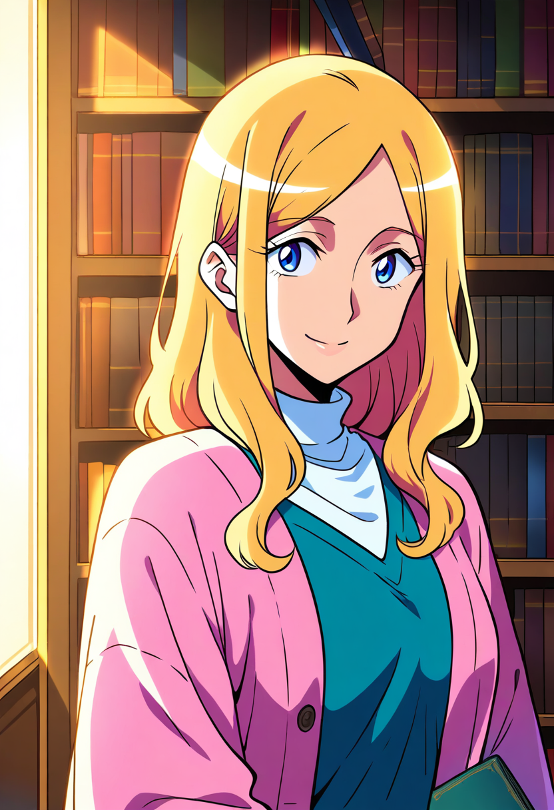

# ローカルAI画像モデル比較

**現在の作品方針:** [固定台詞・BGM/SE・セーブ/ロード・バックログ・回想を中心とするノベルゲーム](GAME_REQUIREMENTS.md)。Qwen3とllama.cppは不要との指示で削除済み。Godotは検証デモとして保持し、本編エンジンの採用は未確定。

**キャラ差分制作:** [衣装・表情・ポーズ・背景を変える作業手順書](workshop/README.md) / [実際の品質比較と推奨](workshop/QUALITY_COMPARISON.md)。2026-10-20に内蔵画像編集5枚、ComfyUIで3課題＋再試行2枚を確認。基準画像、マスク、画面用ワークフロー、操作・調整・採否の手順を収録。

**3モデル×2シード＝6枚の共通条件比較**と、**Animagine 4.0 Optの通常設定テスト1枚**を載せた確認用ギャラリー。2026-10-19にWindows PCのComfyUIで実機生成。一般向けの服を着た人物のみ。

**同一キャラクターの別構図・衣装・背景を作る手順**: [ChatGPT画像編集／ComfyUI／Codexの使い分けと実務プレイブック](CHARACTER_VARIATION_PLAYBOOK.md)。現在の環境の検証済み・未検証を区別し、img2img、Inpainting、OpenPose、IP-Adapterの導入・確認手順を記載。

**今回、新規の有料契約・アカウント登録・無料体験の申込み・支払いはしていない。モデルの取得とローカル生成に従量課金はない。** PCの電気代・契約に応じた通信費、および既存のCodex契約・利用枠は別。詳しくは [料金・利用条件](USAGE.md)。

**別系統の画風も見る:** [Web上の公式参考画像（Animagine / Illustrious / Pony、NoobAIはリンク）](WEB_REFERENCES.md)。モデルを追加取得せずに閲覧できる外部作例で、このPCの生成結果とは区別する。

**現在のPC構成:** 通常用は **Animagine XL 4.0 Opt**。導入済みの無料公開版を使用し、SDXL Baseの重みはユーザーの希望で削除した。下のSDXL画像は過去の比較記録として残している。通常生成は [`09-animagine40-normal.json`](workflows/09-animagine40-normal.json) をComfyUIに読み込む。SDXL Base削除後の一般向け生成に成功。切替後の局所Inpaintingは今回実行し、口の修正は候補、手振りと衣装変更は再試行を含め不採用だった。全身参照・ポーズの品質合格は確認できていない。[検証範囲](workshop/QUALITY_COMPARISON.md)

## 画像を比較する

金髪・青い瞳・28歳の成人女性・私服・図書館という共通の文章指示。上段はシード419274、下段は419275。画像をクリックすると原寸で確認できる。

| SDXL Base 1.0 | Animagine XL 3.1 | Animagine XL 4.0 Opt |
| --- | --- | --- |
|  |  |  |
|  |  |  |

今回の出力では、SDXLは柔らかい陰影、Animagine 3.1は明瞭な輪郭線とセル塗り、4.0 Optは強めの彩度・明暗差が出た。単一題材・2シードでの観察であり、モデル全体の優劣や固定の画風とは断定しない。衣装の色や形が指示から変わる例もある。

## Animagine 4.0 Optの通常設定テスト（追加）

**直近に生成して確認した画像はこれ。** 2026-10-19 23:47（日本時間）に、SDXL Baseを削除した後のAnimagine XL 4.0 Optで生成した。2026-10-20に比較ページへ追加した。

832×1216、seed **42006**、28 steps、CFG 5、Euler ancestral / normal。[設定](workflows/09-animagine40-normal.json) / [生成記録](normal-settings-record.json)。上の6枚とはプロンプトが違うため、通常用設定の参考例として区別する。

## 再現と調整

- 共通設定: 832×1216、28 steps、CFG 5、Euler ancestral / normal、batch 1。
- 指示の全文・シード・出力SHA256・処理時間: [生成記録](generation-record.json)。
- モデルの固定版・公式入手先・SHA256: [モデル台帳](model-manifest.json)。
- [workflows](workflows/) の `.json` をComfyUIにドラッグして実行する。`.api.json` はAPI用。
- 保存PNGにもprompt・workflow・使用モデルの版とハッシュを保持しているため、PNGからも設定を読み込める。

全モデルに同じ文章・設定を使った比較。各モデル専用タグで最高品質を追求したものではない。モデルが変われば同じシードでも顔や構図は一致しない。添付された参考画像そのものはモデルへ入力していない。

## このフォルダーの範囲

比較画像6枚と通常設定テスト1枚、キャラ差分制作の作業手順・一般向け比較画像、ワークフロー、生成条件、利用条件を収録する。モデル重み・Python・CUDA・ComfyUI本体・APIキー・個人を特定するローカル情報は含めない。既存ゲームへの素材採用・コード統合は行わない。画像は制作方法を確認する試作で、販売用の権利確認・仕上げを済ませた素材とは扱わない。
