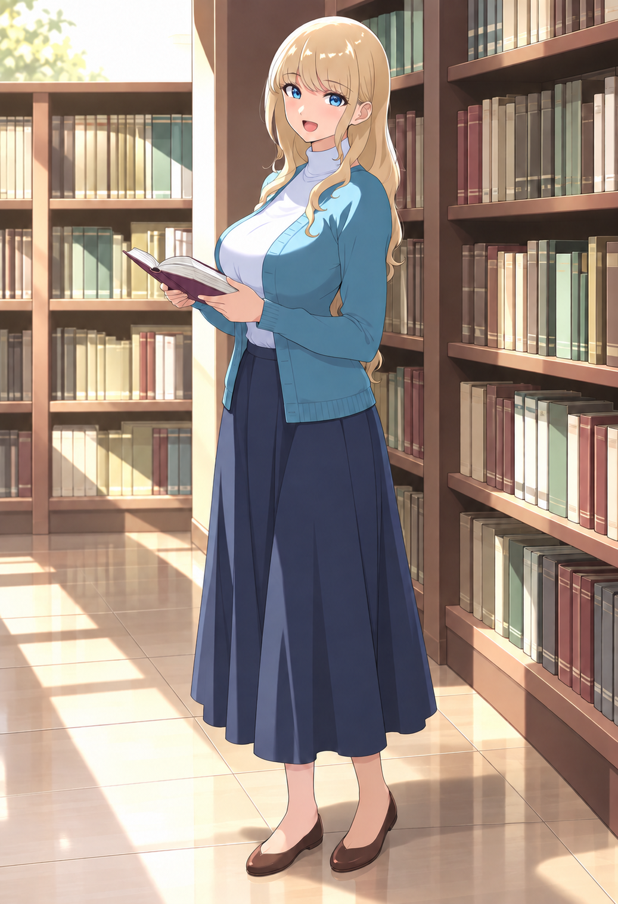
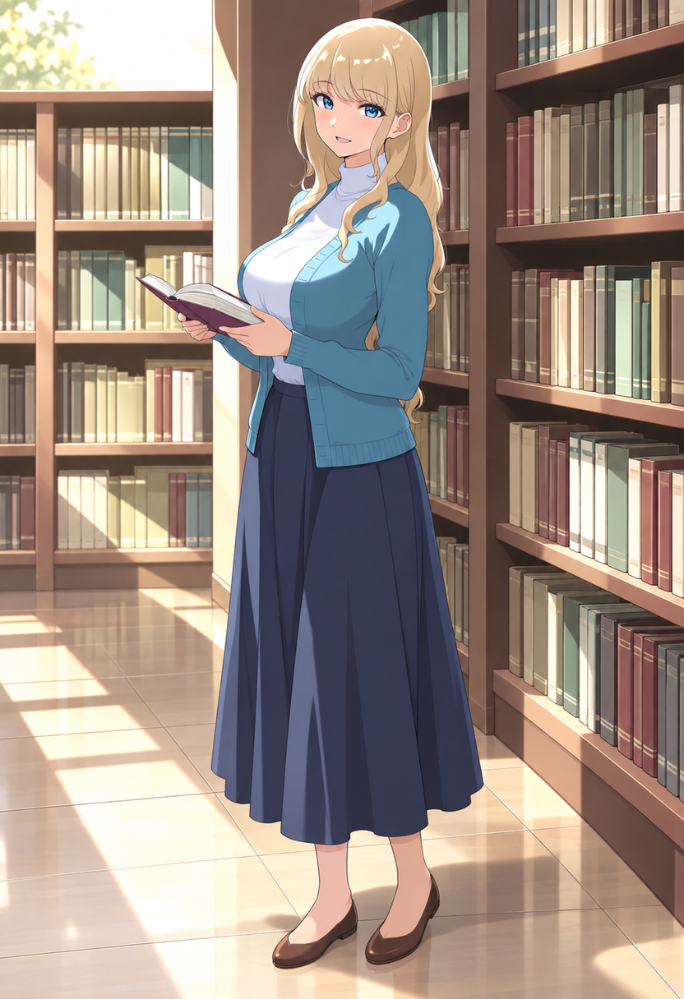
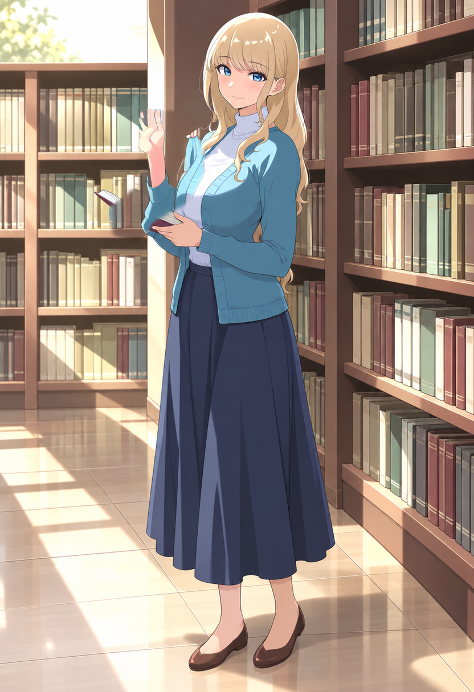
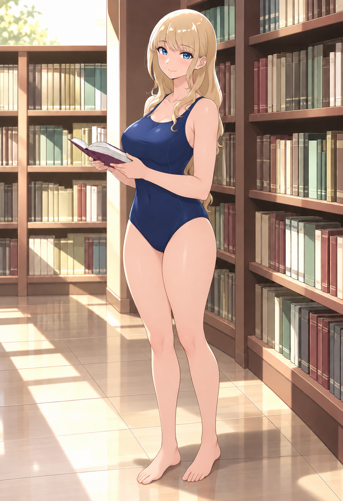
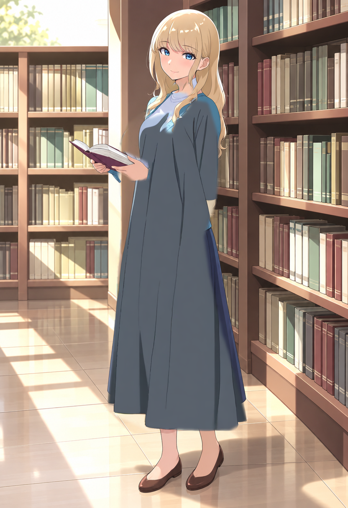
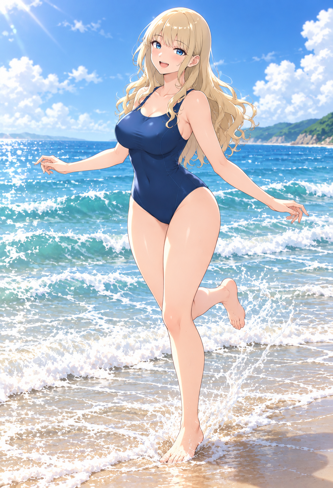

# 同一キャラクターの差分制作 品質比較と推奨手順

実施日: 2026-10-20。**今回の基準キャラでは、服装や構図を変える主工程は内蔵画像編集機能、ComfyUIは限定した表情・細部の修正へ使う方法が有力だった。** ComfyUIを使う割合より、人物の一致と自然な仕上がりを優先する。

これは1キャラに対する実用比較。画像編集5枚、ComfyUIの3課題と2回の再試行を確認した。全モデルの最高品質を決める網羅的ベンチマークではなく、未導入のモデルがこれ以上にならないとは言えない。

## 比較した条件

共通の [Image A](assets/image_a.png) から、次の変更を分けて試した。

| 課題 | 変えるもの | 維持するもの |
| --- | --- | --- |
| 表情 | 口を開けた嬉しい笑顔 | 顔立ち、髪、衣装、姿勢、本、図書館 |
| 手振り | 左手で本を持ち、右手を肩の横で振る | 顔、髪、衣装、立ち姿、図書館 |
| 服装 | 不透明な紺色スポーツ用ワンピース水着、裸足 | 顔、髪、体格感、姿勢、本、図書館 |

内蔵画像編集にはImage A原本を入力。ComfyUIは832×1216の作業版を入力し、顔や画風を全面再生成する方法に固執せず、**変更箇所だけマスクして元絵を合成する方法**を試した。表情は口を含む部分を拡大して処理した。編集の説明は意味をそろえたが、各方式に合う文章や制御を使っており、同じ文字列・解像度・計算量の純粋なモデル比較ではない。

この比較で「同じ人物」と判定するのは目視。人物一致率などの自動スコアは算出していない。全身服の下の腰・脚は原本では見えないため、水着姿の体形は推定を含む。

## 実際の出力

クリックすると元サイズで見られる。右列は初回と再試行の両方を残し、失敗を成功例として扱わない。

| 課題 | 内蔵画像編集 | ComfyUIとAnimagine 4.0 Opt |
| --- | --- | --- |
| 笑顔 |  |  |
| 手振り |  |  [初回](assets/benchmark/comfy-pose.png) |
| 衣装 |  |  [再試行では別の顔と身体が発生](assets/benchmark/comfy-clothing-retry.png) |

### 観察と採否

| 課題 | 内蔵画像編集 | ComfyUI |
| --- | --- | --- |
| 表情 | 顔と線・塗りを保ち、嬉しい開口表情になった。採用候補 | 小さな開口表情を作れた。全身と背景を保全。局所修正の候補 |
| 手振り | 肩横の手振りと、本を片手で持つ構図が成立。採用候補 | 初回は手が上がらない。骨格追加後は手が上がるが、指や本の断片、袖の接続に破綻。不採用 |
| 衣装 | 元の顔と画風に近い水着姿を作れた。体形は新たな推定。採用候補 | 初回は長い服が残る。マスク拡大・denoise 1.0・禁止語追加後は別の顔と身体が混入。不採用 |

再試行は各失敗を直すための一回。ComfyUIのマスクは手で指定した多角形なので、境界をさらに精密化した結果までは評価していない。マスクの不適切さ、Animagineの適性、設定の影響を完全に分離した実験でもない。「ComfyUI全般の品質が低い」という結論にはしない。

### マスク外の保全を数値で確認

ComfyUIの5出力すべてで、**マスク値が0の領域について、作業用Image AとのRGB差分は0画素**だった。[実測記録](records/benchmark-results.json)

これは合成処理による保全の確認であり、描き直した手や服の品質が良いことを意味しない。顔を完全に残せても、身体や本が壊れれば完成品としては不採用となる。

## 大きな構図変更と複合変更

内蔵画像編集で、さらに次の2枚を作成した。

| 図書館で座る | 水着で海辺を軽く走る |
| --- | --- |
|  |  |

- **座位:** Image Aから作成。同じ上着・スカート・靴、本を膝に置く姿勢、ベンチとの接触が概ね成立。頭の角度とまぶたの形など細部は変化している。
- **海辺:** Image Aを顔と画風、採用候補の水着画像を衣装参照として同時に入力。海辺の背景、楽しそうな表情、片足を上げる動作を作成。髪の巻き方や体の輪郭には変化があり、元画像の完全複製とは扱わない。

この2条件のComfyUI出力は作っていない。前段の手振り・衣装の採用条件を満たさなかったため、失敗した人物を海へ移す試行を重ねることはしなかった。**背景置換・全身の走る構図を同条件で比較した結果ではない。**

これらは制作候補であり、ゲームへそのまま採用済みの完成素材ではない。最終的な手指、足先、衣服、キャラの一致は用途の解像度で確認する。

## このキャラで品質を優先する制作順序

1. **基準画像を固定する。** Image A、顔の特徴、髪、体格感、年齢感、画風を記録する。
2. **内蔵画像編集で衣装差分を作る。** まず背景と姿勢を変えず、顔と体形の変化を確認する。
3. **承認できた画像だけを参照へ追加する。** 次の構図では「Image Aは人物、衣装画像は服装」と役割を分ける。失敗した派生画像を基準へ混ぜない。
4. **構図と感情を指定する。** 一つずつ検証し、うまくいった条件を組み合わせる。大きな変更で必要なら、元のImage Aも毎回参照する。
5. **同じ人物に見える候補を先に選ぶ。** 顔が別人の絵を、背景や細部の修正で救おうとしない。
6. **ComfyUIは改善が確認できる箇所に使う。** 今回は口の部分拡大修正が該当。元の線や色へ戻す合成も利用する。別の顔・指へ悪化したら直前の採用画像へ戻す。
7. **書き出しと最終確認。** 必要サイズで線、指、衣装の接続、接地、背景の光を確認する。学習済み超解像を使っていない拡大を「AIで高品質化」と表現しない。

改善点がない画像を必ずComfyUIへ通す必要はない。元の顔・画風を保持する目的では、全面をAnimagineで再生成すると、良かった絵を変えてしまうリスクがある。

## 未導入モデルも含めた調査

ComfyUIは別の画像編集モデルも実行できる。現在のAnimagineとIPAdapterだけが選択肢ではない。ただし、公式の作例が良いという理由だけで、このキャラでも最良とは決めない。

| 候補 | この用途との関係 | このPCでの確認 |
| --- | --- | --- |
| Qwen Image Edit 2511 | 公式が人物一貫性の改善を説明する画像編集モデル。Apache-2.0。20B/BF16なので重みだけで概算40GB、さらに実行用メモリが必要。量子化やオフロードは別途検証が必要 | 未導入・未生成。12GB VRAMへ通常版がそのまま載る構成ではない |
| FLUX.2 klein 4B | 複数参照編集、Apache-2.0。公式カードのVRAM目安は約13GB | 未導入・未生成。12GB環境での動作・画質を保証しない |
| FLUX.2 klein 9B | 4Bとは別の非商用ライセンス | 未導入・未生成。商用ゲーム素材用として無条件採用しない |

各候補の一次資料は [SOURCES.md](SOURCES.md)。追加検証を行う場合も、先に同じ3課題の出力を見て、量子化やモデル変更によって顔と画風がどう変わるかを判断する。

## 再現と検証範囲

- [内蔵機能の全プロンプト](records/builtin-prompts.json)。原本または原本と採用衣装を参照。シードと厳密な内部モデル版はツールから取得できない。
- [ComfyUIの出力ハッシュ・シード・denoise・所要時間](records/benchmark-results.json)。実験は30–34のUI/APIファイルと入力RGBAを公開。
- 実験用入力も配置する場合は、リポジトリルートで `& '.\tools\local-ai-foundation\Python.cmd' '.\projects\local-ai-image-lab\workshop\scripts\prepare_inputs.py' --include-benchmark` を実行し、30–34の `.json` をComfyUIで開く。実験の不採用条件を再現するためのもので、完成素材を保証するワークフローではない。
- 口の修正は約8秒、他のローカル試行は約10–14秒。サンプリングしたGPU使用量は約8.5–11GB。これは今回の条件の観測値で、ピークを完全に捕捉するものではない。
- 手順用の00、20–24はノード構造の確認済み雛形。**30–34の実行成功を、そのまま20–24全条件の画質合格とは扱わない。** 特に21の全身再生成と22の背景変更は今回の画質試験を行っていない。
- 新しいモデル・拡張の導入、アカウント登録、支払い、外部有料APIの呼び出しはしていない。内蔵画像編集5枚は既存のCodex利用枠を消費した。ローカル実行にはPCの電力等が必要。

GitHubへは小規模な比較画像と手順だけを置く。今回の比較用アセットは約21MBで、モデル重みは含めない。大量の候補を制作する運用では全候補をGitへ追加せず、採用例と生成記録に絞り、残りは別ストレージへ保管する。
