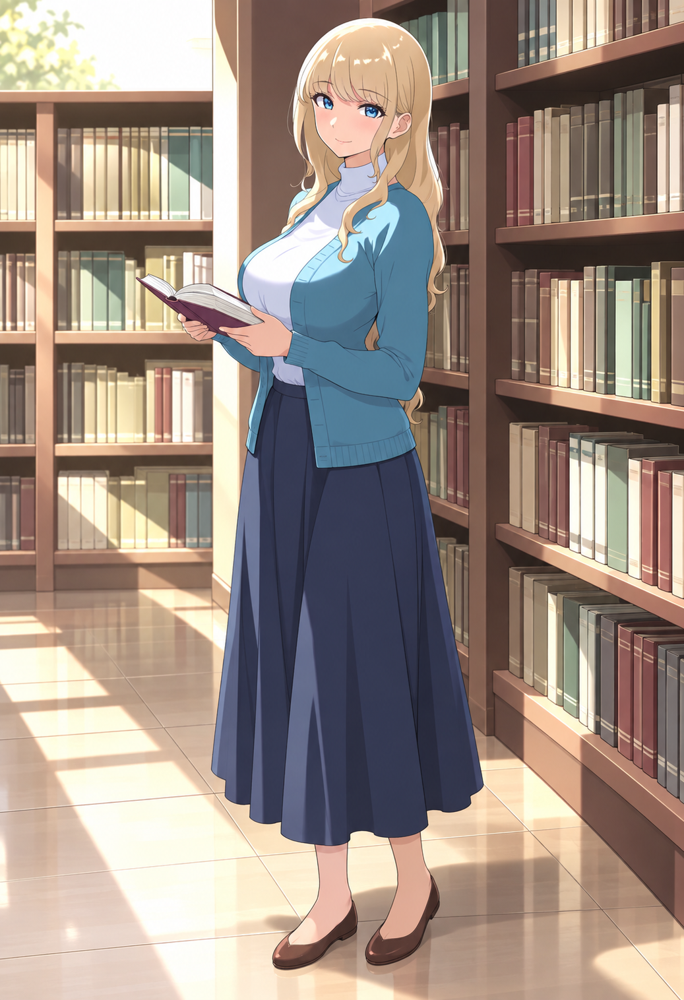

# 同一キャラクターの衣装 表情 ポーズ 背景を変更する作業手順

更新: 2026-10-20。対象は、このPCの独立したComfyUI環境と、下の成人オリジナルキャラクター。既存ゲームのコード・素材は変更しない。

**品質を優先するなら、まず画像編集機能で人物を保った差分を作り、必要な箇所だけComfyUIで修正する分担を試す。** ComfyUIを全工程で使う必要はない。一方、マスク外の画素を確実に戻したい修正や、同じ設定で候補を反復する工程はComfyUIが扱いやすい。実際の比較と採否は [品質比較](QUALITY_COMPARISON.md) を参照。

ここでいう「ここで頼む」はCodexから内蔵画像編集機能を呼ぶこと。「ComfyUI」はPC上のAnimagine XL 4.0 Optを使う構成。CodexからComfyUIを操作することもできる。ComfyUI自体が画風や人物を記憶するモデルではない。

## 入口と添付ファイル

- [Image A 原本](assets/image_a.png): ユーザーが指定した着衣の全身像。1037×1516。画像編集機能で作った画像で、Animagineの通常設定テストとは別。
- [品質比較と現時点の推奨](QUALITY_COMPARISON.md): 実際の出力・失敗・未検証候補。
- [ワークフロー](workflows/): 画面へ読み込む `.json` と、プログラム向け `.api.json`。
- [環境とモデルの固定情報](environment.json)、[雛形の構造確認](validation.json)、[参考資料](SOURCES.md)。
- [作業記録の雛形](records/run-template.json)。



## まず理解する保全の範囲

| 作業 | 保全できるもの | 描き直すもの |
| --- | --- | --- |
| マスクで衣装だけ変更 | マスク外の顔・髪・背景。添付雛形は最後に元画像から合成し直す | 衣装と、その下で見えなかった身体、衣装がなくなる場所の背景 |
| 表情だけ変更 | マスク外の服・髪・身体・背景 | 口や目など指定した領域 |
| 全身ポーズ変更 | 参照から顔・髪・画風を近づける | 人物全体。顔の完全一致は保証できない |
| 背景だけ変更 | マスク外の人物 | 背景、足元の影や境界 |

**マスク外の画素を保つこと、同じ人物に見えること、画風が近いことは別の条件。** `denoise` を下げるだけでは、変更しない場所の完全保全にはならない。最後の `ImageCompositeMasked` が、マスク0の場所を元画像へ戻す。柔らかい境界は中間値なので少し変わる。

## 準備と初回の操作

### 現在利用できるもの

| 機能 | 現状 |
| --- | --- |
| ComfyUI | Portable v0.42.1、127.0.0.1:8188 |
| 通常モデル | `animagine-xl-4.0-opt.safetensors` |
| 画像参照 | IPAdapter Plus SDXL ViT-H と対応CLIP Vision、導入済み |
| ポーズ制御 | Xinsir OpenPose SDXL 1.0、導入済み |
| Mask Editor、VAE、マスク合成 | 標準ノードを利用 |
| Face Detailer、人物の自動切り抜き | この構成では未導入 |
| 2倍拡大 | Lanczosによる通常拡大。学習済み超解像モデルは使わない |

新しいモデル・拡張・有料APIを取得しなくても、添付雛形を準備できる。モデルの利用条件は [既存の利用条件](../USAGE.md) と環境台帳を参照。ComfyUIで外部APIノードを使う場合は別の料金体系になるが、この雛形には含めていない。

### 作業用画像を配置する

リポジトリのルートをPowerShellで開き、既存の専用Pythonを使う。

```powershell
& '.\tools\local-ai-foundation\Python.cmd' '.\projects\local-ai-image-lab\workshop\scripts\prepare_inputs.py'
```

このスクリプトはモデルを取得せず、次の2ファイルを `tools/local-ai-foundation/data/inputs/` に配置する。異なる内容の同名ファイルがあれば停止し、上書きしない。

- `workshop_image_a_work.png`: Image Aを縦横比を保って832×1216へ収めた作業用画像。原本は変更しない。
- `workshop_pose_guide.png`: 腕を少し広げた、手描き相当の骨格ガイド。実人物の検出結果ではなく、指の関節も含まない。

ComfyUIが停止している場合だけ `tools/local-ai-foundation/Start-ComfyUI.cmd` を起動し、ブラウザーで `http://127.0.0.1:8188` を開く。既に起動中なら二重起動しない。

### ワークフローを開いて保存する

1. GitHubで必要な `.json` を開き、Raw表示からファイルとしてダウンロードする。`.api.json` は画面用ではない。
2. ComfyUIのキャンバスへ `.json` をドラッグする。現在の未保存ワークフローは先に保存する。
3. `LoadImage`（画像を読み込む）で対象画像を選ぶ。後工程では、初期値のImage Aから**直前に採用した出力**へ必ず切り替える。
4. `CheckpointLoaderSimple` がAnimagine 4.0 Optになっていることを確認する。SDXL Baseは削除済みなので選ばない。
5. 編集用のワークフローを別名で保存する。例: `B_clothing_v01.json`。
6. seedは固定のまま、右上の「実行する」でまず1枚生成する。候補を増やすときだけseedを変える。

雛形は実機のノード定義と照合済み。ただし、**雛形を読み込めることと、その衣装・ポーズが高品質に出ることは別**。画面での読み込み確認と画質確認の範囲は各記録を参照する。

## 0 基準画像と採用条件を固定する

1. Image A原本を編集しない。ファイル名とSHA256を [environment.json](environment.json) に記録済み。
2. 正面寄りの顔、金髪の前髪と毛先、青い瞳、成人の年齢感、体格、線と塗りを固定条件として書く。
3. 変えるものを一つ決める。衣装・表情・ポーズ・背景を同時に変えて原因を分からなくしない。
4. 変更前後を同じ大きさで並べ、顔の拡大と全身の両方を見る。

別の構図で承認できた画像が増えたら、基準画像を正面・斜め・横などに整理する。失敗画像を参照へ混ぜると、その誤りを次へ引き継ぐ。各派生画像は原則Image Aと承認済み参照から作り、劣化した派生画像だけを次々と入力しない。

### 工程の保存名

| 名前 | 中身 | 次へ進める条件 |
| --- | --- | --- |
| A | 基準画像 | 顔・髪・服・画風を確認済み |
| B | 同じ立ち姿で衣装だけ変更 | 顔・頭身・衣装・手・脚が自然 |
| C | ポーズを変更 | 人物の一致と全身構造が成立 |
| D | 背景を海へ変更 | 人物と背景の境界、光、接地が自然 |
| E | 細部の修正版 | 指・肩紐・顔・足などを原寸で確認 |
| F | 必要な解像度の書き出し | 拡大後の線や境界を確認 |

## 1 服だけを変える

### ComfyUIでの操作

使う雛形: [20-clothing-inpaint.json](workflows/20-clothing-inpaint.json)。この段階は**IPAdapterなし**で始める。顔を変更しないなら、顔をマスク外にして原画を戻す方が確実だからである。

1. ノード4 `LoadImage` に `workshop_image_a_work.png` を選ぶ。
2. ノード4を右クリックし、`Open in MaskEditor`（マスクエディターで開く）を選ぶ。表示名はフロントエンドの言語・版で変わる。
3. **変更する領域を白、残す領域を黒**にする。カーディガン、白い上着、スカート、靴と、それらを取り除くために周囲へ描き足す領域を含める。顔、前髪、本、残したい手は保護する。
4. スカートの幅が脚より広いため、スカートを消す領域には新しい脚だけでなく背景も必要になる。服の布部分だけを細く塗ると、布の端が残る。
5. 髪の前後関係に注意し、顔へマスクをはみ出させない。境界は作業解像度で数px程度の柔らかいブラシを使い、広くぼかしすぎない。
6. Mask Editorで保存する。編集後のノードの画像選択名も作業記録へ残す。
7. マスクの白黒を確かめたい場合は [00-mask-preview.json](workflows/00-mask-preview.json) で同じ編集済み入力を選び、実行する。これは拡散モデルを使わない。真っ黒なら編集領域がない。
8. ノード2の文章で衣装を指定する。雛形は「成人女性、紺色の不透明なスポーツ用ワンピース水着、自然な立ち姿」。背景変更やポーズ変更は加えない。
9. ノード6 `KSampler` を確認し、1枚実行する。
10. 出力をImage Aと並べる。顔が変わった場合は、顔にマスクがかかっていないか、合成ノード8を経由して保存しているかを先に確認する。

### 配線と調整

```text
LoadImage.IMAGE → VAEEncodeForInpaint.pixels → KSampler → VAEDecode
LoadImage.MASK  → VAEEncodeForInpaint.mask
元のLoadImage.IMAGE + VAEDecode.IMAGE + 同じMASK
  → ImageCompositeMasked → SaveImage
```

| 項目 | 雛形の初期値 | 調整の考え方 |
| --- | --- | --- |
| 解像度 | 832×1216の入力 | 原本と作業用画像の座標を混ぜない |
| seed | 53001固定 | まず同じseedで一条件だけ変える |
| steps / CFG | 28 / 5 | モデル変更と同時に動かさない |
| sampler / scheduler | euler_ancestral / normal | 通常用設定に合わせる |
| denoise | 0.75 | 大きな衣装変更の開始案。0.65、0.75、0.85などを比較する |
| grow_mask_by | 8px | 潜在側の再生成範囲を広げる。最終合成は元のマスクで制限する |

**denoiseは常に低い方がよいわけではない。** この雛形の `VAEEncodeForInpaint` はマスク内の元絵を除去して処理するため、大きな衣装変更で0.2などに固定すると描き直せない場合がある。低めの値で原画を生かす修正は、工程4の `VAEEncode + SetLatentNoiseMask` と使い分ける。上記の数値は、このキャラでの成功を保証する最適値ではない。

### 採用条件とここで頼む場合

- 顔・髪・年齢感が同じ。頭の大きさ、肩幅、腰の位置が不自然に変化していない。
- 肩紐や縫い目がつながる。本や手を巻き込んだ布がない。脚が2本で、膝・足首・足先が自然。
- 元のスカートが隠していた腰や脚は推定であり、「元の体格を完全復元」とは扱わない。

ここでの依頼例:

> Image Aの同じ成人女性を使い、服装だけを紺色の不透明なスポーツ用ワンピース水着へ変更。裸足にする。顔、髪型、体格、立ち姿、本、図書館、画風を維持。構図や表情は変えない。

このキャラのように元絵の雰囲気を優先する一枚なら、まず画像編集機能で試す方が手軽。ComfyUIへ移すのは、マスク外の厳密な保全や細部修正が必要になった段階でもよい。[公式の画像編集手順](https://learn.chatgpt.com/docs/image-generation)

## 2 全身の姿勢を変える

使う雛形: [21-pose-reference.json](workflows/21-pose-reference.json)。**これは全身の新規描画。顔を画素として固定する方式ではない。** 手だけ動かすなら、工程4で腕と移動先だけをマスクする方法も比較する。

1. 衣装変更Bを採用してから、そのPNGをComfyUIへアップロードする。
2. ノード4のキャラ参照を**採用したB**へ変更する。初期値のAのままでは衣装参照も元へ戻る。
3. ノード16に `workshop_pose_guide.png` を選ぶ。まず添付の「腕を少し広げる」程度から試す。[骨格ガイド](assets/pose_guide.png) と [関節座標](assets/pose-guide-keypoints.json) を参照。
4. ノード2へ「成人の同じ金髪女性、同じ水着、両腕を少し広げる、全身、簡素な背景」と書く。海、走る、跳ぶはまだ加えない。
5. ノード15 `IPAdapterAdvanced` とノード18 `ControlNetApplyAdvanced` の初期値を確認する。
6. 固定seedで1枚実行し、全身と顔を確認する。顔が別人なら不採用とし、背景工程へ進まない。
7. まず骨格の位置を確認し、次に参照の強さを調整する。一度に両方を強めない。
8. この小さな変更が通ったら、走る・片脚を上げる等の別ガイドへ切り替える。身体の重心、左右の手足、足先まで描く。ガイドと出力の縦横比を合わせる。

### 二つの参照の接続先

| 入力 | 接続 | 役割 |
| --- | --- | --- |
| キャラ画像B | LoadImage 4 → IPAdapterAdvanced 15 | 人物・髪・衣装・画風の参考。元のポーズや背景の影響も混ざる |
| 骨格ガイド | LoadImage 16 → ControlNetApplyAdvanced 18 | 肩・肘・手首・腰・膝・足首などの配置 |

IPAdapterの初期値はweight **0.35**、start **0.25**、end **0.8**。ControlNetはstrength **0.7**、start **0**、end **0.8**。これらは調整の開始案で、同一人物を保証する値ではない。

- ポーズを無視する: 骨格の左右・位置・縦横比を先に直す。参照画像の元ポーズが強い場合はIPAdapterを少し下げて比較する。
- 顔や服が別物: 参照の強さを小刻みに比較する。単純に最大へ上げると、頭身や元の構図へ引っ張られる場合がある。
- 指が崩れる: 添付ガイドは身体18点のみで、指の情報がない。手の資料を別途用意し、最後に局所修正する。

ポーズ写真を直接ノード16へ入れても、写真が自動的に骨格図へ変換されるわけではない。この環境には自動姿勢検出の前処理を追加していない。写真からの検出を追加する場合は、対応する前処理ノード・検出モデル・ライセンスを別途確認する。[ComfyUI公式のポーズ制御](https://docs.comfy.org/tutorials/controlnet/pose-controlnet-2-pass)

### 品質優先ならここでの編集も先に比較する

> Image Aの同じ成人女性と同じ服装・画風で、両腕を少し広げて楽しそうに笑う全身像に変更。髪と顔立ちと体格を維持。背景は簡素に。人物は一人。

大きな構図変更は、文章で編集できるモデルの方が良い結果になる場合がある。骨格図を正確に合わせたいときや同じポーズ資料で候補を繰り返すときにComfyUIを比較する。どちらも実物を見て採否を決める。

## 3 海の背景へ移す

使う雛形: [22-background-inpaint.json](workflows/22-background-inpaint.json)。入力は**採用したC**。マスクを衣装工程と逆にする。

1. ノード4にCを選ぶ。
2. Mask Editorで、人物全体と残したい髪・衣装を黒、背景を白にする。髪の隙間、腕の間、脚の間も背景として塗る。
3. 足元の影を描き直す余白を白に含める。足の形まで塗りつぶさない。
4. ノード2に「青空、砂浜、穏やかな波、夏の日差し、人物を追加しない」と指定する。雛形の `no people` は**背景領域に人物を追加しない**ための指示。
5. denoise 0.9から1枚試す。大きな背景置換なので、低すぎると図書館が残る。
6. 元人物を戻す合成ノード8を経由して保存する。
7. 髪の縁、足元、影、色温度を確認する。不自然な輪郭や足の浮きは、境界周辺だけを工程4で修正する。

この方法は人物の画素を守れるが、図書館の照明を受けた人物が海の光に完全に合うとは限らない。光まで統一して描き直す場合は人物も変化するため、別候補として顔や体格を再確認する。

ここでの依頼例:

> この採用画像の人物・顔・髪・服装・ポーズ・画風を維持し、背景を晴れた砂浜と穏やかな海に変更。足元の影と光の方向を自然につなげる。人物を追加しない。

背景と光を一体として整える一枚は、画像編集機能で先に試す価値がある。人物を画素単位で固定した背景差分なら、ComfyUIのマスク合成が向く。

## 4 顔 手 足 衣装の細部を修正する

使う雛形: [23-local-repair.json](workflows/23-local-repair.json)。入力は採用したD、背景変更が不要なら採用したBまたはC。

1. 不具合を一箇所選ぶ。顔・両手・足をまとめて塗らない。
2. 小さな修正なら元絵を含めた `VAEEncode → SetLatentNoiseMask` を使う。この雛形は衣装用の `VAEEncodeForInpaint` と経路が違う。
3. 修正箇所と、つながりに必要な周囲をマスクする。手なら指先だけでなく手首と少しの袖、本との接触も見る。
4. ノード2を具体化する。「自然な手」だけでなく「左手で開いた本の背を支える」など、役割を書く。
5. denoise 0.35から試す。小さな表情なら0.2–0.4、形が大きく壊れた手なら0.45–0.7などを比較する。これも開始案。
6. seedを固定して、マスクの範囲かdenoiseの片方だけ変更する。
7. 改善したら別名で採用し、次の箇所へ進む。悪化したら直前の採用画像へ戻る。

### 顔が小さい場合の部分拡大

全身画像の口や指は、そのままでは作業領域が小さすぎる場合がある。

1. 顔や手と周囲を256–512px程度で切り出し、切り出しのx・y・幅・高さを記録する。
2. 切り出しを512–768px程度へ拡大し、その中の変更箇所だけをマスクする。
3. 局所修正し、切り出しの元のサイズへ縮小する。
4. 元の全身画像の同じx・yへ、同じマスクで合成する。単に顔を全体生成へ差し替えない。

実験用 [30-benchmark-expression.json](workflows/30-benchmark-expression.json) は、今回のImage A専用座標で口を部分拡大して修正する例。**別画像・別解像度へその座標を流用しない。**

### Face Detailerは必要になってから追加する

Face Detailerは顔を検出して再描画する機能で、人物の同一性を保証する機能ではない。顔が別人化することもあるため、まず手動の局所修正を使う。

現在のランチャーはカスタムノードをIPAdapterだけ許可している。Face Detailerの導入にはImpact Pack等、検出器や必要なモデル、依存関係、起動時の許可対象の見直しが必要になる。この作業ではインストールも起動設定の変更も行っていない。[開発元の導入・依存関係](https://github.com/ltdrdata/ComfyUI-Impact-Pack)

### 2倍にして書き出す

1. 原寸の顔・手・足を確認してEを採用する。
2. [24-upscale-lanczos.json](workflows/24-upscale-lanczos.json) のノード4にEを選び実行する。
3. 832×1216の入力なら1664×2432になる。Lanczosは画素補間であり、指や線の誤りを直すAI超解像ではない。
4. 拡大後に修正するなら、気になる箇所を切り出して工程4へ戻す。12GB VRAMで全身を拡大したままIPAdapter・ControlNet・Inpaintを重ねる構成は、この手順では検証していない。

## 失敗したときの確認順序

| 症状 | 最初に確認すること |
| --- | --- |
| 実行しても変化しない | マスクが真っ黒でないか、Mask Editorで保存したか、正しい編集済み入力を選んだか |
| 顔や背景まで変わる | 白黒が逆でないか、顔に白がないか、ノード8の合成を飛ばしていないか |
| 服が残る | マスクに布端と周囲が入っているか。大きな衣装変更でdenoiseが低すぎないか |
| 肌や背景が継ぎはぎ | マスク境界・元絵の残り・光の不一致を確認。境界だけの追加修正を試す |
| 骨格を読めない | ノード16に普通の写真を入れていないか。対応モデル、ガイドの色・サイズを確認 |
| 赤いノードが出る | 実機の導入済みモデル名を確認。Face Detailerや別系統のノードを混ぜない |
| VRAM不足 | batchを1、作業解像度へ戻す。同時のLLMや他のGPU処理を確認。全面拡大修正を部分修正へ替える |
| 別人のまま | 不採用として基準画像へ戻る。シードだけ増やす前に、使う編集モデルや手法を比較する |

## 作業記録と品質判定

候補ごとに [記録雛形](records/run-template.json) をコピーし、入力画像・マスク・ワークフロー・プロンプト・モデル版・シード・出力のSHA256を保存する。UIで変更したら**変更後のワークフロー**も保存する。APIファイルがUIの手動変更へ自動追従するとは考えない。

保存PNGのworkflowメタデータも残すが、それだけでは参照画像・マスク・モデル重みは復元できない。入力ファイルを同時にバックアップする。画像編集機能でシードや内部の版が取得できない場合は、取得不能と記す。

採否は、まず人物の一致、次に意図した表情・服装・構図、最後に描画の自然さを確認する。顔が別人なら背景が綺麗でも採用しない。元画像で見えない身体を推定している候補は、その推定も人が確認する。

GitHubには手順、一般向けの採用・比較画像、固定した小さなワークフローを置く。モデル重みや大量の生成候補、個人用入力、APIキーは置かない。この手順ではゲームへの組み込みやモデルの追加取得は行っていない。
