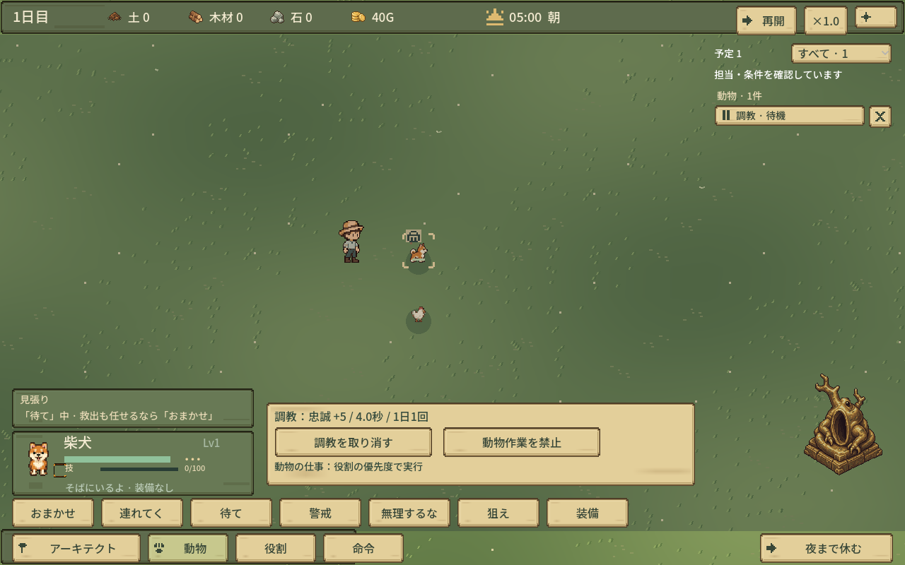
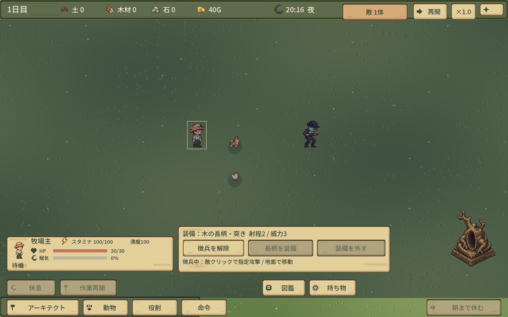
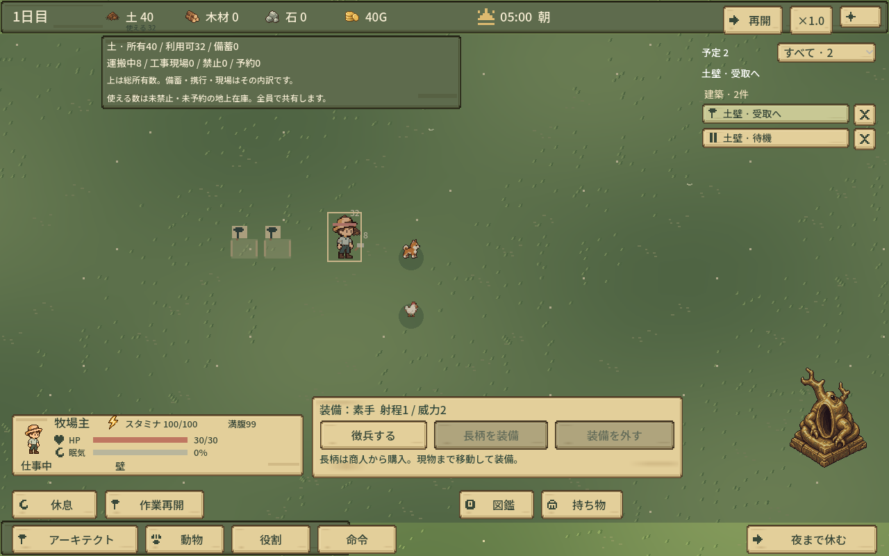

# 最新：採掘・伐採の作業演出

[実装・検証・仮素材](harvest/REPORT.md)・[PNG8枚/連続画像2本/音](harvest/SCREENS.md)。実装ca21a14、正式素材b0e917a。通常EXE反映は進行中。

---

# 今回：仕事・物流・操作・岩場の統合修正

[現在の状況・原因・関連テスト・配布](HANDOFF.md)。動物1.25倍を維持し採用岩場の実物を反映。実装667ca06、配布版bf6eeea。関連テスト/Windows export成功。EXE本体の隔離GPU起動/終了/再開5項目を確認し、通常EXEへ反映済み。撮影失敗はrelease EXEの非対応 --script を使ったランナーの誤りと特定。修正後の実GPU画面8枚を取得/画素確認。[原因報告](RENDER_DIAGNOSIS.md)・[画面8枚](SCREENS_INTEGRATED.md)。同条件beforeは未取得。過去の画像を今回の完成証拠として扱いません。

---

# バイオーム改善01：撮影担当への入口

作業ブランチ **codex/sporehollow-biome01**。実装 `428e568cad8669aa9e89a910026c3b8bf22e8b27`。地形・自然資源分布を実装し、新規207項目と既存12スイート323項目が成功。通常EXEへ反映済み、main未統合。

- [撮影・視覚レビュー引き継ぎ](biome01/HANDOFF.md)
- [実装・検証・残課題](biome01/REPORT.md)
- [成功と既存失敗を含む検証一覧](biome01/test-summary.json)

[バイオーム01の前後21組](biome01/SCREENS.md)と[通常EXEの反映記録](biome01/DELIVERY.md)を追加しました。人間の見た目評価・実操作・実GPU FPSは別確認です。以下のレビュー02画像は変更前の別レビュー資料です。 古い2テストの失敗は変更前EXEでも同一再現し、上記報告へ分離しています。

---

## 過去のレビュー02資料

# ホイッスル牧場：外部独立レビュー02

GitHub上の入口はこのページです。ブランチ **codex/sporehollow-review02** に修正コード、前後画像、報告、テスト結果をまとめています。既存のprototype／colony-09ブランチを巻き戻したり、mergeしたりしていません。

- [修正結果・原因・未検証事項](review02/REPORT.md)
- [同条件の修正前後10組／20枚](review02/SCREENS.md)
- [テスト結果](review02/test-summary.json)
- [画像・実装・素材・EXEの対応](review02/IMAGE_MANIFEST.json)
- [隔離入力の監査](review02/tests/isolated-ui/isolation.json)
- [最新版の操作・保存](../../README.md)

実装91f76a298a5bb3775fb2aafedca74a9e8c9ad19b、素材b0e917a11f205190dde0136165a72c189f39e275。配布EXEのSHA256はA10287B62CE93C985891982C3A8B4B2B2CB67BD58722349A8113A8FA22110C1C。資料を置くコミットはゲーム内容を変更しません。

動物仕事の分類・文言、夜間休息、徴兵中の通常命令、予定の種類・状態、物資の所有と携行、翌朝の残敵、メニューを修正。交渉の左クリック・サブタスク上の右クリック解除・新規開始時の中央の像と主人公を維持しています。

関連headless166項目、GPU入力50項目、以前の試遊版確認7項目、終了再開5項目成功。最終EXEの33入力項目・after10枚・終了再開は非対話デスクトップで検証。人間の操作感・面白さ・長時間AI・実音・IMEは未評価です。

## 代表画面

調教：仕事カテゴリは動物。番号の代わりに種類・状態を表示。

夜・徴兵中：朝まで休む、休息・作業再開・装備は無効。

共有在庫：8個を携行しても所有40。利用可と内訳を区別。

通常セーブ・履歴・ショートカットは保持。セーブ原本、実行EXE、GPUキャッシュ、作業途中や失敗した証拠はこの公開資料へ含めていません。[前の定点入口](HISTORY-before-review02.md)は履歴として保管しています。

環境整理・容量・保留対象：[MAINTENANCE.md](MAINTENANCE.md)。

