# 工程1〜2 UIレビュー：実ゲーム画面

**機能実装済み・UIレビュー待ち。全条件の需給比較は未完。工程3は未着手。**

[実装・検証結果](REPORT.md) / [撮影情報とPNGハッシュ](SCREENSHOT_MANIFEST.json) / [隔離実行記録](CAPTURE_ISOLATION.json) / [EXE反映記録](DELIVERY.json)

実装コミット：`763ae39e08ed6e521f63a90f8a0de76b12f95985`。通常EXEのSHA256：`79F7EAB18099C40CCAF4015E0F3424FE1B17EF431CD6045CA927800DE5A60025`。

以下はこの実装と同じソースを開発用Godotで動かした、実ゲームのViewport原寸PNGです。正式EXEのウィンドウを撮影したものではありません。CPU合成・理想画面・画像の切抜き・拡大縮小・レタッチはありません。13枚が1280×800、最後の1枚が1600×1000です。要求12場面を14枚に分けて収録しています。

撮影seedは`125805423`。通常の新規開始は01のみ、02以降には下表のfixtureがあります。自然進行の生存検証は[RESULTS.json](RESULTS.json)に別記しています。全画像のゲーム内時刻・tickと条件はmanifestを参照してください。

非対話WindowStation/専用Desktopで直列1プロセス、最大30fps、Dummy音声、60秒上限、実所要13.33秒。通常デスクトップでの起動・OS入力・fallbackはありません。隔離撮影も物理GPUは共有するため、長時間安定性やPC停止原因の解消を証明するものではありません。

## 画面一覧

|画像|画面と役割|操作・表示状態|
|---|---|---|
|[01](screenshots/01-day-overview.png)|朝の通常プレイ全体|新規マップ開始05:00、一時停止。初期備蓄・黄金像・牧場主・柴犬・ログ・下部メニュー。|
|[02](screenshots/02-architect-mushroom.png)|アーキテクトと栽培床の配置|設置カテゴリからキノコ栽培床を選択。混合費用と実際の配置ゴーストを表示。|
|[03](screenshots/03-mushroom-pending.png)|建築予約と資材待ち|木材3/8、土0/4を搬入した現場。赤系の予約ゴースト、資材待ちと不足内訳。|
|[04](screenshots/04-mushroom-growing.png)|キノコ栽培床の植菌後・生育中|実際の作業処理で種菌を搬入・消費し、植菌直後に停止。48時間の生育待ち。|
|[05](screenshots/05-mushroom-harvest.png)|キノコ収穫と現物回収UI|実際の収穫処理で出たキノコ×3を選択。「回収」「禁止」、未備蓄であることを表示。|
|[06](screenshots/06-cooking-workbench.png)|調理台の製作指示・進捗|キノコ2を確保・搬入し、製作30%で停止。焼きキノコ5食のバッチ。|
|[07](screenshots/07-stockpile-food.png)|備蓄の食料フィルター・利用権限|食材置場、食料カテゴリのみ許可、通常優先度、牧場主の持出し権限。|
|[08a](screenshots/08a-resident-status.png)|住民ステータス|牧場主のHP・スタミナ・満腹度・眠気・満足度・心情・現在の仕事。|
|[08b](screenshots/08b-resident-food.png)|住民の食事優先|生活→食事のカテゴリ×ティア優先順位と同順位の説明。|
|[09a](screenshots/09a-resident-work.png)|住民の仕事優先順位|役割画面。建築・採集・回収・動物・その他・運搬の既定優先度。|
|[09b](screenshots/09b-auto-collect.png)|住民の自動収集|住民詳細→仕事。自動収集設定、現在の仕事、役割・生活への導線。|
|[10](screenshots/10-night-overview.png)|夜間・襲撃表示|22:00の夜間描画、敵1体の危険通知と実敵キャラクター。|
|[11](screenshots/11-house-sleep.png)|家屋・ベッド・睡眠|家屋情報、居住者・設備、ベッドでの睡眠表示。|
|[12](screenshots/12-wide-overview-1600.png)|1600×1000の全画面UI|広い実Viewportでアーキテクト・夜間拠点・家屋・ログ・下部メニューを確認。|

## レビューで判断したい点

- 04：栽培指示パネルと設備の情報カードが重なり、数量・モードの周辺を隠す。大規模UI改修はせず、問題が見える状態を提出。
- 05：現物が人物の足元に出るため、アイコンが人物に隠れやすい。選択時の「キノコ×3」「備蓄0」は確認可能。
- 各画面：左上の小さな空矩形、上部「使える」の補助値のコントラスト、パネルの占有面積・余白・文字サイズを確認したい。
- 栽培床：既存の土/木描画と共通キャッシュの仮キノコ記号。正式設備と描き込み密度が違う。空床・植菌・生育・成熟の専用素材は未納品。
- 住民・製作・備蓄：状態説明、停止理由、権限設定、下部メニューとログの位置関係、クリック回数を比較レビューしたい。

## 原寸画像とfixture条件

### 01 朝の通常プレイ全体

新規マップ開始05:00、一時停止。初期備蓄・黄金像・牧場主・柴犬・ログ・下部メニュー。

撮影条件：状態改変なし。自動撮影のため導入案内のみ省略。

[原寸PNGを開く](screenshots/01-day-overview.png)

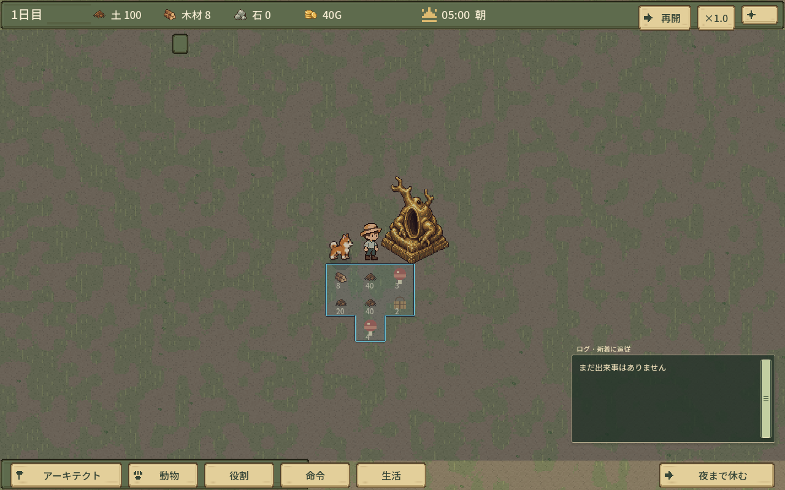

### 02 アーキテクトと栽培床の配置

設置カテゴリからキノコ栽培床を選択。混合費用と実際の配置ゴーストを表示。

撮影条件：拠点近くの小区画を空地にしたfixture。他の地形は保持。

[原寸PNGを開く](screenshots/02-architect-mushroom.png)

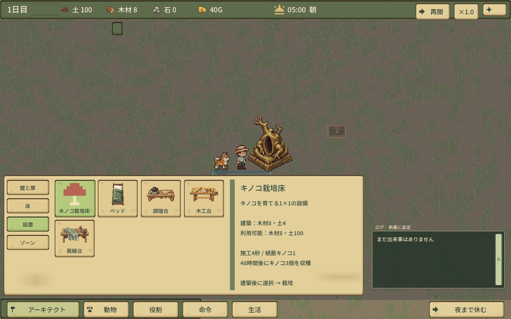

### 03 建築予約と資材待ち

木材3/8、土0/4を搬入した現場。赤系の予約ゴースト、資材待ちと不足内訳。

撮影条件：部分搬入状態を直接設定し、備蓄木材を禁止したfixture。自然な搬入経過を撮影したものではない。

[原寸PNGを開く](screenshots/03-mushroom-pending.png)

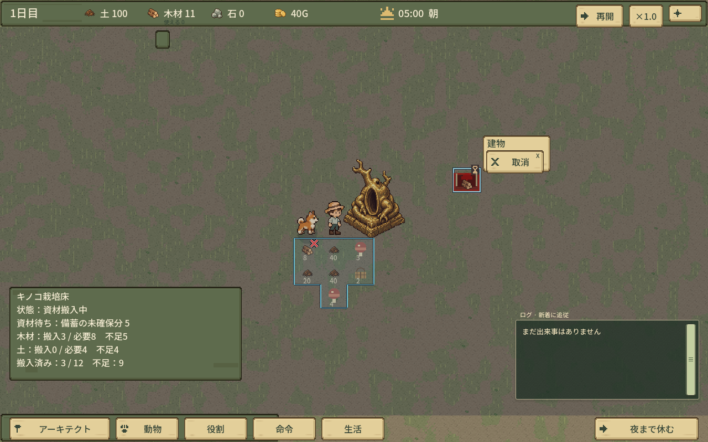

### 04 キノコ栽培床の植菌後・生育中

実際の作業処理で種菌を搬入・消費し、植菌直後に停止。48時間の生育待ち。

撮影条件：完成設備のみfixture。初期の現物キノコを通常作業で使用。栽培指示と設備カードの重なりもそのまま残す。

[原寸PNGを開く](screenshots/04-mushroom-growing.png)

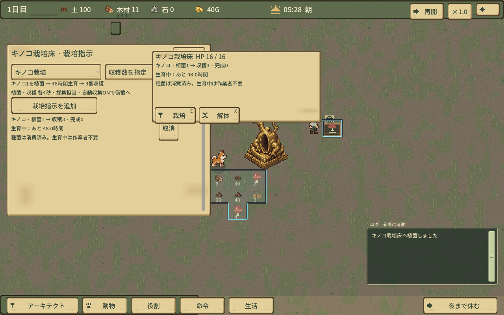

### 05 キノコ収穫と現物回収UI

実際の収穫処理で出たキノコ×3を選択。「回収」「禁止」、未備蓄であることを表示。

撮影条件：生育済み時刻へ進めたfixture。回収前の現物を残すため自動収集OFF。48時間を自然進行させた撮影ではない。現物が人物の足元で隠れやすい。

[原寸PNGを開く](screenshots/05-mushroom-harvest.png)

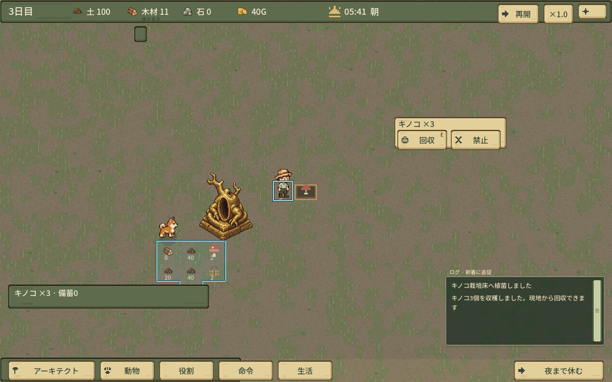

### 06 調理台の製作指示・進捗

キノコ2を確保・搬入し、製作30%で停止。焼きキノコ5食のバッチ。

撮影条件：完成調理台をfixture配置。素材確保・運搬・製作進捗は通常エンジン。

[原寸PNGを開く](screenshots/06-cooking-workbench.png)

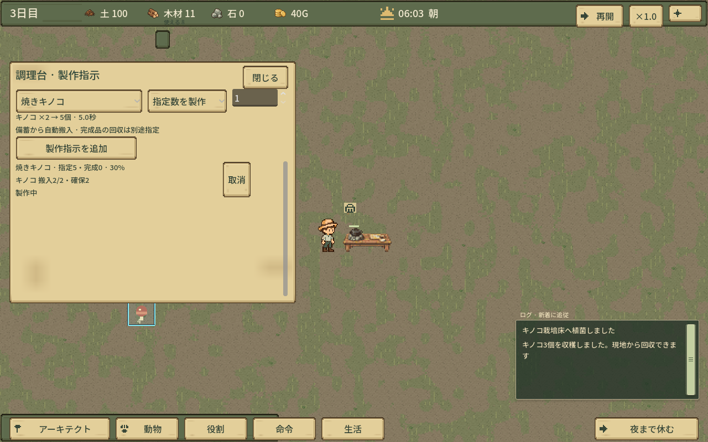

### 07 備蓄の食料フィルター・利用権限

食材置場、食料カテゴリのみ許可、通常優先度、牧場主の持出し権限。

撮影条件：初期備蓄の名称とフィルターを変更。元の木・土などの現物は削除せず保持。

[原寸PNGを開く](screenshots/07-stockpile-food.png)

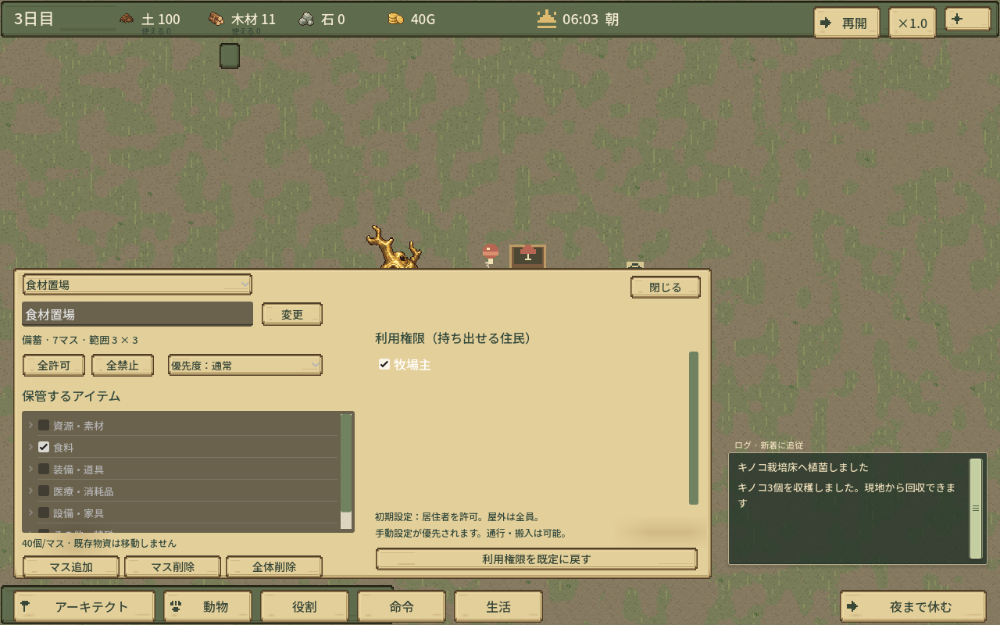

### 08a 住民ステータス

牧場主のHP・スタミナ・満腹度・眠気・満足度・心情・現在の仕事。

撮影条件：同じ撮影用作業状態から通常の住民詳細を開いたもの。

[原寸PNGを開く](screenshots/08a-resident-status.png)

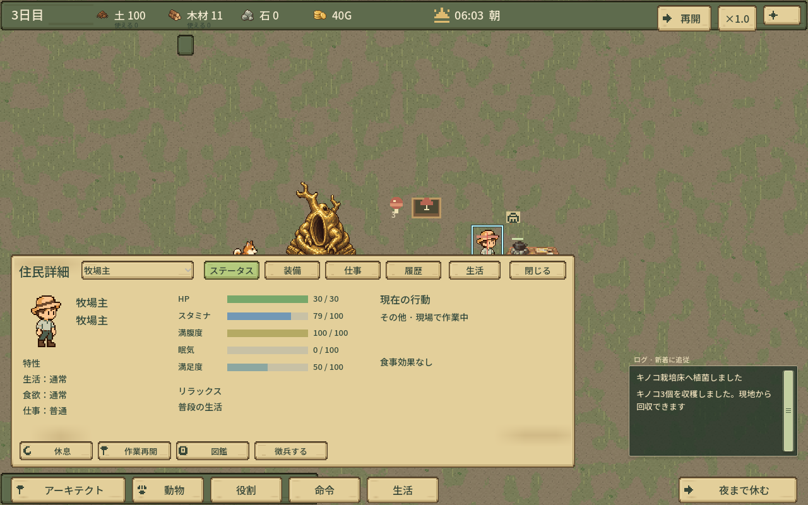

### 08b 住民の食事優先

生活→食事のカテゴリ×ティア優先順位と同順位の説明。

撮影条件：同じ住民の既存設定。時間割・食事の仕様は今回変更していない。

[原寸PNGを開く](screenshots/08b-resident-food.png)

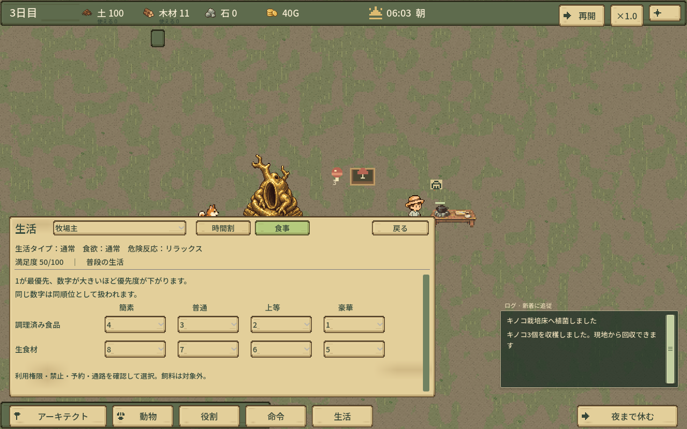

### 09a 住民の仕事優先順位

役割画面。建築・採集・回収・動物・その他・運搬の既定優先度。

撮影条件：同じ撮影用Worldの通常役割パネル。

[原寸PNGを開く](screenshots/09a-resident-work.png)

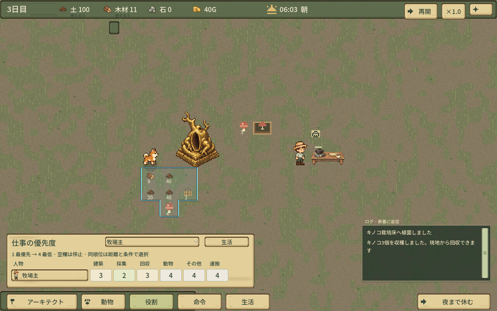

### 09b 住民の自動収集

住民詳細→仕事。自動収集設定、現在の仕事、役割・生活への導線。

撮影条件：05の現物確認のため自動収集はOFF。自動収集の動作自体はロジック試験で別途確認。

[原寸PNGを開く](screenshots/09b-auto-collect.png)

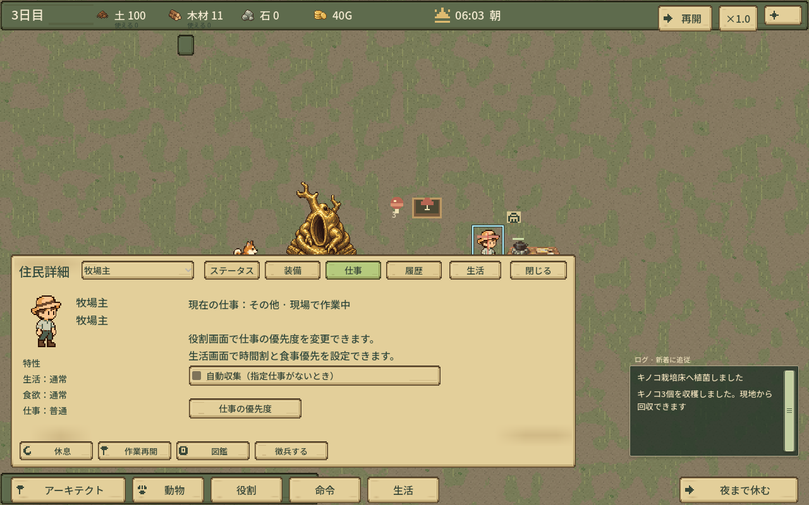

### 10 夜間・襲撃表示

22:00の夜間描画、敵1体の危険通知と実敵キャラクター。

撮影条件：夜時刻・防衛フェーズと敵1体の位置を設定して一時停止したfixture。自然な3夜生存到達ではない。

[原寸PNGを開く](screenshots/10-night-overview.png)

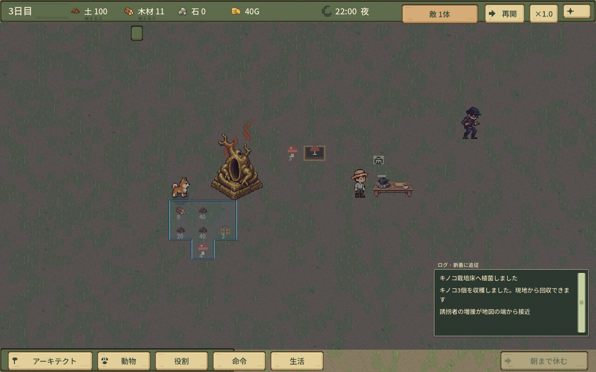

### 11 家屋・ベッド・睡眠

家屋情報、居住者・設備、ベッドでの睡眠表示。

撮影条件：5×5家屋・床・扉・ベッド・居住ゾーンをfixture配置、Homesで割当。牧場主の位置と睡眠表示を設定。プレイヤー建築完遂を示す画像ではない。

[原寸PNGを開く](screenshots/11-house-sleep.png)

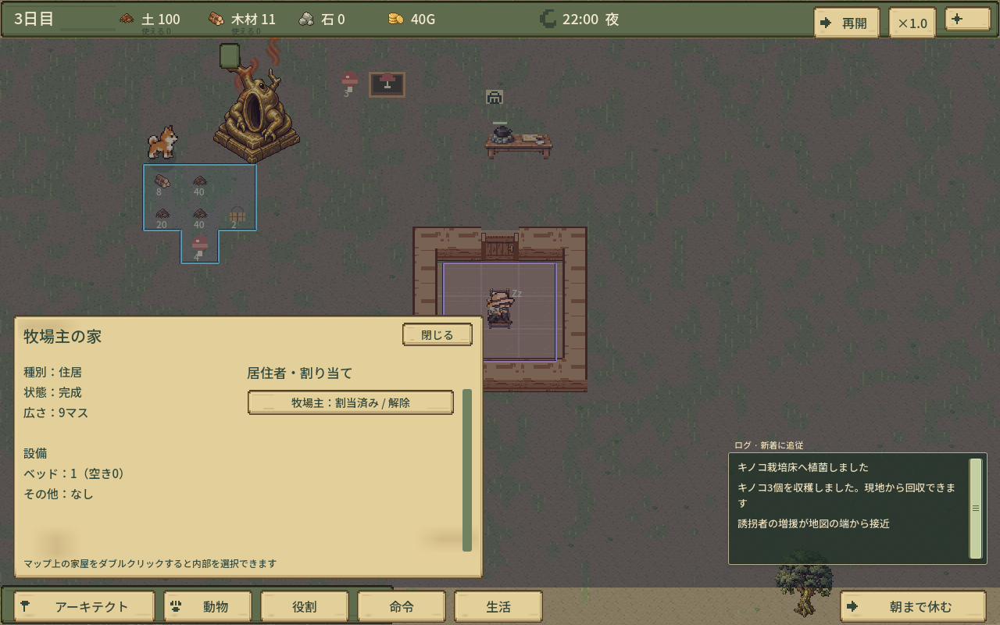

### 12 1600×1000の全画面UI

広い実Viewportでアーキテクト・夜間拠点・家屋・ログ・下部メニューを確認。

撮影条件：同じ生産・家屋・夜間fixture。1600×1000へ実Viewportを変更し、画像を拡大補間していない。

[原寸PNGを開く](screenshots/12-wide-overview-1600.png)

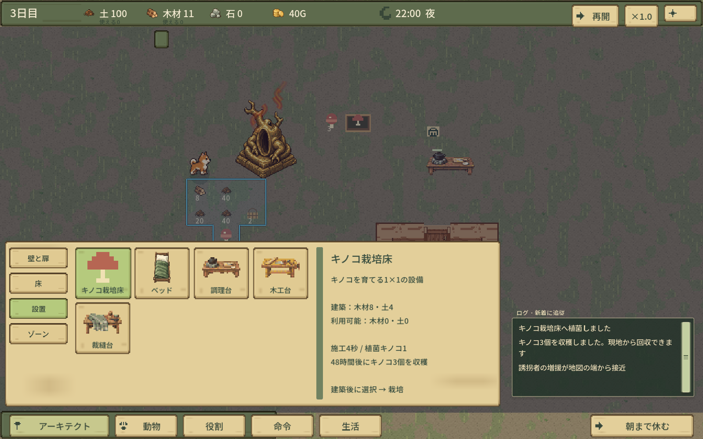

## 旧版との区別

初回608eb58eでは栽培床のアイコンが四角い代替表示だったため、共有キャッシュの仮キノコ記号へ修正し、現行14枚すべてを撮り直しました。[修正前の原寸1枚](prototype-icon-before-608eb58e.png)のみ比較資料として保持しています。これは最新画面には含めません。
