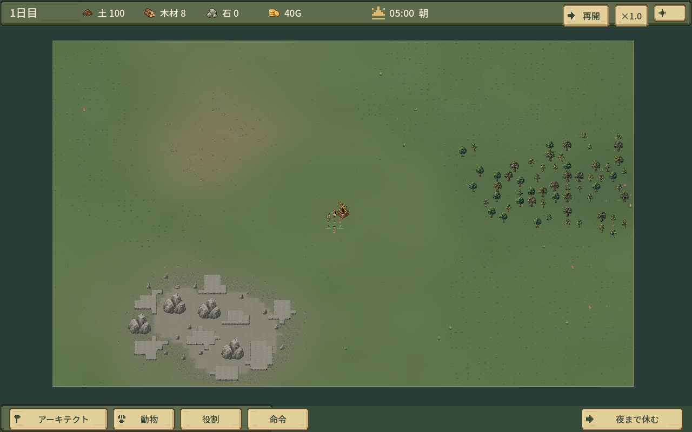
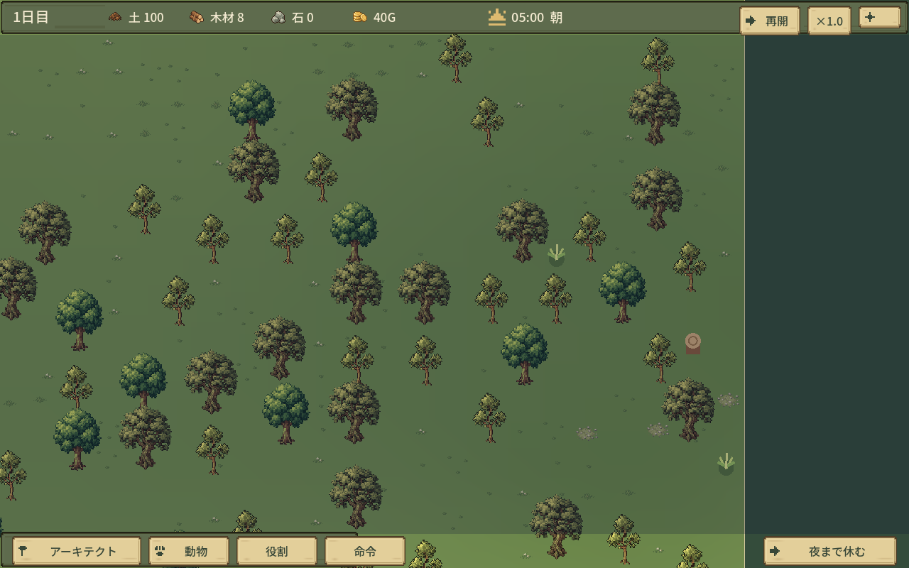
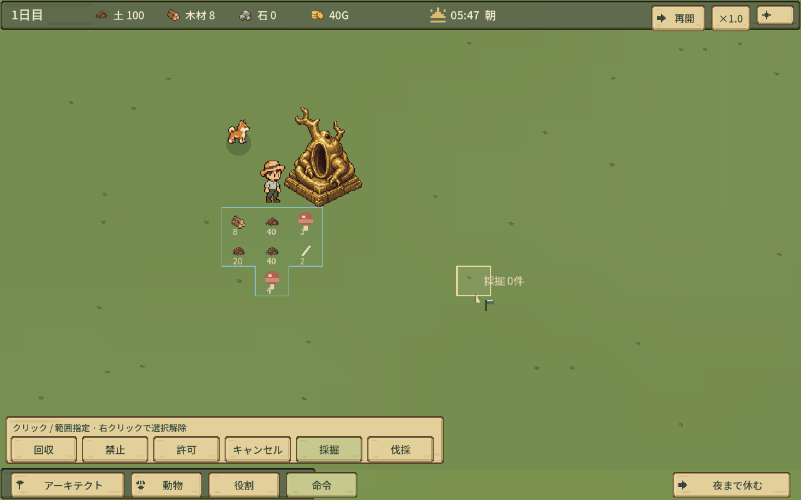
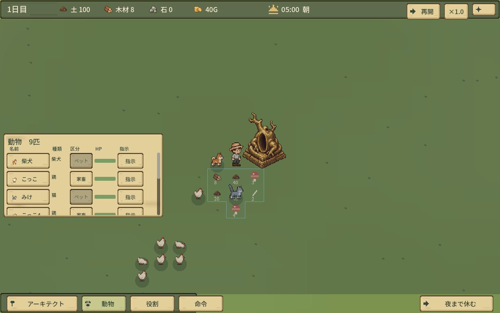
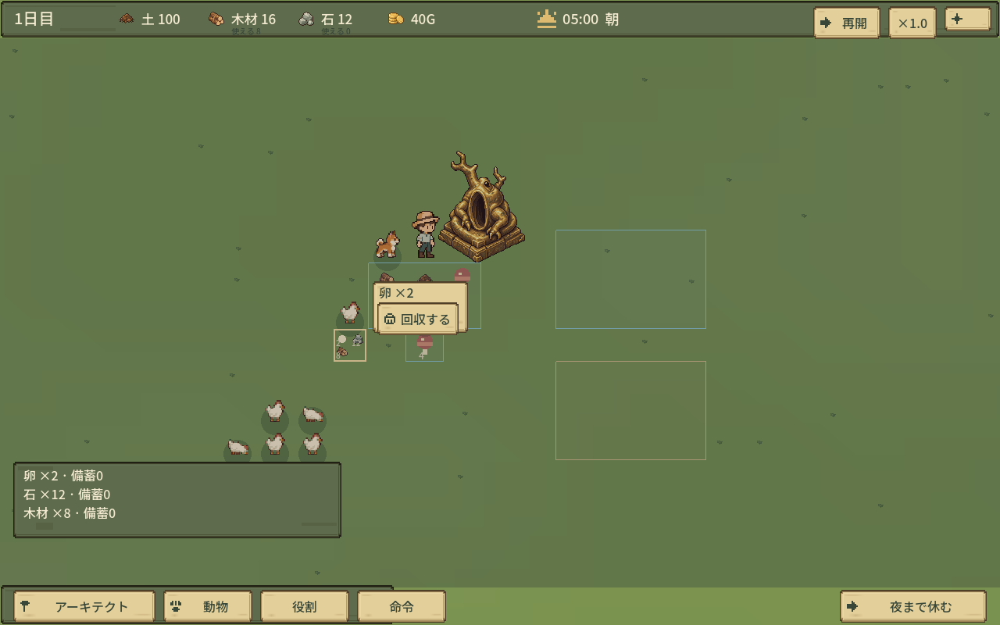
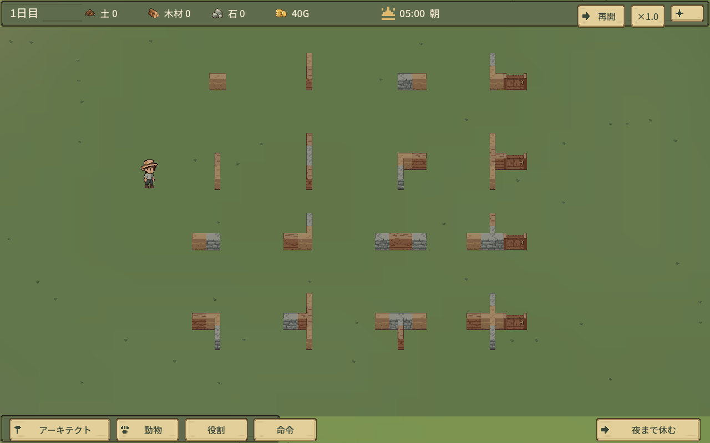

# 実ゲーム画像

実装 `260923924abe952f4ff2befe61831c80f8ab6e77`。素材 `3229d2655e35e82d178577cdd8acbbe66e9be4f8`。すべて今回のGodot描画、1280×800。素材見本や合成画像は証拠に使用していません。

seed31/73/109は各seedの通常新規生成。境界8画面はseed31のカメラ移動。動物一覧・壁・ゾーン・物資は専用データに対象を追加した明示fixture。採掘後は実仕事を進めた結果、壁破壊後は実対物攻撃の結果です。各画面の状態・実入力チェックはui-survey.jsonを参照。

| PNG | 内容 |
|---|---|
| [seed_31_overview.png](seed_31_overview.png) | 100×68 全景 / seed31 |
| [seed_31_center.png](seed_31_center.png) | 拠点と開けた草地 / seed31 |
| [seed_31_woodland.png](seed_31_woodland.png) | 通常倍率 / woodland / seed31 |
| [seed_31_rocky.png](seed_31_rocky.png) | 通常倍率 / rocky / seed31 |
| [seed_73_overview.png](seed_73_overview.png) | 100×68 全景 / seed73 |
| [seed_73_center.png](seed_73_center.png) | 拠点と開けた草地 / seed73 |
| [seed_73_woodland.png](seed_73_woodland.png) | 通常倍率 / woodland / seed73 |
| [seed_73_rocky.png](seed_73_rocky.png) | 通常倍率 / rocky / seed73 |
| [seed_109_overview.png](seed_109_overview.png) | 100×68 全景 / seed109 |
| [seed_109_center.png](seed_109_center.png) | 拠点と開けた草地 / seed109 |
| [seed_109_woodland.png](seed_109_woodland.png) | 通常倍率 / woodland / seed109 |
| [seed_109_rocky.png](seed_109_rocky.png) | 通常倍率 / rocky / seed109 |
| [edge_0.png](edge_0.png) | 外周・四隅 (0, 0) |
| [edge_1.png](edge_1.png) | 外周・四隅 (99, 0) |
| [edge_2.png](edge_2.png) | 外周・四隅 (0, 67) |
| [edge_3.png](edge_3.png) | 外周・四隅 (99, 67) |
| [edge_4.png](edge_4.png) | 外周・四隅 (50, 0) |
| [edge_5.png](edge_5.png) | 外周・四隅 (50, 67) |
| [edge_6.png](edge_6.png) | 外周・四隅 (0, 34) |
| [edge_7.png](edge_7.png) | 外周・四隅 (99, 34) |
| [commands.png](commands.png) | 命令6種類・一行・採掘選択 |
| [mountain_selected.png](mountain_selected.png) | 4×4岩山を一体選択 |
| [mountain_planned.png](mountain_planned.png) | 岩山全体の採掘指定 |
| [mountain_shrunk.png](mountain_shrunk.png) | 採掘後の縮小・現地石材 |
| [animal_shiba.png](animal_shiba.png) | 個体情報 / shiba |
| [instructions_shiba.png](instructions_shiba.png) | 個体指示 / shiba |
| [animal_hen.png](animal_hen.png) | 個体情報 / hen |
| [instructions_hen.png](instructions_hen.png) | 個体指示 / hen |
| [animal_cat.png](animal_cat.png) | 個体情報 / cat |
| [instructions_cat.png](instructions_cat.png) | 個体指示 / cat |
| [animals_three.png](animals_three.png) | 小型動物一覧・3匹 |
| [animals_nine.png](animals_nine.png) | 小型動物一覧・9匹 |
| [zones_items.png](zones_items.png) | 連続ゾーンと物資の名称・数量（ホバーなし） |
| [walls_closed.png](walls_closed.png) | 土・木・石の16接続と閉ドア |
| [walls_open.png](walls_open.png) | 開ドアと接続 |
| [walls_removed.png](walls_removed.png) | 1マス破壊後の再接続 |

## 代表画面

## 連続スクロール

PNGはmotion_00〜11の連続12描画フレーム。撮影I/Oを含むため性能計測と分離。測定はcamera-performance.jsonの各90フレーム、位置履歴・平均/p95/最大を参照。

- [01](motion_00.png)
- [02](motion_01.png)
- [03](motion_02.png)
- [04](motion_03.png)
- [05](motion_04.png)
- [06](motion_05.png)
- [07](motion_06.png)
- [08](motion_07.png)
- [09](motion_08.png)
- [10](motion_09.png)
- [11](motion_10.png)
- [12](motion_11.png)
