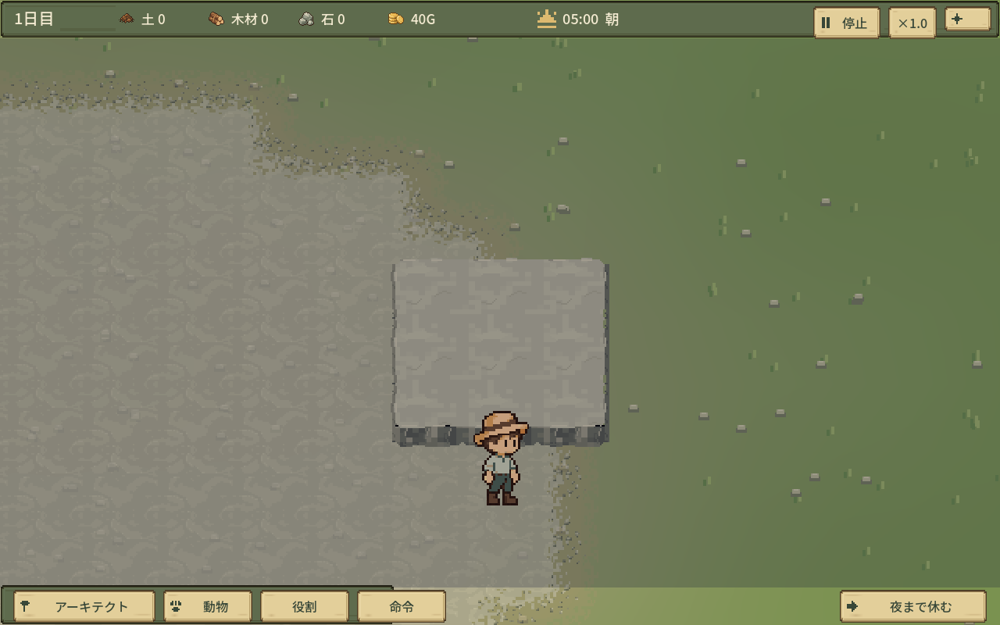
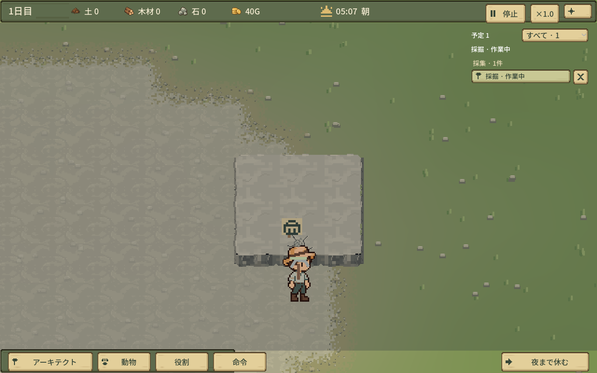
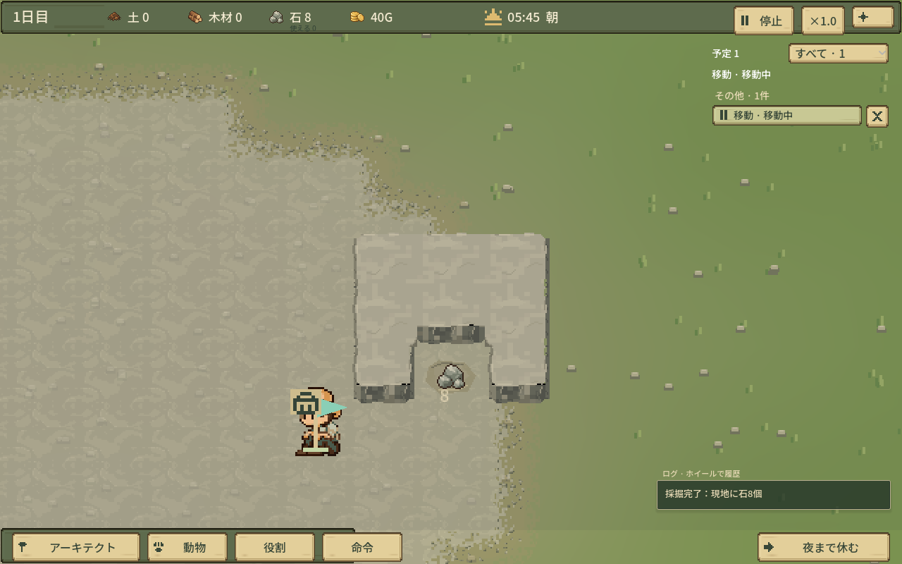
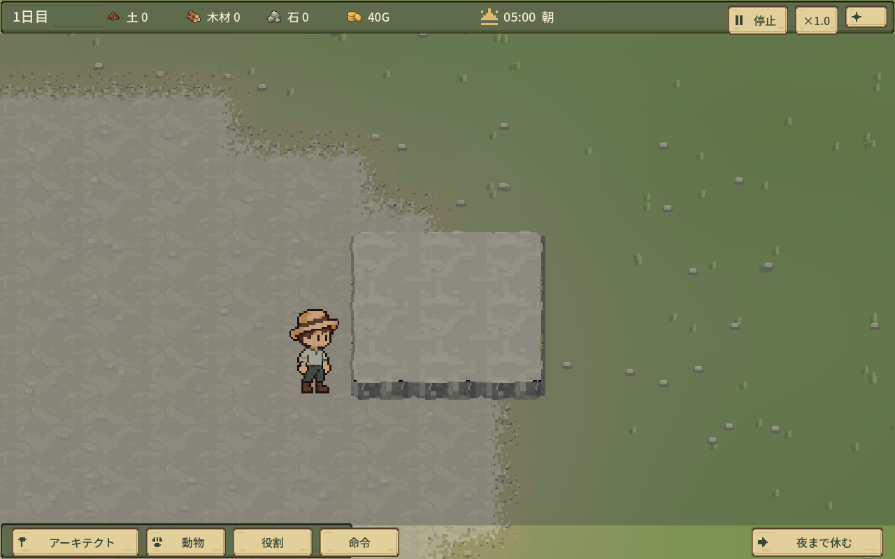
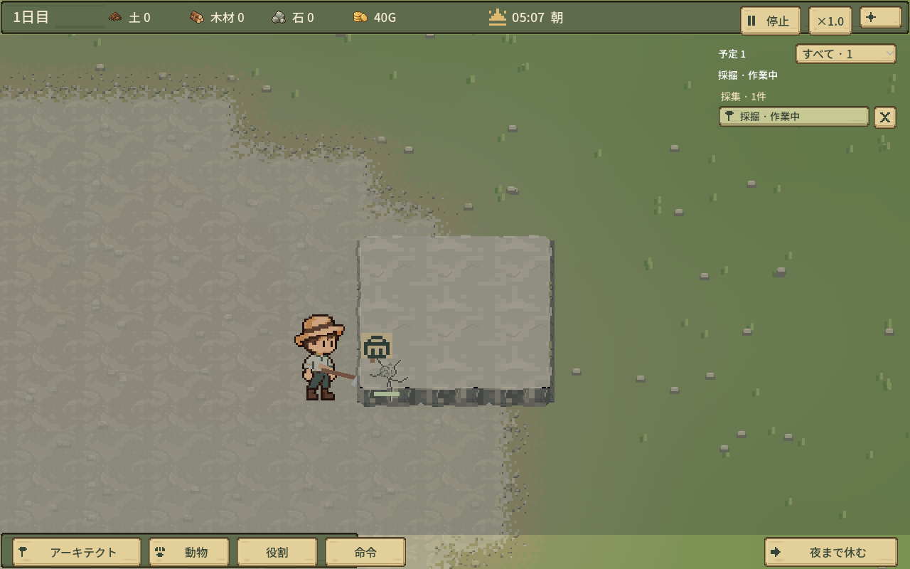
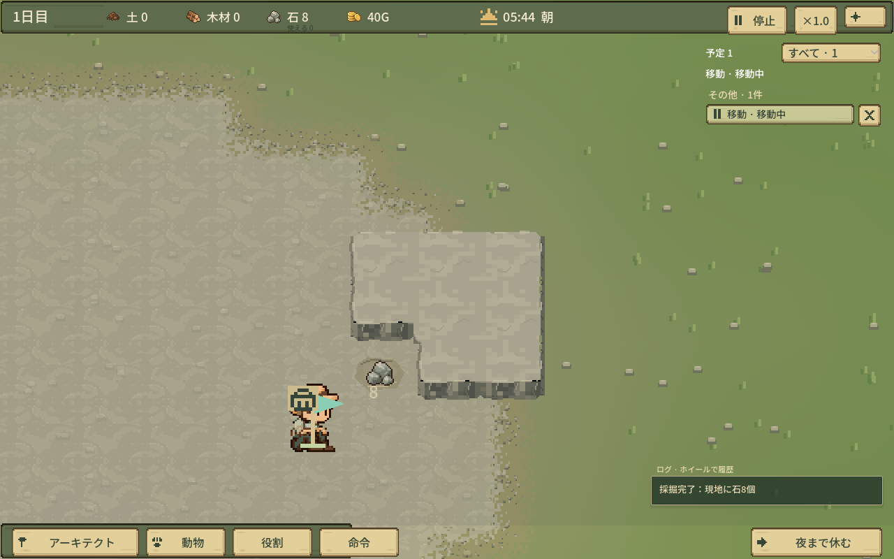
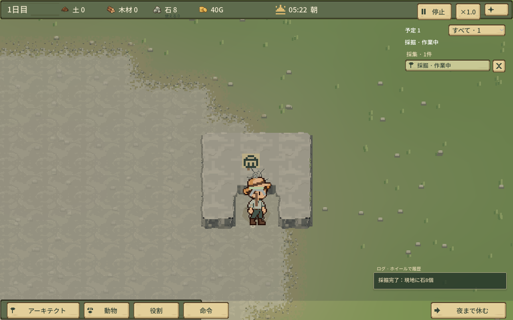
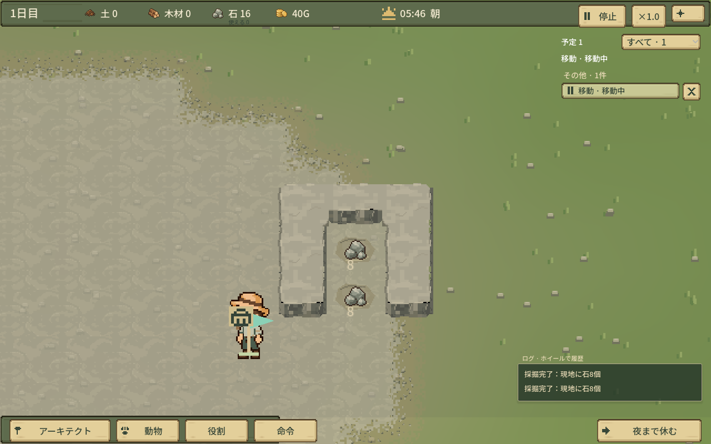
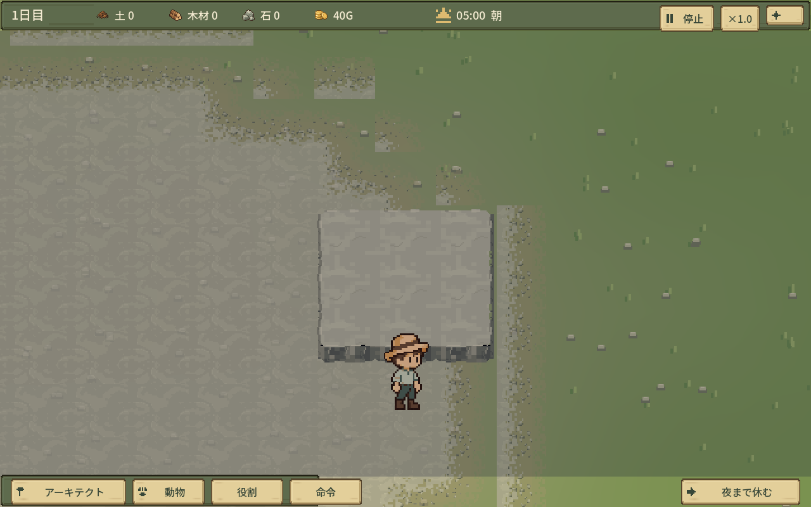

# 岩場の実ゲーム画面

実ゲームの隔離GPU撮影。詳細は[検証報告](REPORT.md)。画像合成ではありません。

## 端1マス

[13秒の動き](edge.webp)

## 角1マス

[13秒の動き](corner.webp)

## 端を掘ってから中央

[13秒の動き](center.webp)

## 境界の修正

初回の二重境界。これは修正前です。

同じ場所の修正後。

