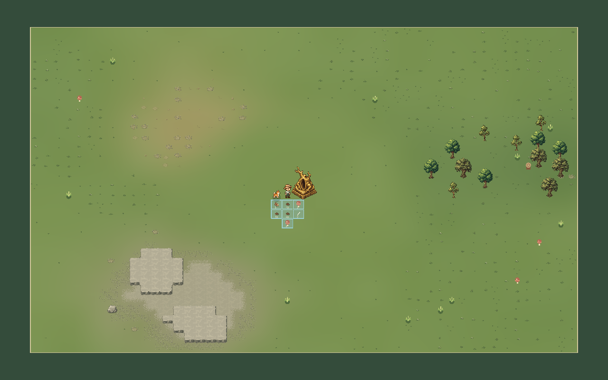
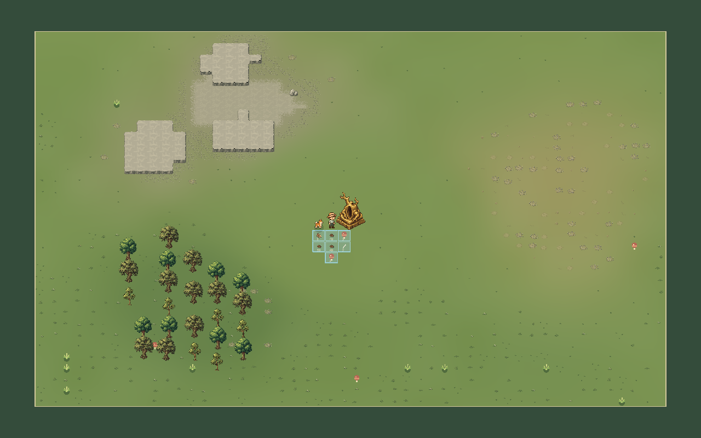
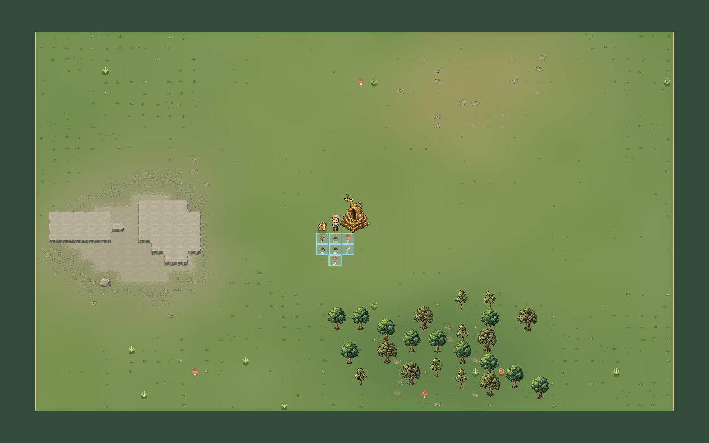

# 実ゲーム画像：地形生成 v2

3シードの実ゲームから90枚・12連続画像を取得。非対話GPU、Dummy音声。生成画像や合成モックではありません。通常倍率は1.5/1.8、全景だけは診断用0.48倍でHUDを隠しています。

採掘後の「全9マス」は各シードで選んだ自然生成3×3範囲です。周囲の岩群は残し、位置と状態の不変を検査しました。連続画像は間引いたシミュレーション標本で、実時間動画ではありません。

[結果・性能・既存課題](REPORT.md) / [状態と撮影情報](terrain-observations.json) / [画像ハッシュ](IMAGES.json) / [ローカル一覧](index.html)

## シード 31

| 確認箇所 | 実画面 |
|---|---|
| 新規マップ全景 | [PNG](seed_31_full_map.png) |
| 黄金像と初期拠点 | [PNG](seed_31_idol_center.png) |
| 草地と岩場の境界 | [PNG](seed_31_grass_rock_boundary.png) |
| 岩場の内部 | [PNG](seed_31_rocky_interior.png) |
| 疎林 | [PNG](seed_31_woodland.png) |
| 乾いた土地 | [PNG](seed_31_dry.png) |
| 草の多い土地 | [PNG](seed_31_lush.png) |
| 北西の角 | [PNG](seed_31_corner_nw.png) |
| 北東の角 | [PNG](seed_31_corner_ne.png) |
| 南西の角 | [PNG](seed_31_corner_sw.png) |
| 南東の角 | [PNG](seed_31_corner_se.png) |
| 北辺 | [PNG](seed_31_edge_n.png) |
| 南辺 | [PNG](seed_31_edge_s.png) |
| 西辺 | [PNG](seed_31_edge_w.png) |
| 東辺 | [PNG](seed_31_edge_e.png) |
| 単独岩 | [PNG](seed_31_isolated_rock.png) |
| 自然生成の連続岩場・採掘前 | [PNG](seed_31_connected_before.png) |
| 端の岩・作業途中 | [PNG](seed_31_mine_edge_damage.png) |
| 端を採掘した後 | [PNG](seed_31_mine_edge_after.png) |
| 外縁を掘って中央への通路を開通 | [PNG](seed_31_center_entrance.png) |
| 中央・作業途中 | [PNG](seed_31_mine_center_damage.png) |
| 中央を採掘した後 | [PNG](seed_31_mine_center_after.png) |
| 角・作業途中 | [PNG](seed_31_mine_corner_damage.png) |
| 角を採掘した後 | [PNG](seed_31_mine_corner_after.png) |
| 対象3×3の全9マス採掘後 | [PNG](seed_31_patch_all_mined.png) |
| 伐採前 | [PNG](seed_31_logging_before.png) |
| 伐採途中 | [PNG](seed_31_logging_damage.png) |
| 伐採完了直後 | [PNG](seed_31_logging_after.png) |
| 伐採後の木材と切株 | [PNG](seed_31_logging_drops_clear.png) |
| 採掘物の回収禁止 | [PNG](seed_31_stone_forbidden.png) |
| 物資を回収した後 | [PNG](seed_31_after_collection.png) |
| 採掘跡への床施工完了 | [PNG](seed_31_built_on_mined_cell.png) |

### 動きの比較

- [端の採掘](seed_31_mine_edge.webp)
- [中央の採掘](seed_31_mine_center.webp)
- [角の採掘](seed_31_mine_corner.webp)
- [伐採](seed_31_logging.webp)

## シード 97

| 確認箇所 | 実画面 |
|---|---|
| 新規マップ全景 | [PNG](seed_97_full_map.png) |
| 黄金像と初期拠点 | [PNG](seed_97_idol_center.png) |
| 草地と岩場の境界 | [PNG](seed_97_grass_rock_boundary.png) |
| 岩場の内部 | [PNG](seed_97_rocky_interior.png) |
| 疎林 | [PNG](seed_97_woodland.png) |
| 乾いた土地 | [PNG](seed_97_dry.png) |
| 草の多い土地 | [PNG](seed_97_lush.png) |
| 北西の角 | [PNG](seed_97_corner_nw.png) |
| 北東の角 | [PNG](seed_97_corner_ne.png) |
| 南西の角 | [PNG](seed_97_corner_sw.png) |
| 南東の角 | [PNG](seed_97_corner_se.png) |
| 北辺 | [PNG](seed_97_edge_n.png) |
| 南辺 | [PNG](seed_97_edge_s.png) |
| 西辺 | [PNG](seed_97_edge_w.png) |
| 東辺 | [PNG](seed_97_edge_e.png) |
| 単独岩 | [PNG](seed_97_isolated_rock.png) |
| 自然生成の連続岩場・採掘前 | [PNG](seed_97_connected_before.png) |
| 端の岩・作業途中 | [PNG](seed_97_mine_edge_damage.png) |
| 端を採掘した後 | [PNG](seed_97_mine_edge_after.png) |
| 外縁を掘って中央への通路を開通 | [PNG](seed_97_center_entrance.png) |
| 中央・作業途中 | [PNG](seed_97_mine_center_damage.png) |
| 中央を採掘した後 | [PNG](seed_97_mine_center_after.png) |
| 角・作業途中 | [PNG](seed_97_mine_corner_damage.png) |
| 角を採掘した後 | [PNG](seed_97_mine_corner_after.png) |
| 対象3×3の全9マス採掘後 | [PNG](seed_97_patch_all_mined.png) |
| 伐採前 | [PNG](seed_97_logging_before.png) |
| 伐採途中 | [PNG](seed_97_logging_damage.png) |
| 伐採完了直後 | [PNG](seed_97_logging_after.png) |
| 伐採後の木材と切株 | [PNG](seed_97_logging_drops_clear.png) |

### 動きの比較

- [端の採掘](seed_97_mine_edge.webp)
- [中央の採掘](seed_97_mine_center.webp)
- [角の採掘](seed_97_mine_corner.webp)
- [伐採](seed_97_logging.webp)

## シード 2026

| 確認箇所 | 実画面 |
|---|---|
| 新規マップ全景 | [PNG](seed_2026_full_map.png) |
| 黄金像と初期拠点 | [PNG](seed_2026_idol_center.png) |
| 草地と岩場の境界 | [PNG](seed_2026_grass_rock_boundary.png) |
| 岩場の内部 | [PNG](seed_2026_rocky_interior.png) |
| 疎林 | [PNG](seed_2026_woodland.png) |
| 乾いた土地 | [PNG](seed_2026_dry.png) |
| 草の多い土地 | [PNG](seed_2026_lush.png) |
| 北西の角 | [PNG](seed_2026_corner_nw.png) |
| 北東の角 | [PNG](seed_2026_corner_ne.png) |
| 南西の角 | [PNG](seed_2026_corner_sw.png) |
| 南東の角 | [PNG](seed_2026_corner_se.png) |
| 北辺 | [PNG](seed_2026_edge_n.png) |
| 南辺 | [PNG](seed_2026_edge_s.png) |
| 西辺 | [PNG](seed_2026_edge_w.png) |
| 東辺 | [PNG](seed_2026_edge_e.png) |
| 単独岩 | [PNG](seed_2026_isolated_rock.png) |
| 自然生成の連続岩場・採掘前 | [PNG](seed_2026_connected_before.png) |
| 端の岩・作業途中 | [PNG](seed_2026_mine_edge_damage.png) |
| 端を採掘した後 | [PNG](seed_2026_mine_edge_after.png) |
| 外縁を掘って中央への通路を開通 | [PNG](seed_2026_center_entrance.png) |
| 中央・作業途中 | [PNG](seed_2026_mine_center_damage.png) |
| 中央を採掘した後 | [PNG](seed_2026_mine_center_after.png) |
| 角・作業途中 | [PNG](seed_2026_mine_corner_damage.png) |
| 角を採掘した後 | [PNG](seed_2026_mine_corner_after.png) |
| 対象3×3の全9マス採掘後 | [PNG](seed_2026_patch_all_mined.png) |
| 伐採前 | [PNG](seed_2026_logging_before.png) |
| 伐採途中 | [PNG](seed_2026_logging_damage.png) |
| 伐採完了直後 | [PNG](seed_2026_logging_after.png) |
| 伐採後の木材と切株 | [PNG](seed_2026_logging_drops_clear.png) |

### 動きの比較

- [端の採掘](seed_2026_mine_edge.webp)
- [中央の採掘](seed_2026_mine_center.webp)
- [角の採掘](seed_2026_mine_corner.webp)
- [伐採](seed_2026_logging.webp)