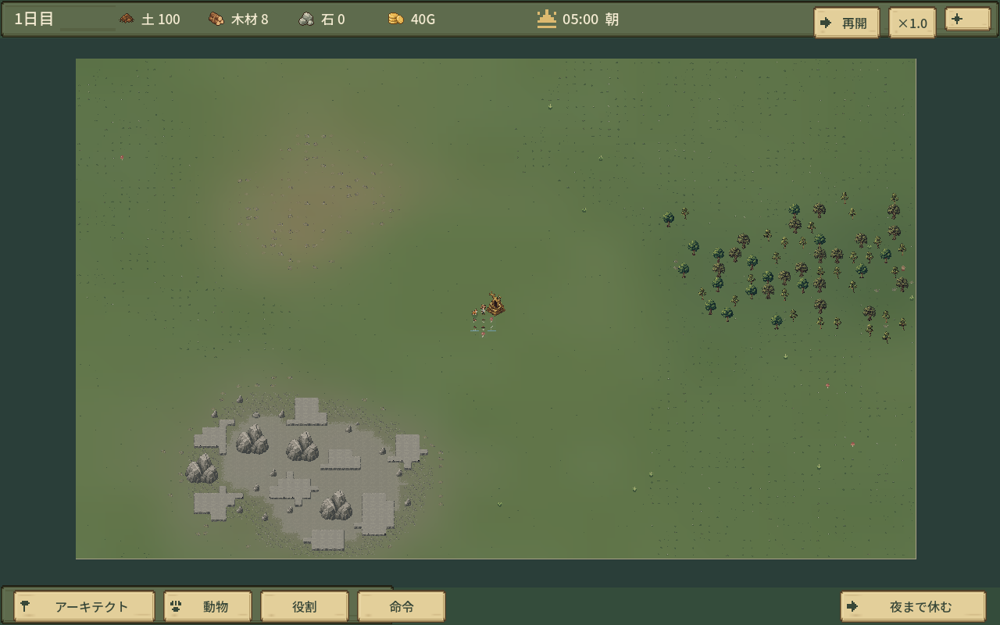
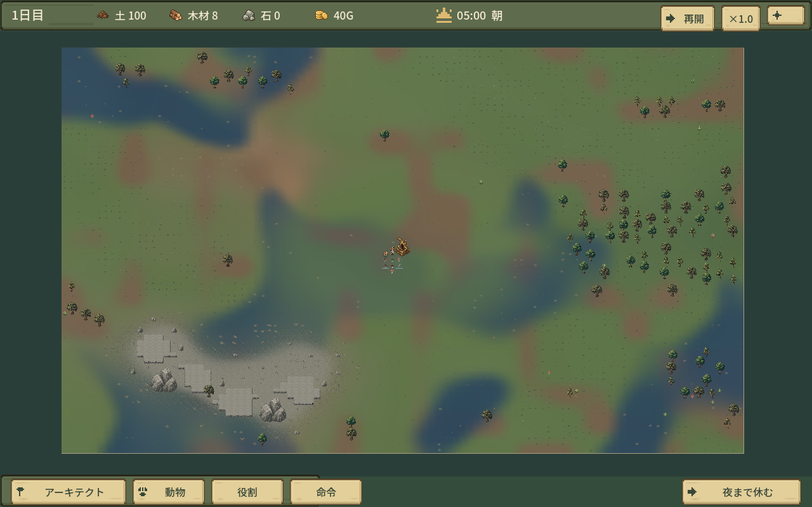

# 実ゲーム画像

実装・最終描画：`942e9a51dfefe4de5bf23feb9976770fec17f64d`。素材 `3229d2655e35e82d178577cdd8acbbe66e9be4f8`。1280×800、非対話GPU、通常新規マップの地形。撮影のため時間停止・カメラ移動。合成見本や素材原画ではない。各撮影条件は[ui-survey.json](ui-survey.json)、隔離・コードハッシュは[監査](ui-survey-isolation.json)。

## 同一seed31の比較

1日目05:00・100×68・全景倍率0.224。前は開始HEAD `49a1bfb`。岩場詳細は各生成版の岩場濃度最大地点、倍率1.0（生成形状が変わるため中心座標は異なる）。

|修正前|修正後|
|---|---|
|||
|[岩場詳細](before/seed_31_rocks.png)|[岩場詳細](seed_31_rocks.png)|

## 最終画像

|画像|確認内容|
|---|---|
|[seed31 全景](seed_31_overview.png)|不規則な地表、中央の余地、大岩2体|
|[seed31 岩場](seed_31_rocks.png)|連続岩盤と砂利、疎らな岩山・砕石|
|[seed73 全景](seed_73_overview.png)／[岩場](seed_73_rocks.png)|別seedの分布、通常倍率|
|[seed109 全景](seed_109_overview.png)／[岩場](seed_109_rocks.png)|反対側へ分布する岩場・森|
|[中央](center.png)|建築余地と控えめな地表変化|
|[土層](surface_soil.png)|仮の土色と周辺への移行|
|[砂層](surface_sand.png)|茶色主体の地表|
|[粘土層](surface_clay.png)|深青色＋既存亀裂、資源追加なし|
|[連続0](scroll_00.png)・[1](scroll_01.png)・[2](scroll_02.png)・[3](scroll_03.png)|通常tick下の斜めスクロール4連続描画。PNG保存時間は性能計測から除外|

空間・操作の人間による評価は、この画像と性能記録から独立して行う。画面外のWindows物理入力を撮影で確認した扱いにはしない。
