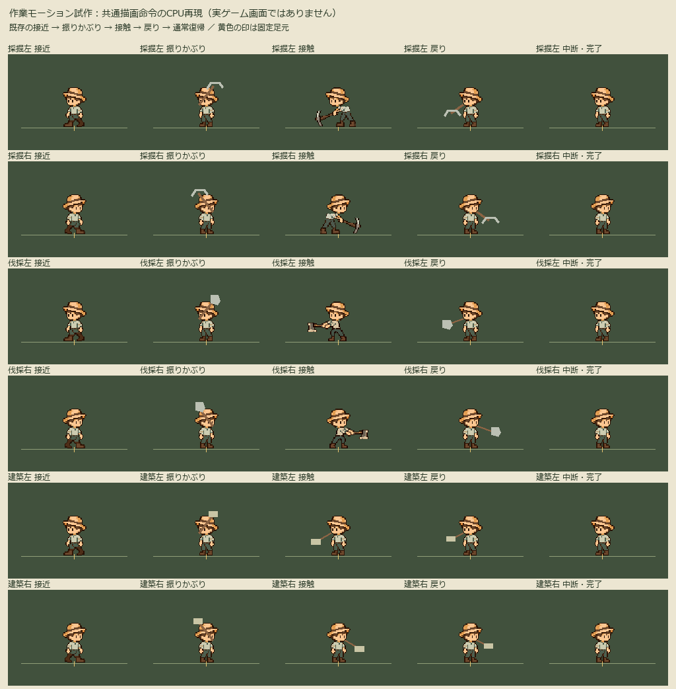
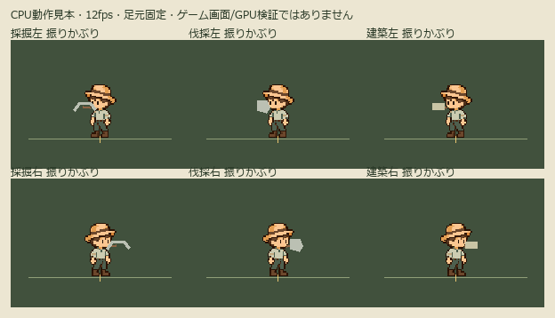

# 作業モーション確認

これは実ゲーム画面の撮影ではなく、ゲームのWorkMotion.paintと同じ描画命令をCPUで再現した比較資料。
原素材は無加工。黄色の印が共通足元。画像の土台は確認用の単色背景。

再作成：headlessでtests/test_work_motion.gdを実行し、そのmotion-draw-commands.jsonをこのフォルダへ保存。
その後、Pillow導入済みPythonで tools/render_work_motion.py --project <ゲームの絶対パス>。
36フレーム/3秒、12fps。通常ゲーム画面の自動起動やGPU描画は不要。
