# 人物・表情・エフェクトの参考シーン12場面

2026-10-23。**自宅8場面**＋図書館・居酒屋・ホテル前・海辺。新しい画像出力10件からCG9場面を選び、既存CG3場面と組み合わせました。

[資料の入口](../README.md) ／ [対応状況32項目](../reports/REQUEST_AUDIT.md) ／ [拒否・未生成](../reports/REFUSALS.md) ／ [GIF一覧](../reports/GIF_INDEX.md)

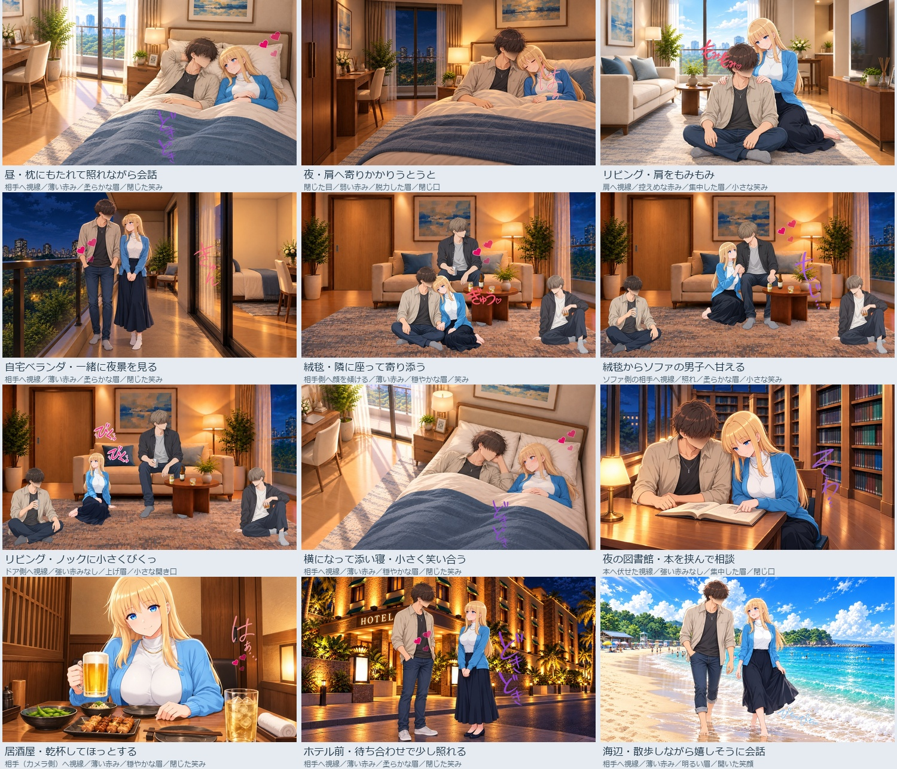

5場面にGIF／WebPを収録。人物・表情は静止し、描き文字とエフェクトが動きます。すべて制作候補で、最終採用やゲーム表示の検収は未完了です。新規室内では靴なしを指定。布団内の足元は画角外です。原背景からベッド幅・画角などが付随変化しており、厳密に背景を固定した差分ではありません。

## 昼・枕にもたれて照れながら会話

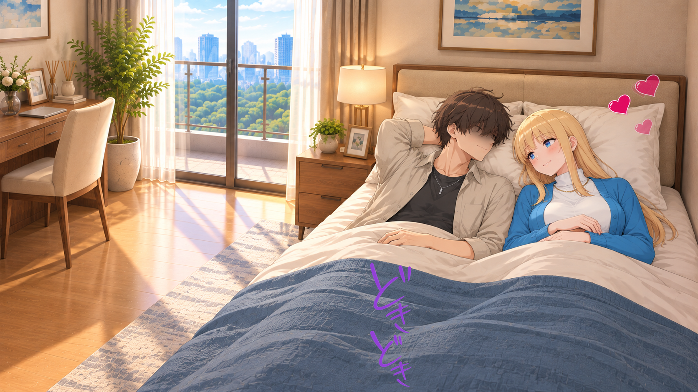

相手へ視線／薄い赤み／柔らかな眉／閉じた笑み。枕にもたれる姿勢。完全な横臥版は12に別途用意。

人物CG：新規生成。人物・表情はベースCGに統合。描き文字とハート等は別素材を数値合成。

[PNG](01_home_bed_day.png) ／ [文字・効果を重ねる前](../reference-scenes/01_home_bed_day-base.png)

## 夜・肩へ寄りかかりうとうと

閉じた目／弱い赤み／脱力した眉／閉じ口。静かな休息。足元は布団内で画角外。靴なしを指定。

人物CG：新規生成。人物・表情はベースCGに統合。描き文字とハート等は別素材を数値合成。

[PNG](02_home_bed_night.png) ／ [文字・効果を重ねる前](../reference-scenes/02_home_bed_night-base.png)

## リビング・肩をもみもみ

肩へ視線／控えめな赤み／集中した眉／小さな笑み。手は衣服の上から左右の肩へ。肩もみ用文字を組み合わせる。

人物CG：新規生成。人物・表情はベースCGに統合。描き文字とハート等は別素材を数値合成。

[PNG](03_home_shoulders.png) ／ [文字・効果を重ねる前](../reference-scenes/03_home_shoulders-base.png) ／ [GIF](03_home_shoulders.gif) ／ [WebP](03_home_shoulders.webp)

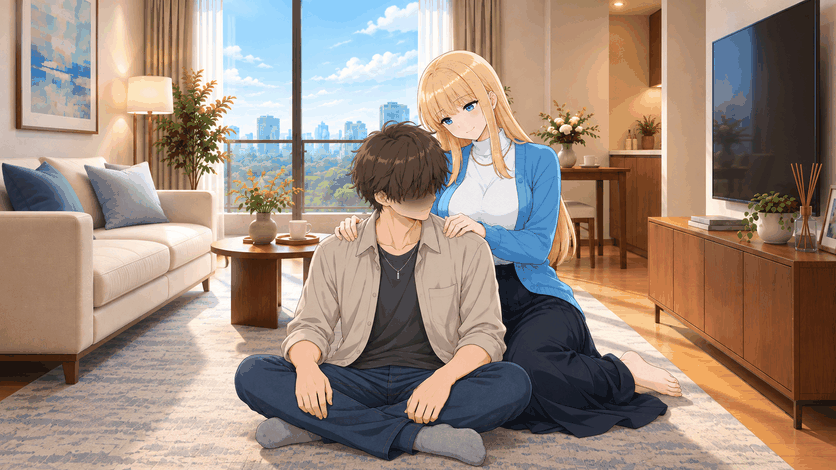

## 自宅ベランダ・一緒に夜景を見る

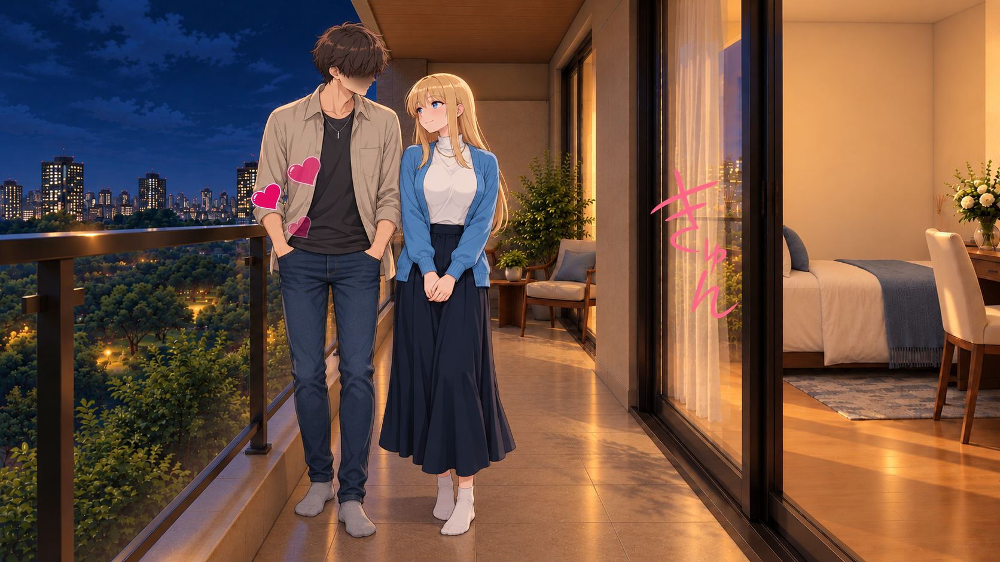

相手へ視線／薄い赤み／柔らかな眉／閉じた笑み。寝室とつながる自宅ベランダ。二人とも靴下。

人物CG：新規生成。人物・表情はベースCGに統合。描き文字とハート等は別素材を数値合成。

[PNG](04_home_balcony.png) ／ [文字・効果を重ねる前](../reference-scenes/04_home_balcony-base.png)

## 絨毯・隣に座って寄り添う

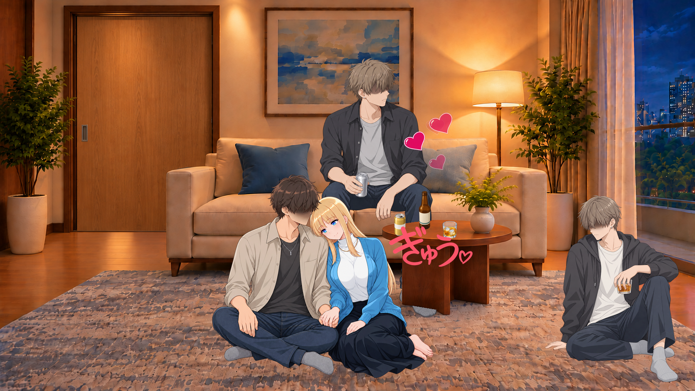

相手側へ顔を傾ける／薄い赤み／穏やかな眉／笑み。既存の床同士のペアと同席男子を再利用。男子3人とヒロイン1人。

人物CG：既存素材を再利用。人物・表情はベースCGに統合。描き文字とハート等は別素材を数値合成。

[PNG](05_home_carpet.png) ／ [文字・効果を重ねる前](../media/fd2993876b3c88916734.png) ／ [GIF](05_home_carpet.gif) ／ [WebP](05_home_carpet.webp)

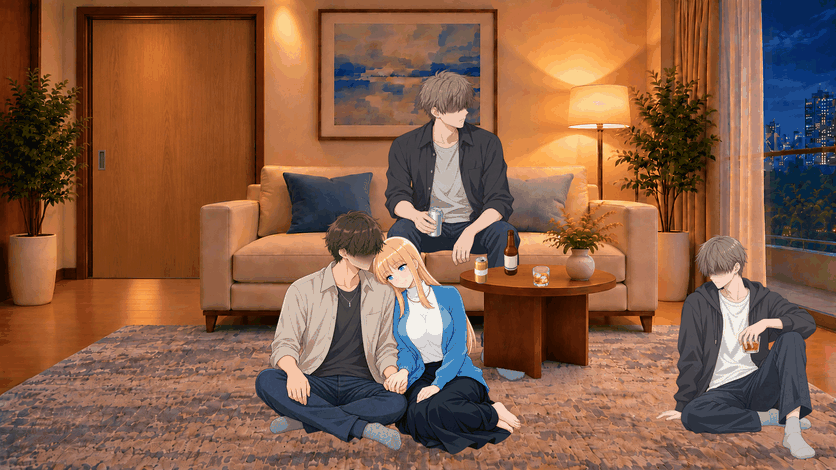

## 絨毯からソファの男子へ甘える

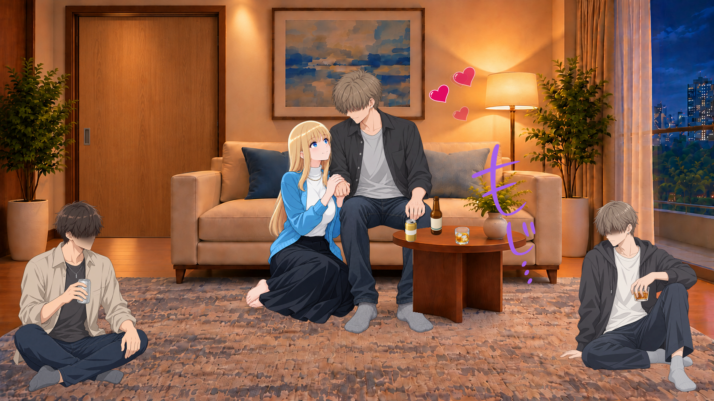

ソファ側の相手へ視線／照れ／柔らかな眉／小さな笑み。支持面が違う接触。静止場面であり、歩いて近づく人物動画ではない。

人物CG：既存素材を再利用。人物・表情はベースCGに統合。描き文字とハート等は別素材を数値合成。

[PNG](06_home_sofa.png) ／ [文字・効果を重ねる前](../media/1d806359de2f29eec85e.png)

## リビング・ノックに小さくびくっ

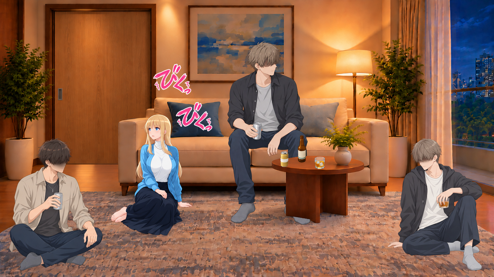

ドア側へ視線／強い赤みなし／上げ眉／小さな開き口。男性3人の同席を維持した顔編集。ピンクの2語の時間差フェード。

人物CG：新規生成。人物・表情はベースCGに統合。描き文字とハート等は別素材を数値合成。

[PNG](07_home_startle.png) ／ [文字・効果を重ねる前](../reference-scenes/07_home_startle-base.png) ／ [GIF](07_home_startle.gif) ／ [WebP](07_home_startle.webp)

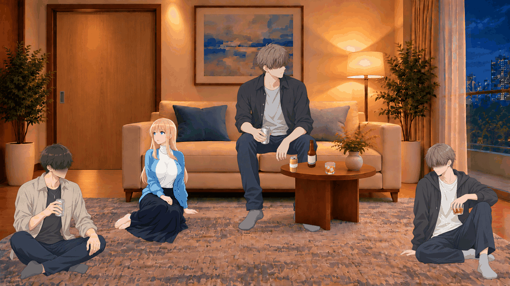

## 横になって添い寝・小さく笑い合う

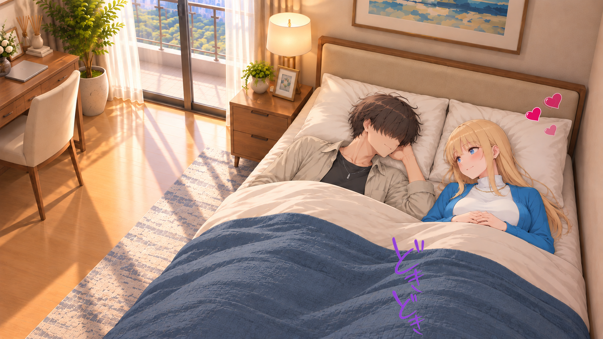

相手へ視線／薄い赤み／穏やかな眉／閉じた笑み。横臥が分かる俯瞰案。男子の目元を髪で隠す修正済み候補。ベッド幅は背景から付随変化。

人物CG：新規生成。人物・表情はベースCGに統合。描き文字とハート等は別素材を数値合成。

[PNG](12_home_flat_sleep.png) ／ [文字・効果を重ねる前](../reference-scenes/12_home_flat_sleep-base.png) ／ [GIF](12_home_flat_sleep.gif) ／ [WebP](12_home_flat_sleep.webp)

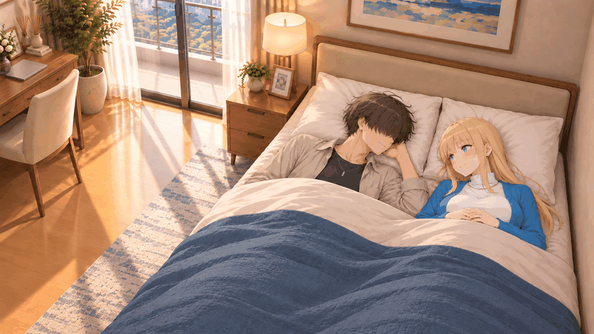

## 夜の図書館・本を挟んで相談

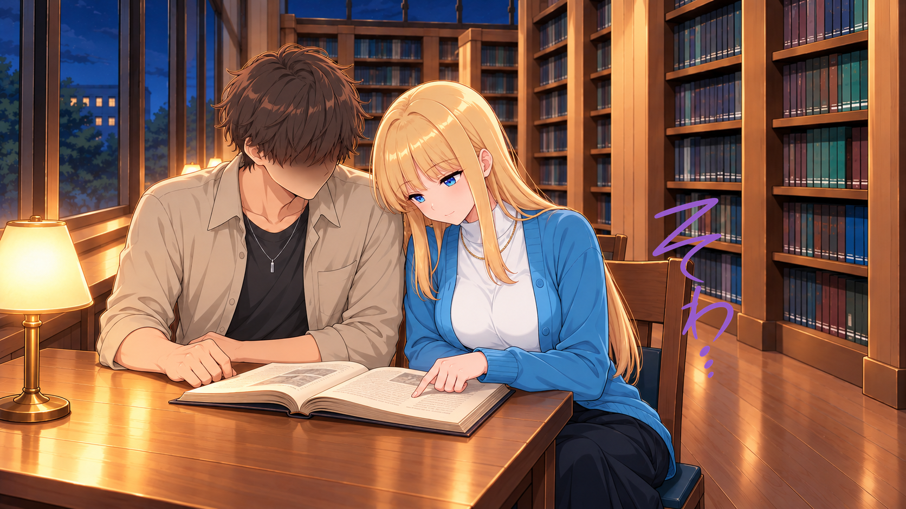

本へ伏せた視線／強い赤みなし／集中した眉／閉じ口。同じ本を近くで見る落ち着かない気持ちを小さい文字で添える。

人物CG：新規生成。人物・表情はベースCGに統合。描き文字とハート等は別素材を数値合成。

[PNG](08_library.png) ／ [文字・効果を重ねる前](../reference-scenes/08_library-base.png)

## 居酒屋・乾杯してほっとする

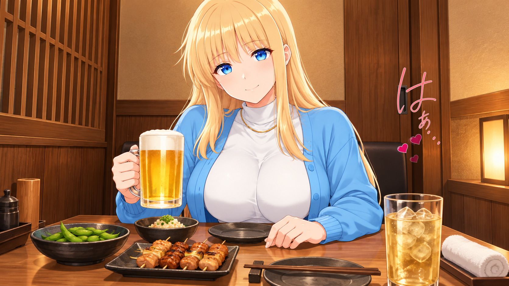

相手（カメラ側）へ視線／薄い赤み／穏やかな眉／閉じた笑み。既存の机上CGを再利用。主人公は画面外で、足元も画角外。

人物CG：既存素材を再利用。人物・表情はベースCGに統合。描き文字とハート等は別素材を数値合成。

[PNG](09_izakaya.png) ／ [文字・効果を重ねる前](../reference-scenes/09_izakaya-base.png)

## ホテル前・待ち合わせで少し照れる

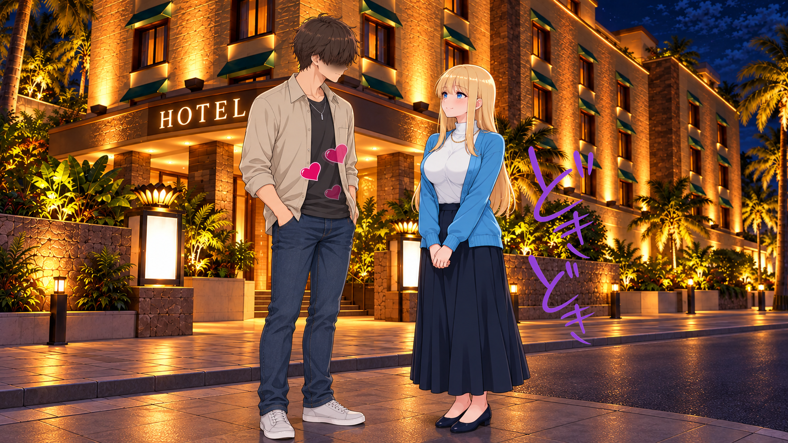

相手へ視線／薄い赤み／柔らかな眉／閉じた笑み。屋外の待ち合わせ。室内ではないため通常の靴。

人物CG：新規生成。人物・表情はベースCGに統合。描き文字とハート等は別素材を数値合成。

[PNG](10_hotel.png) ／ [文字・効果を重ねる前](../reference-scenes/10_hotel-base.png)

## 海辺・散歩しながら嬉しそうに会話

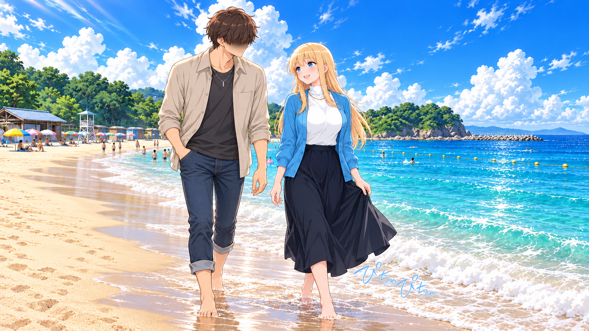

相手へ視線／薄い赤み／明るい眉／開いた笑顔。二人とも砂浜で素足。水際の足音としてぴちゃぴちゃを添える。

人物CG：新規生成。人物・表情はベースCGに統合。描き文字とハート等は別素材を数値合成。

[PNG](11_beach.png) ／ [文字・効果を重ねる前](../reference-scenes/11_beach-base.png) ／ [GIF](11_beach.gif) ／ [WebP](11_beach.webp)

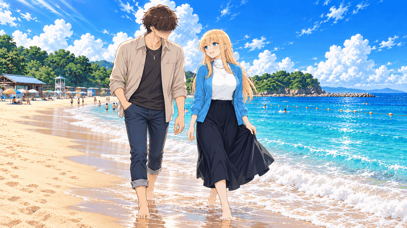
