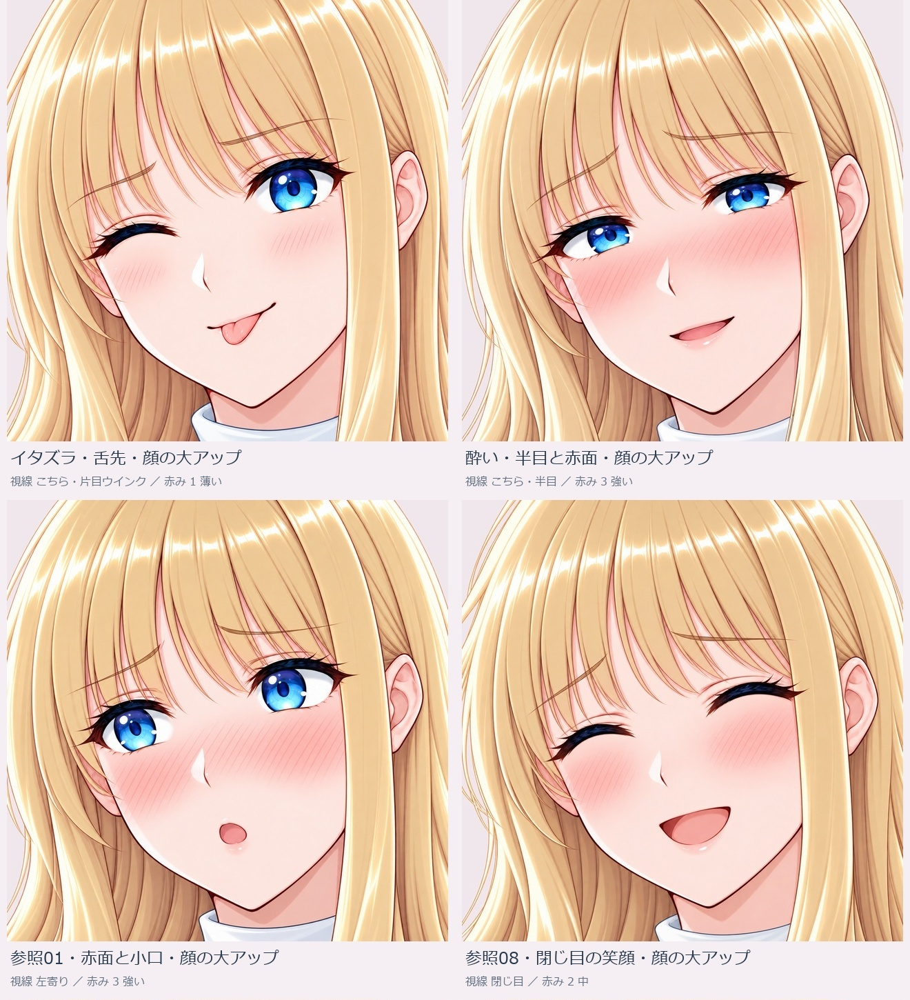

# 舌出し・酔い・参照表情と、顔の大アップ

2026-10-23。[資料の入口](../README.md) ／ [前回のアップ4種類](PORTRAITS.md)

**4表情×通常アップ／顔大アップの8画像と、前回の微笑みの顔大アップ1画像を追加しました。** 顔大アップは1254×1254、通常アップは1037×1516または1517。いずれも独立したRGBA PNGです。

[通常アップと顔大アップの比較を開く](../faceups/framing-comparison.jpg)

## 参照元と取り入れた表情

| 表情 | 参照元 | 取り入れた項目 |
| --- | --- | --- |
| イタズラ・舌先 | 今回の指定 | ウインク、短い舌先、小さな笑み |
| 酔い | 参照用素材/ref-06.png | 半目、内側の上がる眉、頬・鼻の赤み。口は小さな笑みへ調整 |
| 赤面と小口 | 参照用素材/ref-01.png | 強い赤み、眉、開いた目、小さな丸い口 |
| 閉じ目の笑顔 | 参照用素材/ref-08.png | 閉じ目、赤み、開いた笑顔 |

参照は表情だけに使い、人物・髪・体・服装・姿勢・背景は既存ヒロインを基準にしています。原本の参照画像はこの共有版へ追加していません。顔大アップも内蔵画像編集で作った別出力で、単純な画素クロップではありません。表情や形状に微差があり、完全な画素固定は保証していません。

## 個別PNG

| 候補 | 画角 | 大きさ | PNG |
| --- | --- | --- | --- |
| イタズラ・舌先・顔の大アップ | 顔大アップ | 1254×1254 | [開く](../faceups/01_tease_face.png) |
| 酔い・半目と赤面・顔の大アップ | 顔大アップ | 1254×1254 | [開く](../faceups/02_tipsy_face.png) |
| 参照01・赤面と小口・顔の大アップ | 顔大アップ | 1254×1254 | [開く](../faceups/03_shy_round_face.png) |
| 参照08・閉じ目の笑顔・顔の大アップ | 顔大アップ | 1254×1254 | [開く](../faceups/04_closed_smile_face.png) |
| イタズラ・舌先・通常アップ | 通常アップ | 1037×1517 | [開く](../faceups/01_tease.png) |
| 酔い・半目と赤面・通常アップ | 通常アップ | 1037×1516 | [開く](../faceups/02_tipsy.png) |
| 参照01・赤面と小口・通常アップ | 通常アップ | 1037×1517 | [開く](../faceups/03_shy_round.png) |
| 参照08・閉じ目の笑顔・通常アップ | 通常アップ | 1037×1516 | [開く](../faceups/04_closed_smile.png) |
| 微笑み・顔の大アップ | 顔大アップ | 1254×1254 | [開く](../faceups/00_smile_face.png) |

## 比較・採否

表情管理は既存34候補を保ち43画像候補へ追加。新しい感情が9種類という数え方ではなく、新表情4種類と画角違いを含む9画像です。「今回のみ」は追加9画像、「今回のアップ4候補を並べる」は代表4表情の顔大アップを並べます。採否はIDと画像SHA256で対応し、旧候補の採否を自動変更しません。HTMLの操作には共有ブランチ一式を取得してindex.htmlを開いてください。

内蔵生成・編集9試行9出力、今回のツール拒否0。採用未確定の候補。ゲーム実装・実ブラウザー操作は未検証です。
