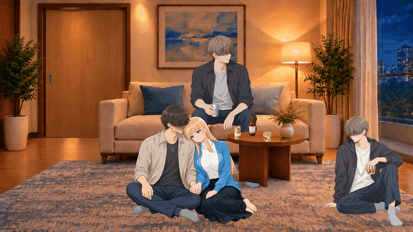
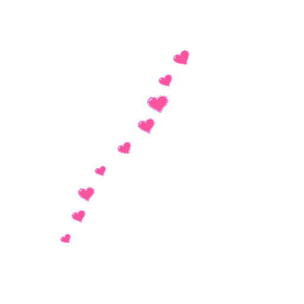
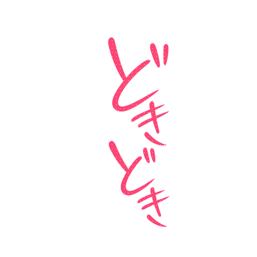
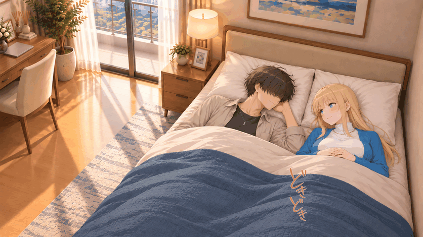

# 以前のGIF索引（13ファイル時点の説明）

現在の全量索引は[GIF一覧](GIF_INDEX.md)を参照。以下は各GIFの用途・旧版の説明として残したものです。

# GitHubへ掲載したGIF一覧

更新：2026-10-23。掲載GIFは13ファイル。[資料の入口](../README.md) ／ [参考シーン](../reference-scenes/README.md) ／ [対応状況](REQUEST_AUDIT.md)

単体の最新版と、合成場面・旧比較を区別しています。GIFは反復再生です。単体GIFの二値透過では半透明をディザで近似し、滑らかな半透明にはAPNG／WebPを使います。合成場面GIFは人物と背景が静止し、文字・効果だけが動きます。

## びくっ びくっ・ピンク／時間差フェード

単体・最新版。 [GIFを開く](../media/408eb2a5dd46ce0f4a79.gif) ／ [WEBP](../media/67cb994062fdb16f0949.webp) ／ [PNG](../media/84b6220bdddf00fee3b8.png)

## ハートを重ねた過去の場面プレビュー

旧比較・履歴。 [GIFを開く](../media/797b8f1b91adc4b65733.gif)

## 初期のハート流出・斜め方向

旧版・最新版とは別。 [GIFを開く](../media/88cebb3d756abdbdac3e.gif) ／ [WEBP](../media/5d43b80696cc62f69b48.webp) ／ [PNG](../media/8aca86443554b7cfe6e9.png)

## 濃いピンクのハート・短い真上移動

単体・最新版。 [GIFを開く](../media/e74e1a210ebddbefe7e7.gif) ／ [WEBP](../media/7d673d5cf0bf25b8da3d.webp) ／ [PNG](../media/f38479399e4831806555.png)

## リビング・肩をもみもみ

今回追加・合成場面。 [GIFを開く](../reference-scenes/03_home_shoulders.gif) ／ [WEBP](../reference-scenes/03_home_shoulders.webp)

## 絨毯・隣に座って寄り添う

今回追加・合成場面。 [GIFを開く](../reference-scenes/05_home_carpet.gif) ／ [WEBP](../reference-scenes/05_home_carpet.webp)

## リビング・ノックに小さくびくっ

今回追加・合成場面。 [GIFを開く](../reference-scenes/07_home_startle.gif) ／ [WEBP](../reference-scenes/07_home_startle.webp)

## 海辺・散歩しながら嬉しそうに会話

今回追加・合成場面。 [GIFを開く](../reference-scenes/11_beach.gif) ／ [WEBP](../reference-scenes/11_beach.webp)

## 横になって添い寝・小さく笑い合う（紫文字の旧版）

旧比較・履歴。 [GIFを開く](../reference-scenes/12_home_flat_sleep.gif) ／ [WEBP](../reference-scenes/12_home_flat_sleep.webp)

<!-- dokidoki15 -->
## どきどき改訂15の追加GIF

[変更内容と独立素材](DOKIDOKI.md)。以下4点が今回の追加です。

### どきどき・ピンク／小さめ／震え／重なる連続表示

[GIF](../media/dokidoki-overlap-v15.gif)

### 昼・枕にもたれて照れながら会話・ピンクのどきどき

[GIF](../reference-scenes/01_home_bed_day-v15.gif)

### 横になって添い寝・小さく笑い合う・ピンクのどきどき

[GIF](../reference-scenes/12_home_flat_sleep-v15.gif)

### ホテル前・待ち合わせで少し照れる・ピンクのどきどき

[GIF](../reference-scenes/10_hotel-v15.gif)

<!-- /dokidoki15 -->
