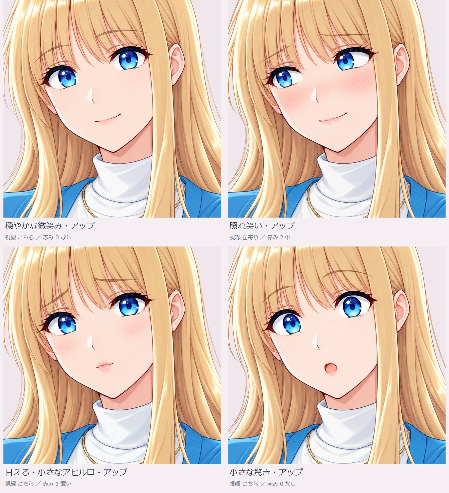
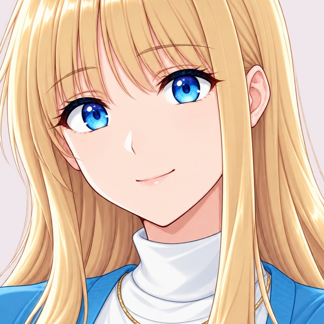
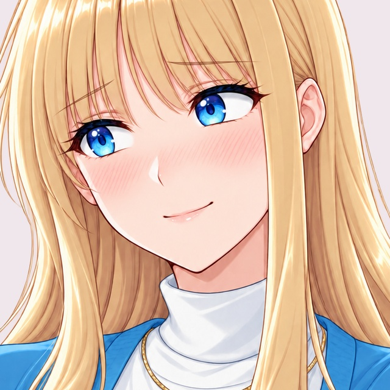
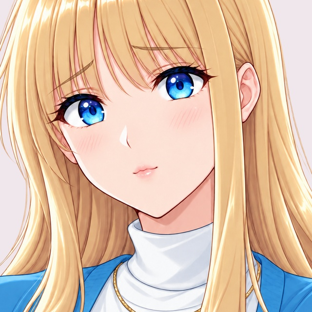
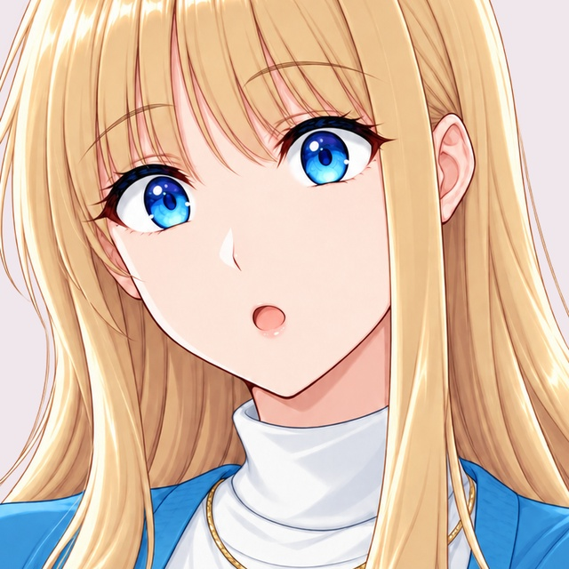

# ヒロインのアップ表情4種類

2026-10-23。[資料の入口](../README.md)。既存のヒロインを参照した、顔〜上半身の背景透過PNGです。ゲームのアニメ画風を維持しました。

比較画像は顔を拡大した表示用クロップです。個別PNGには髪・肩・白いハイネックと青いカーディガンを含みます。各PNGの大きさは1037×1516です。全4点は採用未確定の候補です。

## 穏やかな微笑み・アップ

こちら ／ 0 なし ／ 穏やかな弓眉 ／ 小さな笑み。穏やかな会話用。赤みは自然な肌色の範囲。 ネイティブ生成・編集のため、表情以外の完全な画素一致は保証していない。

[個別PNG](../portraits/01_smile.png)

## 照れ笑い・アップ

左寄り ／ 2 中 ／ 柔らかな困り眉 ／ 照れ笑い。頬のハッチングと眉で照れを表す。視線は左寄り。 ネイティブ生成・編集のため、表情以外の完全な画素一致は保証していない。

[個別PNG](../portraits/02_shy.png)

## 甘える・小さなアヒル口・アップ

こちら ／ 1 薄い ／ 柔らかな困り眉 ／ 小さなアヒル口。閉じた小さなアヒル口。上目づかいの差は弱く、眉・口が主な差分。 ネイティブ生成・編集のため、表情以外の完全な画素一致は保証していない。

[個別PNG](../portraits/03_affection.png)

## 小さな驚き・アップ

こちら ／ 0 なし ／ 上げ眉 ／ 小さな丸い開き口。目・眉を開き、小さな丸い口で軽く驚く。 ネイティブ生成・編集のため、表情以外の完全な画素一致は保証していない。

[個別PNG](../portraits/04_surprise.png)

## 比較・採否

表情の管理一覧は、既存30を保ち34候補へ追加。「今回のアップ4候補を並べる」で4枚を比較できます。採否は画像IDとSHA256に対応し、既存の採否を自動変更しません。HTMLの操作にはブランチ一式を取得しindex.htmlを開いてください。GitHub上ではこのMarkdownとPNGを閲覧できます。

内蔵画像生成・編集4出力、今回拒否0。表情以外の完全な画素一致は保証せず、別角度・全身に貼れる汎用顔パッチとも扱いません。実ブラウザー操作・ゲーム表示は未検証です。
